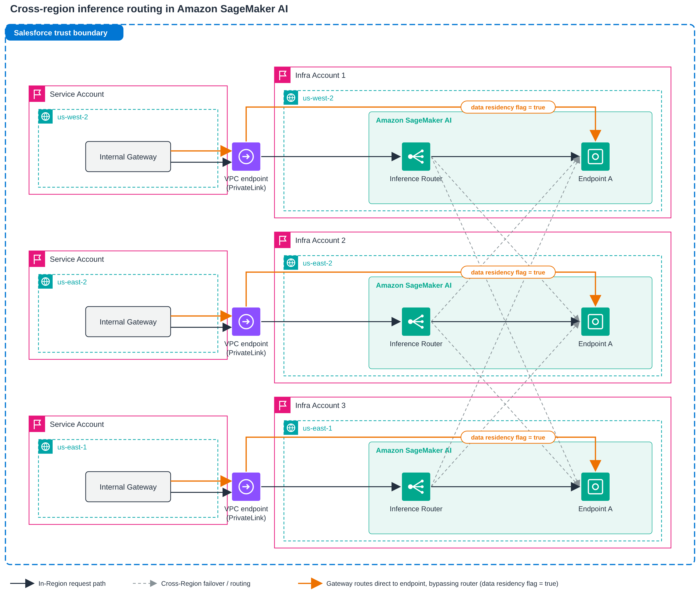

During Salesforce's failover exercise, median inference latency at the local endpoint rose from 0.2 seconds to 45–58 seconds while probe traffic remained in the original region. The Salesforce and AWS account explains the interval. The router started shifting traffic after requests returned errors. For latency-sensitive applications, the period before the switch matters as much as response time afterward.

## Determining eligible destinations at the gateway

Salesforce runs its own models across more than 30 regions. Local capacity can run short while another region has room. The team inserted the SageMaker routing call into the per-request egress path of its Internal Gateway. The gateway first checks data residency. A constrained request has only a local destination. Other requests can use eligible regional endpoints. Salesforce deploys those endpoints in advance and their owners authorize cross-account access through policies. Borrowing spare capacity therefore depends on having an authorized, serving destination available in the first place.

<a class="note-image-link" href="/assets/images/tech/aws-salesforce-cross-region/overview.png" target="_blank" rel="noopener" aria-label="View original image ↗ — Residency checks limit eligible destinations before cross-region requests can draw on spare capacity.">View original image ↗</a>

*Residency checks limit eligible destinations before cross-region requests can draw on spare capacity.*

## Recording where each request ran and why

Callers retain the request body and content type. The routing layer handles capacity, health and gradual recovery. Each response carries the actual destination in InvokedRoutedResourceArn and a RoutingReason. One identifies which endpoint performed the work, the other explains its selection. Together with per-destination invocation counts in CloudWatch, these signals distinguish a change of destination from latency changing within the original region. They also make it possible to inspect whether residency-constrained traffic follows its designated path.

## Five minutes of saturation before traffic moved

The team flooded the local us-west-2 endpoint while a separate probe kept invoking the router. For about five minutes the endpoint grew slow. Errors began when requests crossed the container's 60-second handler timeout. The first probe reached us-east-2 roughly two minutes after those errors. Within another minute about 78% of probe traffic ran there. Roughly 20–25% stayed local, preserving a signal of recovery. After the shift, p50 returned to 0.2 seconds, and crossing regions added less than 100 ms at p50. Traffic gradually moved back over about ten minutes after recovery.

The probe recorded no errors even though requests at the overloaded endpoint had already failed. These were different traffic populations. Eligible spare capacity absorbed load in this test, but an application with a latency objective of a few seconds can degrade well before error-triggered routing begins.

[How Salesforce is advancing global-scale model serving with cross-Region inference routing in Amazon SageMaker AI](https://aws.amazon.com/blogs/machine-learning/how-salesforce-is-advancing-global-scale-model-serving-with-cross-region-inference-routing-in-amazon-sagemaker-ai/) · Apoorva Chandra, Deepti Ragha, Hrushikesh Gangur, Richard Chang, Scott Chang · 2026-11-18
