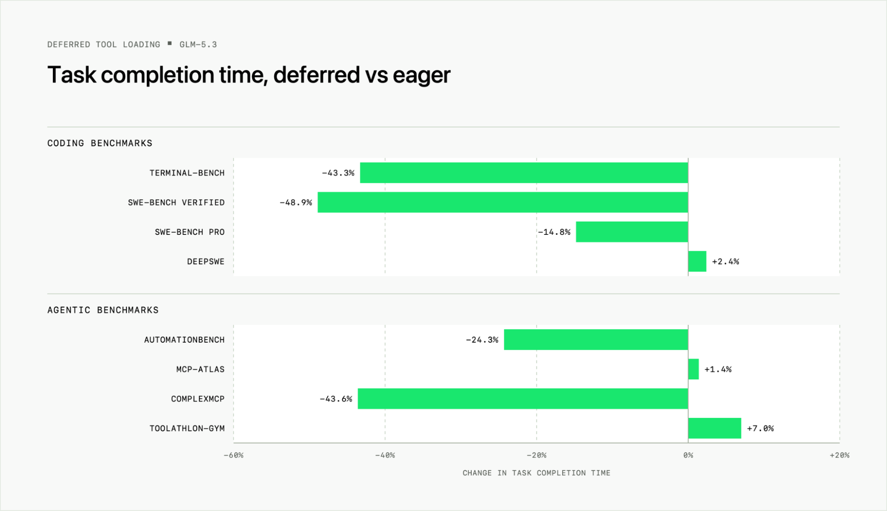

A coding task may edit only local files while its client registers complete Slack, Notion and Baseten tool catalogs. In Baseten’s setup, names, parameters and descriptions occupied about 141,000 tokens. A prefix cache hit still leaves later output attending to those entries. Even a task that barely calls an external tool can pay for its catalog throughout generation.

## The work left after a cache hit

Reusing existing KV avoids recomputing prefill for an identical prefix. Each generated token still attends to the existing context. Avoiding prefill once does not remove those reads from subsequent decode steps. Baseten cut the initial tool portion to about 1,300 tokens by sending names and a search interface. This reduces fixed overhead even when no registered tool is ultimately used.

<a class="note-image-link" href="/assets/images/tech/baseten-deferred-tool-loading/figure.png" target="_blank" rel="noopener" aria-label="Changes in task time vary across agentic benchmarks as discovery introduces extra round trips.">View original ↗</a>

*Changes in task time vary across agentic benchmarks as discovery introduces extra round trips.*

## Why schemas are appended to the conversation

When the model needs a capability, it invokes tool search. The client returns references naming matching tools. The server expands those references into schemas at the current end of the transcript, after which the model can construct an actual call. Existing cached tokens retain their prefix. Rewriting the initial system prompt on discovery would disturb that reuse. The client and gateway therefore need compatible reference semantics. A prompt asking the model to discover tools cannot implement this exchange by itself.

## How the comparison held the model fixed

Fred Liu and Alex Ker sampled 55 tasks across eight benchmarks and ran GLM 5.3 in headless Claude Code with deferred loading enabled or disabled. Four coding benchmarks had the same three MCP services registered. Mean cost fell 62.5% and task time fell 26.2%. Four agentic benchmarks kept their native tool sets. Cost fell 51.1% and time 14.9%. The groups differ in tasks, catalogs and tool-call counts, so the difference between their means does not price any one tool. Timing covers the task and its round trips.

## When discovery consumes the saving

Tool search can introduce an extra exchange. Toolathlon-GYM, at about 68 calls per task, was the exception favoring eager loading in the authors’ tool-call efficiency comparison. DeepSWE and MCP-Atlas tasks were also slightly slower. Large catalogs with sparse use benefit when irrelevant definitions disappear from every decode step. Small catalogs with frequent discovery can make cost and completion time move in different directions. The study reports those exceptions without establishing a universal switching threshold.

Fred Liu, Alex Ker · 2026-11-19 · [Deferred tool loading: Make your agent 62.5% cheaper without changing your model or harness](https://www.baseten.co/blog/deferred-tool-loading-without-changing-model-harness/)
