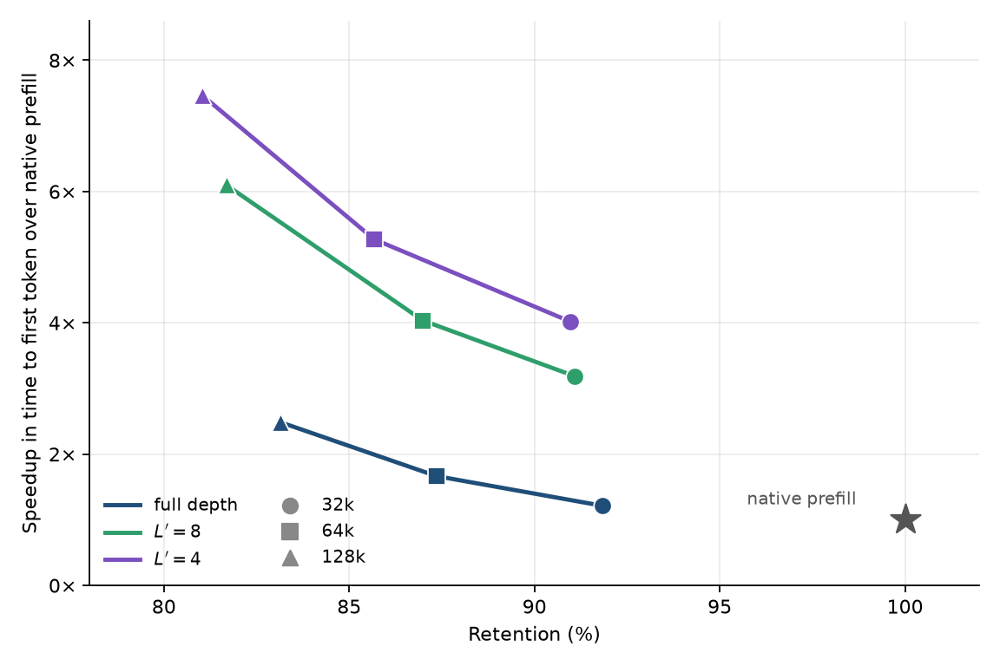

When model A hands a long document to model B as text, B must prefill it again. Base Labs and Ramp Labs study a lossy alternative. A shared network reads the state produced by the sender and builds a cache from which the receiver can continue. The point at which that handoff occurs affects both cost and accuracy.

## One translator for seven models

Head counts, widths, positional encodings and tokenizers differ across models. Pairwise mappings would have 42 ordered directions to cover for seven models. The authors choose hidden states as an intermediate representation, with lightweight alignment projections around a shared translator. A source encoder reads states across layers within a local token window to build a memory. The decoder starts from the target tokenizer's document embeddings, attends to that memory and predicts target hidden states. The target's own frozen weights then form keys and values.

This constrains the prediction to a representation the target already knows how to project. The local windows keep translation cost roughly linear in document length. The source must already have produced the required states, and the serving system must expose them. A remote interface that accepts and returns text alone lacks the data required for this handoff.

## Train against the behavioral cost of a cache error

Matching native state provides dense training signals, but errors of similar magnitude can have very different effects on an answer. A second stage trains on the target's output distribution under native reading, teacher-forcing questions and answers with the translated cache. Sliding-window layers retain their bounded window. Linear-attention layers have no equivalent per-token KV entries, so their layer inputs and final convolutional and recurrent states receive different matching losses.

The 2.35-billion-parameter translator covers seven models. On documents up to the training length of 8,192 tokens, full-depth translation retained an average of 96.9% of native target accuracy across 42 directions, 12 tasks and three seeds. The worst direction retained 93.1%. The denominator is the target's own native score, which may itself be low on a given task. The authors also report normalization against the weaker model in each pair, a different comparison.

## Longer documents increase the speed advantage and the loss of information

The long-document timing uses vLLM on one H200 with the source memory already computed. At 128k tokens the full-depth translator sped up time to first token by a factor of 2.5, while retention fell from about 92% at 32k to 83% at 128k. Predicting eight or four hidden states per token raised speedup to 6.1 or 7.5 respectively, costing another one to two retention points. The 8k retention of 96.9% and 128k speedup of 7.5 therefore describe different operating points. The speed statistic is a median across directions and retention is a mean across directions and seeds.

<a class="note-image-link" href="/assets/images/tech/baseten-speculative-encoding/figure.png" target="_blank" rel="noopener" aria-label="View original ↗">View original ↗</a>

*Each curve follows document length, plotting first-token speedup against the retained share of native accuracy.*

A separate compressor uses an available question to select positions in full-attention layers. The retained states read information from the wider document before producing the shorter cache. At 128k and 64-fold compression, retention rose roughly four points over the full translated cache. This is selective reading for a known question. A new question about another passage may require different information. For a multi-model service, access to source state and knowledge of the next question determine which quality–latency curve applies.

Ben Geist, Thomas Villeneuve · 2026-11-25 · [Speculative Encoding: Many-to-Many Cache Translation](https://labs.baseten.co/articles/speculative-encoding-many-to-many-cache-translation)
