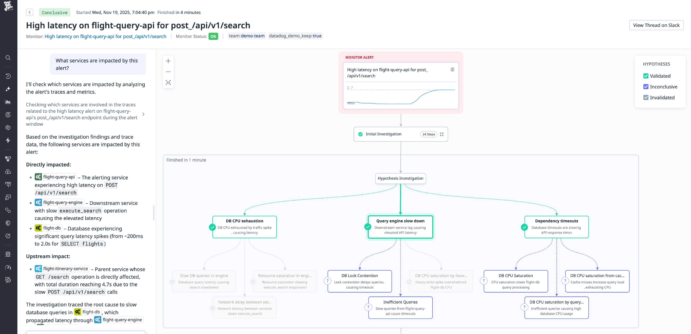

**Datadog · Dan Green, Aurora Dai and Daniel Shan · 2026-11-02**  
Original: [Bits investigations are faster, more accurate, and cost less](https://www.datadoghq.com/blog/bits-investigations-cost-speed-accuracy/)

Automated incident investigation spends resources on orchestration, repeated queries and returning telemetry to model context as well as inference itself. Datadog describes a move from complex staged agents to a simpler ReAct loop, followed by batching queries and correlation inside tool execution. The useful information is the changing investigation path and the exact scope of its product metrics.

## From predetermined stages to an evidence-driven loop

The initial system gathers context, runs targeted telemetry queries, generates and tests root-cause hypotheses, then expands promising branches. This supports evidence-based investigation but requires dedicated retrieval, hypothesis and testing phases with specialized tools.

<a class="note-image-link" href="/assets/images/tech/bits-investigation-efficiency/hypothesis-tree.png" target="_blank" rel="noopener" aria-label="View figure">View figure ↗</a>

*Datadog’s investigation example starts from an API latency alert and tests hypotheses including CPU exhaustion, slow queries, and dependency timeouts.*

The later ReAct design lets each agent reason from evidence, select a tool and decide what to examine next from its result. Newly discovered information can change the next action directly. The company reports that this generation, together with newer models and tools, lowers average investigation cost from roughly $25 to $6.50. Without an ablation, the savings cannot be attributed solely to fewer agents or simpler orchestration.

## Process data in tools before returning evidence

The latest path uses code execution through the Datadog MCP Server to query multiple sources, correlate results and summarize evidence in one tool call. Returning raw telemetry before repeatedly asking the model to issue new queries increases both context and round trips. Tool-side processing returns material closer to what the next decision needs.

Model updates and routing improvements occur alongside this change, so several factors may explain the savings. The post does not expose query plans, execution limits, retry behavior or a complete root-cause decision implementation. It supports a design pattern rather than a reproducible reconstruction: models choose what to test next, while tools perform retrieval and correlation.

## Three metrics and their remaining boundaries

As of October 2026, Datadog reports average investigation cost around $4 and duration around two minutes, down 84% and 82% from approximately $25 and eleven minutes at launch. An internal quality score rises 44% relative to the March 2026 release, assessed against known root causes of historical incidents. This is a relative score increase, not a 44-percentage-point accuracy gain.

The cost and time figures are averages. The post does not provide sufficient sample sizes, incident difficulty mix, tail latency or scoring detail, and does not establish proportional reductions in human repair time, restoration time or MTTR. It also discusses Scout post-training and future autonomous remediation; future remediation is not an accomplished outcome of these investigation updates.

For AIOps, the industrial contribution is a concrete shift from complex orchestration toward a flexible loop and from text-heavy telemetry movement toward tool-side processing. The disclosed evidence supports understanding that mechanism and the reported metrics, not choosing a universally superior model or routing policy for every incident category.
