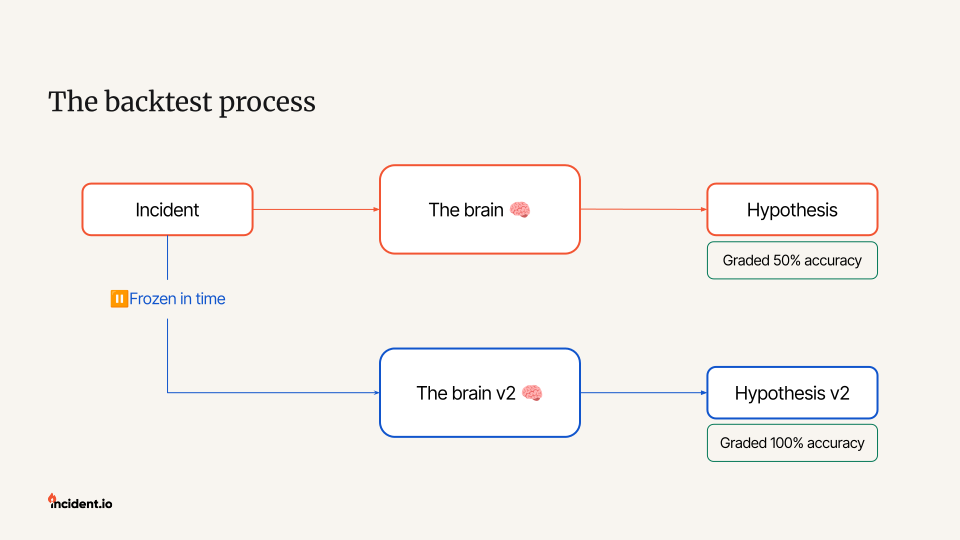
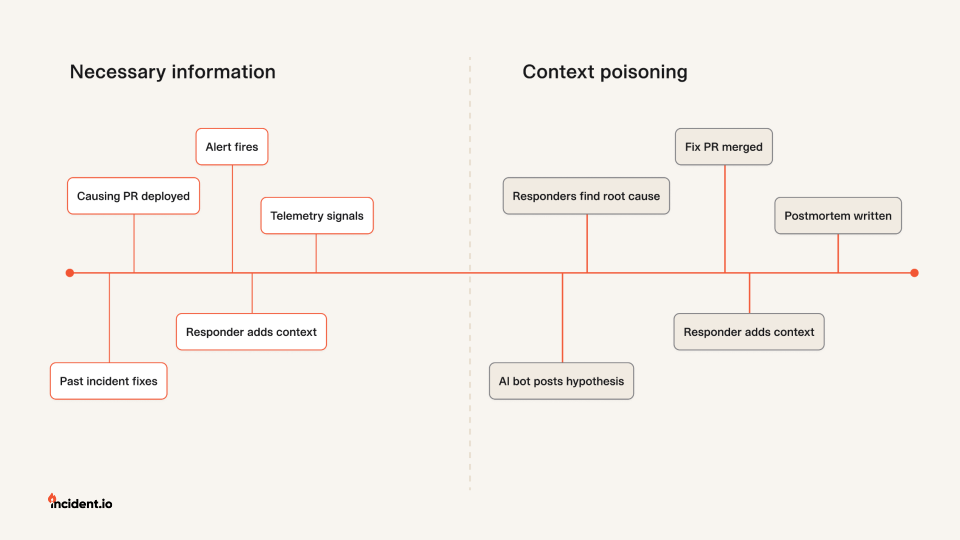
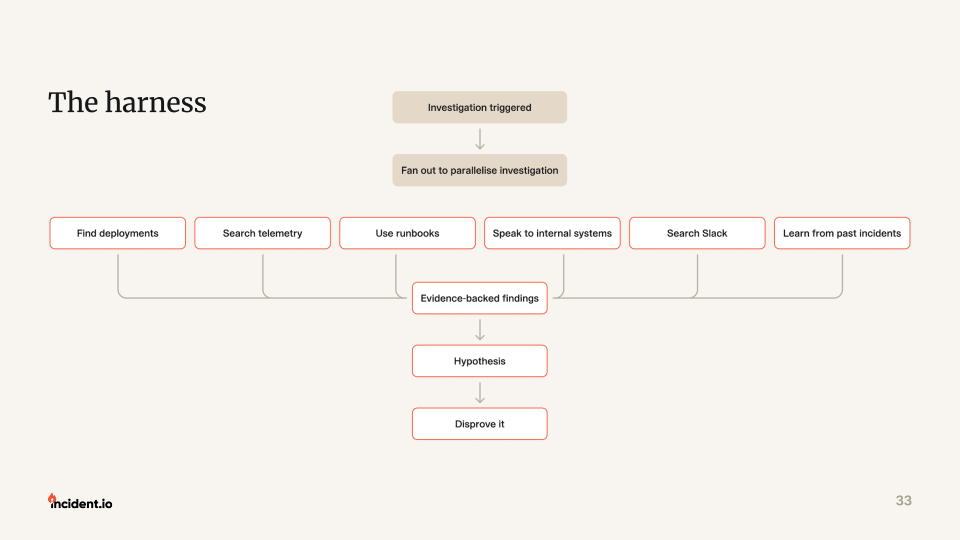
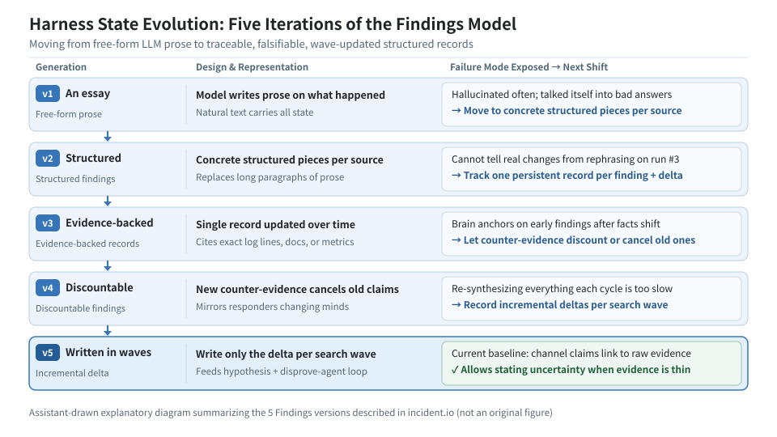
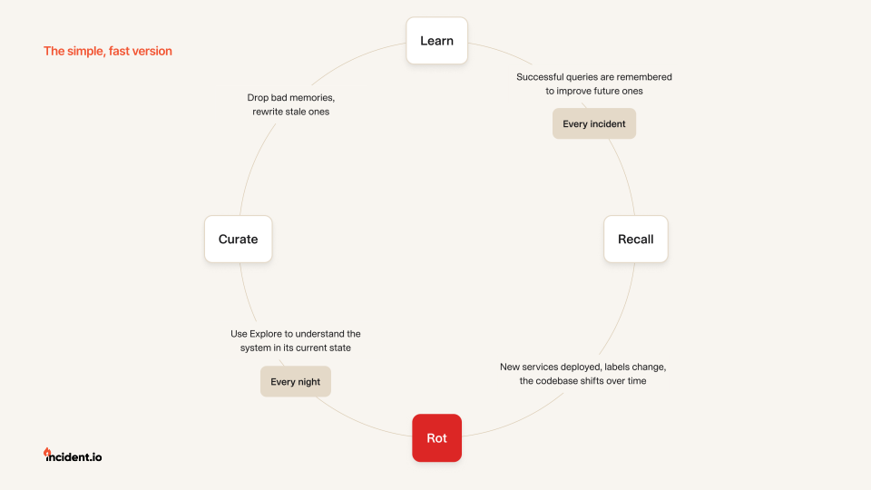

Martha Lambert · incident.io · 2026-10-01 · [Original article](https://incident.io/blog/building-investigations-what-it-takes-to-build-an-ai-sre)

In this engineering retrospective, incident.io Product Engineer Martha Lambert unpacks what it took over roughly two years—from Lisa's early experiment in August 2024 and its first real-incident breakthrough in November 2024 to *Investigations* running in production in 2026—to turn an AI SRE demo into software that on-call engineers can rely on at 2 a.m. Framed squarely around **Build vs. Buy**, the post warns that modern coding agents make a shiny incident-diagnosis prototype trivial to assemble in an afternoon, turning it into a tempting trap that quietly signs teams up for months of unexpected maintenance.

> **Scope note**: This is a first-hand production engineering retrospective from a vendor team rather than an independent controlled study. It specifies incident.io's evaluation rubric, internal state evolution, notification gates, and nightly memory cleanup, but does not disclose blind test sample sizes, aggregate accuracy tables, or production MTTR reductions; percentages inside the original illustrative graphics (such as `50%` vs. `100%`) explain mechanisms rather than report empirical benchmarks.

## Backtesting as a Time Machine: Freezing State Without Leakage

In consumer or low-stakes AI tools, shrugging off an occasional weird model answer may be acceptable. In a major outage, sending responders down the wrong path for 30 minutes directly destroys customer trust and engineering time. incident.io therefore anchors reliability work in reproducible offline evaluation—what they call a "time machine" for past incidents.

Before shipping any prompt edit or swapping the model behind a single step, the team runs the new "brain" across **a whole suite of historical incidents frozen at the moment of failure**, never relying on a single cherry-picked success. Every generated hypothesis is graded against what responders actually found using a four-level rubric:

- **`100%`**: Bullseye—hits the true root cause;
- **`65%`**: One hop short of the real answer;
- **`35%`**: Miss—points off-target;
- **`0%`**: Completely different universe.

<figure>
  <a class="note-image-link" href="/assets/images/tech/building-ai-sre/evaluation.svg" target="_blank" rel="noopener">
    
    Expand diagram ↗
  </a>
  <figcaption>Original figure (incident.io): Replaying historical outages with identical frozen inputs tests prompt or model changes fairly (the 50% and 100% labels are illustrative diagram values, not published benchmark metrics).</figcaption>
</figure>

The hardest technical part is freezing time cleanly. The brain must receive everything a responder had when the alert fired—telemetry, past incident fixes, the causing PR, and early responder notes—while strictly excluding any signal that only emerged after triage progressed. Allowing later artifacts into context creates **context poisoning**, making test scores look artificially strong because the agent is quietly peeking at the answer. Lambert notes two subtle reverse traps as well: older traces falling out of telemetry retention windows (leaving tests starved of required data) and retrospective audits revealing that humans had misdiagnosed or mis-scored the original incident themselves.

<figure>
  <a class="note-image-link" href="/assets/images/tech/building-ai-sre/context-poisoning.svg" target="_blank" rel="noopener">
    
    Expand diagram ↗
  </a>
  <figcaption>Original figure (incident.io): The temporal boundary for backtest snapshots. Everything left of the cut (past fixes, causing PR, alert, pre-discovery responder context, telemetry) is required; everything right (bot hypotheses, responder root-cause discovery, merged fix PRs, Notion post-mortems) must be stripped out.</figcaption>
</figure>

## Tinkering with the Engine: Multi-Agent Harness and Five Iterations of Findings

Evaluation tells you when accuracy lags; fixing it without overfitting requires white-box control. Wrapping a single frontier model around a massive context dump creates a black box where you cannot audit unjustified confidence or trace why latency spikes. incident.io calls its orchestration scaffold the **harness**, grown to encompass "hundreds of prompts and some long-running processes."

When an investigation starts, the harness fans out in parallel across every operational source a human checks—deployments, telemetry, runbooks, internal systems, Slack threads, and past incidents—compresses findings into structured **Findings**, synthesizes a leading **Hypothesis**, and sends it to a dedicated **adversarial agent** tasked explicitly with trying to **disprove it** before looping back around.

<figure>
  <a class="note-image-link" href="/assets/images/tech/building-ai-sre/harness.svg" target="_blank" rel="noopener">
    
    Expand diagram ↗
  </a>
  <figcaption>Original figure (incident.io): Core harness loop—six parallel source retrievers feed evidence-backed findings and a running hypothesis, which an adversarial agent actively attempts to disprove on each pass.</figcaption>
</figure>

To condense hundreds of raw logs, metrics, Slack messages, and docs without drifting, the **Findings** data model went through five distinct architectural iterations, each forced by a specific production failure mode:

| Generation | Representation & Mechanism | Failure Mode Exposed or Production Outcome |
| :--- | :--- | :--- |
| v1 · An essay | Prompt the model to write narrative paragraphs explaining what went wrong | Models love prose and hallucinated heavily, repeatedly talking themselves into unsupported conclusions |
| v2 · Structured findings | Extract concrete, structured pieces of information per data source | Across an evolving incident, responders and tests could not tell genuine state changes from LLM rephrasing on run #3 |
| v3 · Evidence-backed records | Maintain one persistent, updating record per finding citing specific log lines, docs, or metrics | Restored auditability and clear deltas, but exposed anchoring—early findings lingered even after reality shifted |
| v4 · Discountable findings | Allow contradicting new evidence to discount or cancel stale findings like a responder changing their mind | Breaking confirmation bias worked, but re-synthesizing everything on every cycle added prohibitive latency |
| v5 · Written in waves | Write only the incremental delta discovered in each parallel search wave into the live store | Current production baseline: keeps triage fast, ties channel claims to links, and states uncertainty honestly |

<figure>
  <a class="note-image-link" href="/assets/images/tech/building-ai-sre/findings-evolution-en.svg" target="_blank" rel="noopener">
    
    Expand diagram ↗
  </a>
  <figcaption>Assistant diagram summarizing the post (not an original incident.io figure): Step-by-step evolution of the Findings state model toward traceable, falsifiable, wave-updated incident records.</figcaption>
</figure>

## Not Being Annoying: Gating Heads-Up Notifications and Continuous Scoring

Accuracy and tunability still collapse if engineers mute the bot in Slack. Amid widespread AI-generated noise, responders quickly tune out verbose or poorly timed messages; Lambert stresses that **even being useful 80% of the time fails if the noisy 20% permanently erodes trust**. Because responders in active outages do not scroll back up to re-read an editing top summary, Investigations posts proactive **heads-up messages** in the incident channel whenever it finds meaningful news—guarded by three strict gates:

1. **Mechanical checks**: Is the incident still open? Is another worker about to post the exact same thing? Has evidence crossed a conviction bar?
2. **Vibe checks**: Even when mechanics pass, are responders already discussing this point, is the issue already mitigated, or would the message be mere decoration rather than signal?
3. **Tone & evidence tuning**: Match wording confidence directly to supporting evidence, keep messages terse for busy channels, explicitly highlight what changed since the last update, and attach clickable links and rendered charts.

Lambert illustrates the upside with a free-plan abuse incident where someone exploited incident.io to send expensive SMS traffic to Burundi: right after disabling the offending account and winding down, Investigations posted a heads-up within minutes warning that **a newly registered organization had begun running the exact same SMS attack**.

Just like hypotheses, every emitted heads-up notification is continuously graded by an LLM judge along **novelty** (is it telling responders something new?) and **accuracy** (is it right?), tracking across prompt and model upgrades to detect regression into noisy behavior (an illustrative chart in the post tracks `Novelty`, `Accuracy`, and `Signal` trends without publishing evaluation dataset size or threshold details).

## Scaling Against Organizational Drift: Telemetry Graphs, Rollout Friction, and Explore

Once accurate and concise in one team, scaling across thousands of repositories and divergent observability stacks collides with fast-moving organizational drift—especially as AI coding agents accelerate how rapidly teams rename services and alter log schemas.

For **observability**, raw JSON arrays from Prometheus are notoriously opaque to LLMs as well as humans. Every query run by Investigations is summarized around the question asked, why it was run, min/max summary stats, **and rendered into an actual graph image** so multimodal models can visually spot traffic or error spikes.

Deploying across a larger company then surfaced four distinct stakeholder objections in predictable sequence:

- **Finance**: Alarmed by unbounded token consumption without strict controls over query count and payload size.
- **Observability**: Hit by automated query storms overloading Grafana and degrading dashboards for live responders.
- **Engineers**: Unwilling to trust agent summaries without clickable query links and charts attached.
- **Security**: Auditing where and how raw production logs read by agents are retained or stored.

Finally, long-term reliability requires defending against **Memory Rot**. At onboarding, Investigations inspects labels, fields, and existing team dashboards to auto-write initial data-source guidance documents on top of **Nexus**—incident.io's living model linking incidents, systems, and teams. Queries that work during real incidents are saved as memories for recall later. Yet when services are renamed or telemetry formats shift, yesterday's valid query starts silently lying. Every night, a background process named **Explore** re-runs saved queries against recent incidents, rewrites drifted guidance and memories, and **intentionally forgets** broken ones so knowledge stays synchronized without manual babysitting.

Customer-authored custom skills undergo the same closed-loop verification: historical incident simulation before rollout, followed by a live dashboard grading whether each skill helps or hurts real triage.

<figure>
  <a class="note-image-link" href="/assets/images/tech/building-ai-sre/explore-memory.svg" target="_blank" rel="noopener">
    
    Expand diagram ↗
  </a>
  <figcaption>Original figure (incident.io): Nightly Explore curation against memory rot. Successful queries enter memory (Learn → Recall), degrade under service renames and codebase churn (Rot), and get pruned or rewritten every night (Curate).</figcaption>
</figure>

---

> **Assistant Note & Provenance**: This bilingual note was authored and translated by the assistant faithfully from Martha Lambert's original post (paired Chinese edition: [`building-ai-sre` (ZH)](/tech/zh/building-ai-sre/)). Four diagrams preserve incident.io's original SVGs verbatim, while `findings-evolution-en.svg` is an assistant-drawn `v3-blue` diagram illustrating the five Findings versions described in the text. As the post concludes, calling a frontier model is table stakes—what separates a production AI SRE from a weekend prototype trap is frozen-time backtesting without leakage, wave-updated falsifiable state checked by an adversarial critic, signal-gated Slack updates, and nightly self-pruning memory.
