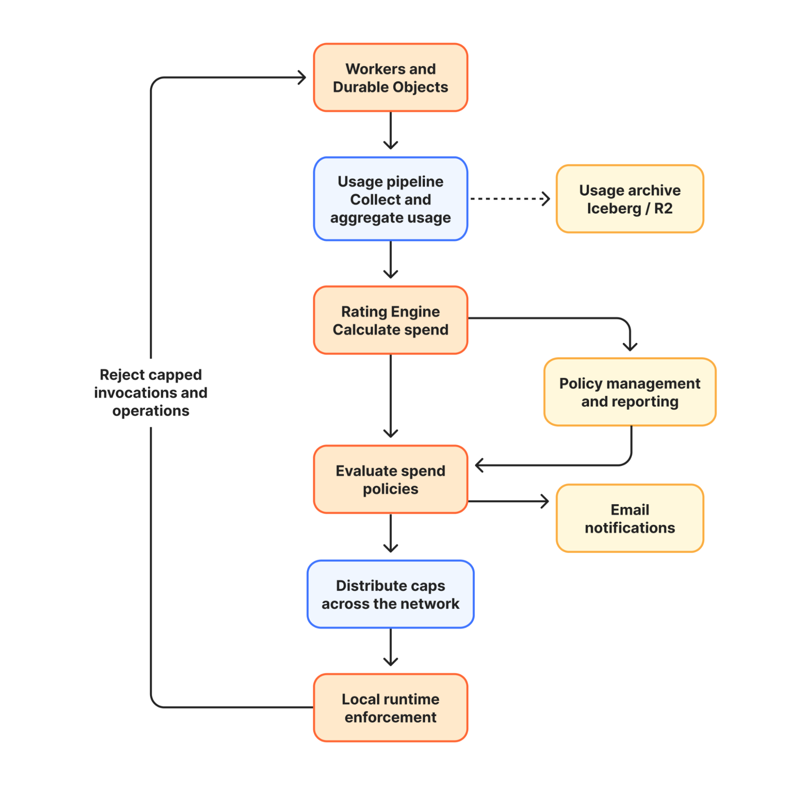

A Worker can measure an invocation locally without knowing the account’s spend for the current billing cycle. CPU time, request counts and storage operations use different units, and a subscription may include an allowance. Cloudflare’s Spend Management beta starts with Workers and Durable Objects for pay-as-you-go accounts. It can notify users at thresholds or pause a product at its cap. The engineering problem is turning scattered observations into a decision that every edge node can enforce.

## What each aggregation stage removes

Passing every raw event to the rating service would make downstream workers repeatedly combine small records for the same account and dimensions. At the first stage a parser converts raw events into usage measurements and combines matching records, typically in one-minute windows. Independent parsers can still produce several partial totals for the same account and interval.

A second stage merges those partial totals with the same grouping rules over windows typically five minutes long. It archives the consolidated records for later analytics and reconciliation. The Usage Engine maps product-specific meters into records of account, window, metric, quantity and relevant dimensions. Rating then receives quantities it can accumulate while retaining the distinctions needed to price them. A new request must wait for this pipeline to advance before it can affect the displayed spend.

<a class="note-image-link" href="/assets/images/tech/cloudflare-spend-management-metering-pipeline/cloudflare-spend-management-metering-pipeline.png" target="_blank" rel="noopener" aria-label="Follow one invocation through metering, rating and policy propagation to local enforcement at the edge. View original image ↗">View original image ↗</a>

*Follow one invocation through metering, rating and policy propagation to local enforcement at the edge.*

## Usage can arrive before the subscription that prices it

Partitioning by account brings accumulated usage and the subscription together, so deciding whether an allowance remains can be local. Each partition keeps fast local state and a durable write-ahead changelog from which a replacement processor can rebuild. This recovery log serves a different purpose from the archived aggregates used for reconciliation.

Usage and subscription updates arrive on independent streams. A delayed or failed webhook can leave usage without enough information to price it. The Rating Engine keeps that usage pending and revisits it later. One million CPU milliseconds can have a different charge depending on the allowance already consumed. The engine applies catalog rates, allowances and rounding to accumulated usage. An account’s cycle can also begin on its subscription date, so a calendar-month comparison may cover the wrong interval.

## Enforcement continues after the threshold is crossed

Once rated spend triggers a policy, the policy service sends the cap state to runtime configuration. Quicksilver replicates it asynchronously, and each node begins rejecting capped operations after its periodic refresh. Normal invocations need no round trip to a central rating engine. The tradeoff is a window spanning aggregation, rating, replication and refresh. A burst can continue while the decision propagates.

Cloudflare describes near-real-time updates in under ten minutes. Getting below a minute is a future target. Current controls apply to supported products, while finer attribution by application or agent task is also planned. Investigating a spend-related pause therefore requires distinguishing when the charge accrued, when the total crossed the threshold and when a particular node began enforcing it.

Celso Martinho, Sid Chatterjee, Brendan Irvine-Broque, Zunayed Ali, André Cruz · 2026-11-13 · [Introducing Spend Management: Spending limits and alerts for Cloudflare](https://blog.cloudflare.com/spend-management/)
