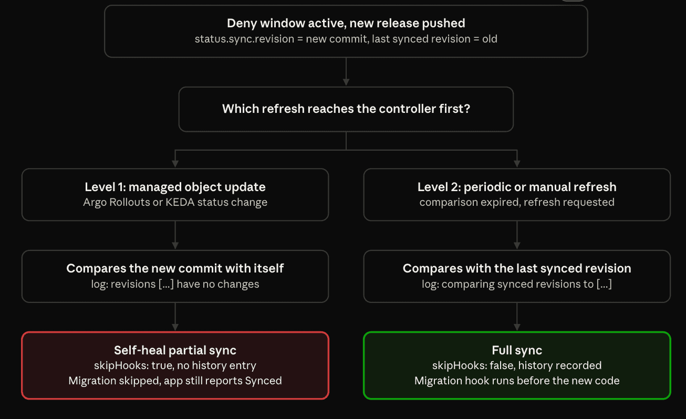

Five regional Applications received one commit. Three ran the database migration. In two regions, new code spent 36–44 minutes using the old schema. Afzal Ansari’s CNCF account identifies a clue inside the successful operation: both affected regions listed 13 specific resources and a self-heal attempt. Synced and Healthy described the resources applied. Neither status established that the migration Job had run.

Afzal Ansari · 2026-11-20 · [When a sync window closes: How Argo CD self-heal skipped the migration hook](https://www.cncf.io/blog/2026/11/20/when-a-sync-window-closes-how-argo-cd-self-heal-skipped-the-migration-hook/)

## Two revisions in controller state

Automated sync, pruning and self-heal were enabled. During the deny window the controller continued comparing Git and recording the new commit in status.sync.revision. The last actual deployment remained on the old commit. Expiry of the window did not emit a dedicated release event. The first subsequent refresh determined the operation.

<a class="note-image-link" href="/assets/images/tech/cncf-argo-cd-self-heal-sync-window-2026-11-20/figure.png" target="_blank" rel="noopener" aria-label="The first refresh after the window expires can lead to full sync or self-heal, with different hook behavior.">View original ↗</a>

*The first refresh after the window expires can lead to full sync or self-heal, with different hook behavior.*

A periodic refresh compared the target with the last deployment, detected the outstanding revision and performed a full sync with hooks. A managed-resource event could reuse the previously compared revision. That path found no revision change and treated the differences as drift. Its selective sync applied the listed resources, skipped hooks and wrote no full release history. Code and configuration could reach the new revision while the database stayed behind.

## Why regions disagreed

Each Application had its own refresh timing. When the periodic refresh won, the same configuration migrated correctly. In five of six lab attempts the failure occurred: the Application displayed the new revision and the migration Job still carried the old release label. Merely finding the migration in Git, or confirming the latest operation succeeded, would miss this distinction. The diagnostic comparison joins commit, operation type and the migration that actually completed.

## Making migration completion part of desired state

Ansari replaced the hook with a managed Job, gave it a unique name per release and placed it in an earlier sync wave. A new Job is a missing resource visible even to selective sync. In the lab, the original self-heal path completed the migration one second before applying the new ConfigMap and Deployment. Per-release names also accommodate immutable Job templates. Pruning old Jobs avoids the cycle in which a TTL deletes a desired Job and self-heal recreates it. The experiment checked successful migration ordering; a deliberately failing migration was outside the test.

A second comparison disabled self-heal. The mistaken revision decision then left the whole application on the old release until a periodic refresh performed a full sync about two minutes later. The trade-off is that manual drift can persist until the next commit. One intervention encodes a release dependency in desired state. The other changes which actions the controller can take after its mistaken comparison.
