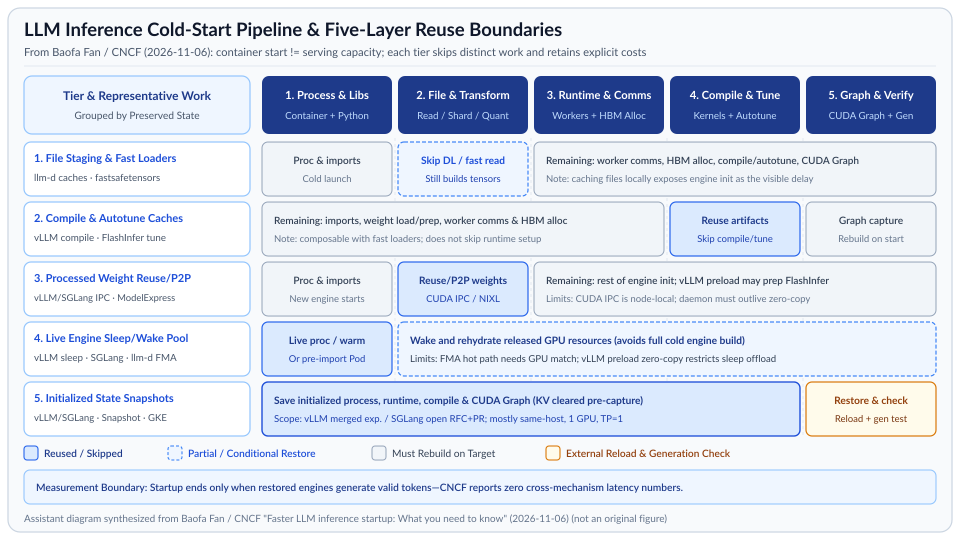
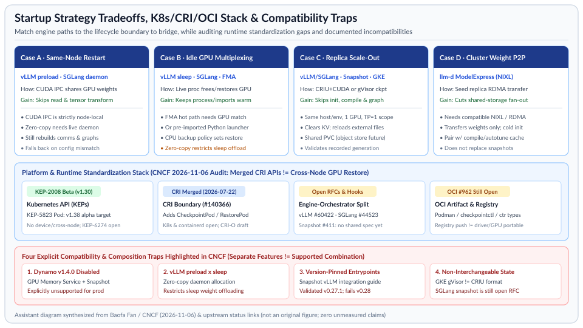

Baofa Fan (DaoCloud) · CNCF Member Post · 2026-11-06 · [Original article: "Faster LLM inference startup: What you need to know"](https://www.cncf.io/blog/2026/11/06/faster-llm-inference-startup-what-you-need-to-know/)

During elastic scale-out, replica crash recovery, or model swaps, a container reaching `Running` does not yet add serving capacity. Between process launch and generating the first valid token, an LLM inference server must pass weight loading and tensor transforms, distributed worker communication and HBM allocation, kernel compilation, autotuning, and CUDA Graph capture. Writing on the CNCF blog on November 6, 2026, DaoCloud engineer Baofa Fan synthesizes how inference frameworks, serving platforms, and Kubernetes/OCI infrastructure tackle cold-start delays—organizing every approach by **which layer of state is actually preserved** and drawing sharp lines around memory ownership, version sensitivity, and standardization status.

> **Evidence & scope boundary**: This CNCF synthesis is a **mechanism taxonomy and ecosystem implementation-status inventory—reporting zero controlled cross-mechanism latency benchmarks**, and every PR, RFC, KEP, and version restriction reflects the primary source's November 6, 2026 snapshot. Readers seeking controlled hardware measurements of GPU checkpoint/restore overhead can pair this overview with our companion deep dive on [NVIDIA Snapshot's B200/NFS evaluation](/tech/en/nvidia-snapshot/): the NVIDIA post benchmarks one specific checkpoint stack end-to-end, whereas this CNCF post supplies the cross-layer architecture map and upstream K8s/CRI/OCI reality check.

## State-Preservation Taxonomy: Which Startup Work Each Mechanism Reuses

Fan begins by separating cold-start work into two buckets. First is **core runtime construction**: launching processes, importing libraries such as Python modules, reading model files, building tensors, applying quantization or sharding transformations, initializing execution runtimes and worker-to-worker communication, and allocating memory. Second is **steady-state optimization work shifted into startup**: kernel compilation, autotuning for the target hardware/config, and CUDA Graph capture so later inference runs with minimal kernel-launch overhead. As the [vLLM optimization documentation](https://github.com/vllm-project/vllm/blob/main/docs/configuration/optimization.md) explains, chasing higher steady-state throughput directly increases upfront startup cost.

<figure class="note-figure">
  <a class="note-image-link" href="/assets/images/tech/cncf-faster-llm-inference-startup/coldstart-state-boundary-taxonomy-en.svg" target="_blank" rel="noopener">
    
    Expand diagram ↗
  </a>
  <figcaption>Assistant diagram (not an original figure): Aligning CNCF's cold-start pipeline phases against the five state-reuse tiers and their remaining work.</figcaption>
</figure>

A central systems insight in the overview is the **shifting-bottleneck effect**: startup time splits dynamically across model, software stack, hardware, and storage. Once model files are cached locally, engine initialization stands out; once processed weights can be reused directly in GPU memory, Python imports, tuning, and CUDA Graph capture account for a larger share of remaining latency. Consequently, meaningful startup measurement ends **only when the restored engine can generate valid output**, never when a Pod starts or files appear on disk.

| Preserved State Tier | Optimization Approach | Representative Projects & Features Cited | Work & Dependencies That Can Remain |
| :--- | :--- | :--- | :--- |
| **Model files** | Pre-staging and efficient loaders | llm-d model caches, `fastsafetensors`, SGLang pre-sharded and streaming loaders | Tensor construction, weight transforms, runtime setup, compilation, and graph capture |
| **Compiled & tuning artifacts** | Persistent artifact caches | vLLM compilation and autotune caches (`vllm preload` also prepares FlashInfer autotune) | Process launch, weight loading, runtime/comms initialization, and CUDA Graph capture |
| **Processed weights** | Persistent weight daemons & P2P transfer | vLLM `preload`, SGLang weight cache daemon, ModelExpress (NIXL/RDMA) | Building the rest of the engine (imports, comms, HBM layout, graphs) on the consumer |
| **A live engine** | Sleep/wake & warm instance pools | vLLM `sleep` mode, SGLang memory release/resume, llm-d Fast Model Actuation (FMA) | Restoring released GPU allocations and matching retained instances to assigned GPUs |
| **Initialized execution state** | Engine or container snapshots | vLLM snapshots, SGLang snapshot RFC/PR, Snapshot (`ai-dynamo`), llm-d/GKE Pod Snapshots | Restoration, validation (e.g., generation check), plus external weight/KV reload |

These five tiers **can be combined, yet they are never drop-in substitutes**, and composition rules depend tightly on implementation semantics. An engine can pair persistent compile caches with specialized loaders documented in [SGLang model loading](https://docs.sglang.io/docs/advanced_features/model_loading) or [llm-d startup overview](https://github.com/llm-d/llm-d/blob/main/docs/operations/startup/model-loading-and-startup.md); similarly, snapshot workflows routinely discard an empty key/value (KV) cache prior to capture and recreate it after restoration.

## Engine and Platform Paths: Weight Ownership, Sleep/Wake, and Snapshot Boundaries

Inspecting each tier at the framework and platform boundary exposes four concrete architectural fault lines highlighted in the CNCF post:

1. **Persistent Weight Daemons (`vLLM` & `SGLang`) vs. Node-Local CUDA IPC**: vLLM's Fast Start ([PR #54921](https://github.com/vllm-project/vllm/pull/54921), roadmap [#56049](https://github.com/vllm-project/vllm/issues/56049)) decouples cached GPU weights from engine restarts using a persistent daemon that loads, transforms, and holds tensors in GPU memory, sharing them with compatible engines via **CUDA inter-process communication (IPC)**. Current [`vllm preload` documentation](https://github.com/vllm-project/vllm/blob/main/docs/features/preload.md) also prepares FlashInfer autotune results ahead of engine startup. In **zero-copy mode**, engines map the daemon's existing allocations—falling back to normal loading if config checks fail—which imposes two hard constraints: **the daemon must outlive every consuming engine**, and because **CUDA IPC handles are strictly node-local**, multi-node deployments must provision relevant shards locally on every node. SGLang has similarly merged an initial weight-cache daemon ([PR #27139](https://github.com/sgl-project/sglang/pull/27139)), while broader model/quantization coverage, memory transport, and daemon lifecycle remain on its [Fast Engine Recovery roadmap (#33522)](https://github.com/sgl-project/sglang/issues/33522).
2. **Sleep/Wake Lifecycle vs. Zero-Copy Ownership Conflicts**: Unlike launching a new engine against a weight daemon, [vLLM sleep mode](https://github.com/vllm-project/vllm/blob/main/docs/features/sleep_mode.md) and SGLang's memory release/resume and generation pause/continue controls **keep the server process alive** while releasing most GPU memory. In SGLang, whether weights stay recoverable quickly after release depends on the configured memory policy, including CPU backup. Crucially, vLLM's `preload` documentation explicitly identifies **restrictions on combining zero-copy weight reuse with sleep-mode weight offloading**—a direct collision between external daemon ownership and an engine releasing GPU allocations.
3. **Initialized-Engine Snapshots & External Orchestrator Boundaries**: vLLM has merged experimental initialized-engine snapshots (`vllm snapshot`, [docs](https://github.com/vllm-project/vllm/blob/main/docs/features/initialized_snapshots.md), design [PR #51360](https://github.com/vllm-project/vllm/pull/51360)) combining **CRIU** for Linux process state with **CUDA checkpoint** for GPU state. Its documented envelope is intentionally narrow: **same machine, compatible software environment, one NVIDIA GPU, and `TP = 1`**. Before capture, it releases both weights and KV state, reloading weights during restore (meaning **model files remain a runtime dependency**) and validating a recorded generation result. SGLang's initialized-engine snapshot—capturing right after init and before HTTP binding under the same single-GPU `TP = 1` envelope—was still an **open RFC and open implementation PR** ([#43965](https://github.com/sgl-project/sglang/issues/43965), [PR #40736](https://github.com/sgl-project/sglang/pull/40736)). Recognizing that node agents operate checkpoint tools while inference engines know when requests, caches, and comms are quiescent, both vLLM ([#60422](https://github.com/vllm-project/vllm/issues/60422)) and SGLang ([#44523](https://github.com/sgl-project/sglang/issues/44523)) carry open proposals for cooperating with external checkpoint orchestrators.
4. **Platform Workflows, Version Fragility & Disabled Combinations**: Under `ai-dynamo`, the independent [Snapshot project](https://github.com/ai-dynamo/snapshot) coordinates Kubernetes GPU capture/restore via an operator, node agent, `PodSnapshot`, and `SnapshotJob`. Its [storage model](https://github.com/ai-dynamo/snapshot/blob/main/docs/operations/storage.md) relies on a **shared Kubernetes `PersistentVolumeClaim` (PVC)**, leaving object-storage backends for future work. Integration guides expose real application-side glue: the [SGLang guide](https://github.com/ai-dynamo/snapshot/blob/main/docs/guides/sglang.md) mounts an entrypoint that warms, pauses, releases memory, signals safe capture, resumes, and validates generation; the [vLLM guide](https://github.com/ai-dynamo/snapshot/blob/main/docs/guides/vllm.md) is validated on **`v0.27.1` and explicitly states it does NOT work on `v0.28`**. Even sharper is Dynamo's feature-composition warning: Dynamo develops [GPU Memory Service (GMS)](https://github.com/ai-dynamo/dynamo/tree/main/lib/gpu_memory_service) to hold GPU memory outside the engine process, and **[Dynamo v1.4.0 Snapshot documentation](https://docs.dynamo.nvidia.com/dynamo/v1.4.0/kubernetes/operations/cold-start-optimizations/dynamo-snapshot) explicitly marks `GMS` plus `Snapshot` disabled and unsupported for production**. Meanwhile, `llm-d` spans three distinct paths rather than one checkpoint format: [Pod Snapshots](https://github.com/llm-d/llm-d/blob/main/guides/pod-snapshot/README.md) relies on **GKE Sandbox (gVisor)**, Google Cloud Storage, and [GKE Pod snapshots](https://docs.cloud.google.com/kubernetes-engine/docs/concepts/pod-snapshots?hl=en) (a different format from CRIU, with platform-independent CRIU marked WIP); [Fast Model Actuation (FMA)](https://github.com/llm-d/llm-d/blob/main/guides/fast-model-actuation/README.md) uses requester/launcher Pods to wake a GPU-matched sleeping instance or start from pre-imported Python modules; and [ModelExpress](https://github.com/llm-d/llm-d/blob/main/guides/modelexpress-p2p/README.md) transfers weights peer-to-peer from a seed replica via **NIXL + RDMA**, leaving all remaining startup steps to the receiver.

## Kubernetes, CRI, and OCI Standardization: Merged Interfaces Do Not Guarantee Portability

Zooming out from individual inference engines to Kubernetes, container runtimes, and OCI registries reveals staggered maturity across layers—making it essential to separate **merged specifications** from **open runtime implementations** and **delivery targets**:

| Infrastructure Layer & Effort | Status Reported in CNCF Post (2026-11-06) | Hard Boundaries, Exclusions & Gaps | Linked Upstream Artifacts |
| :--- | :--- | :--- | :--- |
| **K8s Container Checkpoint (KEP-2008)** | Reached **Beta in Kubernetes v1.30** | Covers single-container checkpoint API only; excludes multi-container Pod orchestration & GPUs | [Container checkpoint API](https://kubernetes.io/docs/reference/node/kubelet-checkpoint-api/) |
| **K8s Pod Checkpoint (KEP-5823)** | Marked **Implementable** (`v1.38 alpha` target) | `v1.38` is a delivery target, not shipped; initial scope excludes device state & cross-node restore | [KEP-5823 proposal](https://github.com/kubernetes/enhancements/tree/master/keps/sig-node/5823-pod-level-checkpoint-restore) |
| **K8s GPU Checkpoint Support (KEP-6274)** | **Provisional** proposal (PR remains open) | Addresses device allocation and GPU restore compatibility contracts | [KEP-6274 PR #6275](https://github.com/kubernetes/enhancements/pull/6275) |
| **CRI Boundary & Runtime PRs** | `CheckpointPod` & `RestorePod` **merged 2026-07-22** | K8s orchestration & `containerd` PRs remain **open**; `CRI-O` PR is a **draft** | [CRI #140366](https://github.com/kubernetes/kubernetes/pull/140366) · [K8s #140186](https://github.com/kubernetes/kubernetes/pull/140186) · [containerd #13822](https://github.com/containerd/containerd/pull/13822) · [CRI-O #10313](https://github.com/cri-o/cri-o/pull/10313) |
| **OCI Packaging & Distribution** | Image/Dist `v1.1.1` carry generic payloads; **#962 open** | Podman, `checkpointctl`, and `containerd` use distinct formats/media types; registry push != restore portability | [OCI #962](https://github.com/opencontainers/image-spec/issues/962) · [`checkpointctl`](https://github.com/checkpoint-restore/checkpointctl) · [`containerd` media types](https://github.com/containerd/containerd/blob/main/core/images/mediatypes.go) |
| **Engine-Orchestrator Lifecycle Hooks** | Open proposals in vLLM, SGLang & Snapshot | Explores files, HTTP, or Unix signals for safe capture/restore handshakes; no cross-project standard yet | [vLLM #60422](https://github.com/vllm-project/vllm/issues/60422) · [SGLang #44523](https://github.com/sgl-project/sglang/issues/44523) · [Snapshot #411](https://github.com/ai-dynamo/snapshot/issues/411) |

Two operational lessons emerge from this standardization map. First, [the Kubernetes Checkpoint Restore Working Group charter](https://github.com/kubernetes/community/blob/main/wg-checkpoint-restore/charter.md) ([WG repo](https://github.com/kubernetes/community/tree/main/wg-checkpoint-restore)) scopes itself to orchestration interfaces (while flagging checkpoint archive efficiency for future work) and deliberately leaves internal engine state handling to frameworks; even the July 2026 CRI `CheckpointPod`/`RestorePod` contract delegates checkpoint file layout to each runtime. Second, while [OCI Image Spec artifact guidelines (v1.1.1)](https://github.com/opencontainers/image-spec/blob/v1.1.1/manifest.md#guidelines-for-artifact-usage) and the [OCI Distribution Spec (v1.1.1)](https://github.com/opencontainers/distribution-spec/blob/v1.1.1/spec.md) allow registries to store and refer to checkpoint blobs, the checkpoint-specific [OCI image-spec issue #962](https://github.com/opencontainers/image-spec/issues/962) remains unresolved alongside separate practices in Podman, `checkpointctl`, and `containerd`. Pushing a checkpoint artifact into a registry proves byte transport only—it never guarantees restore compatibility across container runtimes, Linux kernels, NVIDIA drivers, or GPU architectures.

## Engineering Tradeoff Guide: Selecting a Startup Strategy by Scaling & Failure Boundary

Synthesizing Fan's taxonomy and upstream boundaries yields a practical rule for serving architects: **start from the exact lifecycle disruption you need to bridge**, not from headline mechanism names, and verify four gates—what state is preserved, which component owns GPU memory, what dependencies remain external on restore, and which combinations are explicitly blocked.

<figure class="note-figure">
  <a class="note-image-link" href="/assets/images/tech/cncf-faster-llm-inference-startup/coldstart-tradeoff-decision-matrix-en.svg" target="_blank" rel="noopener">
    
    Expand diagram ↗
  </a>
  <figcaption>Assistant diagram (not an original figure): Combining CNCF's lifecycle-boundary choices, standardization stack, and documented incompatibility traps.</figcaption>
</figure>

Grounded strictly in the constraints surfaced across the CNCF synthesis, four design checks apply before adopting any path in production:

- **Match Mechanism to Lifecycle Scope**: For frequent **same-node restarts**, a persistent **weight daemon (`vllm preload` or SGLang weight cache) plus compile/autotune caches** removes repeated weight reads and tensor prep while staying explicit about CUDA IPC's node-local constraint and daemon liveness. For **idle GPU multiplexing** where processes can stay resident, **sleep/wake or llm-d FMA** preserves Python imports and server state, subject to GPU placement matching and CPU-backup costs. For **Pod recreation or elastic scale-out** needing to skip runtime init, compilation, and CUDA Graph capture together, **engine/Pod snapshots** are the targeted lever—within single-node, compatible-driver/GPU, and (for current open frameworks) mostly single-GPU `TP = 1` bounds. For **cluster-wide model fan-out bottlenecks**, **ModelExpress (NIXL/RDMA)** accelerates weight distribution only and should be paired with compile/autotune caches.
- **Audit Memory Ownership & Version Coupling Before Composing Features**: Both vLLM (`preload` zero-copy vs. `sleep` weight offloading) and Dynamo v1.4.0 (`GMS` + `Snapshot` explicitly disabled and unsupported for production) demonstrate that mechanisms competing over GPU allocation ownership cannot be assumed composable. Similarly, `ai-dynamo/snapshot`'s vLLM guide working on `v0.27.1` yet breaking on `v0.28` shows that engine-internal hooks remain sensitive across minor releases and must be version-pinned in CI.
- **Treat Upstream K8s/CRI/OCI Work as Multi-Release Infrastructure**: Because KEP-5823 targets `v1.38 alpha` without device state, KEP-6274 remains provisional, runtime PRs in `containerd`/`CRI-O` are still open/draft, and OCI #962 stays open, production Kubernetes GPU snapshotting today relies on dedicated operators/node agents (`ai-dynamo/snapshot` over shared PVC) or cloud sandbox stacks (GKE Pod Snapshots on gVisor + GCS) rather than generic cluster portability.
- **Enforce End-to-End Generation Verification as the Readiness Gate**: Whether restoring via `vllm snapshot`, `ai-dynamo/snapshot`, or warm pools, readiness probes and startup benchmarks should include external model-file availability checks, restore/wake orchestration, and a lightweight **valid token generation check**—and track per-phase breakdown timings so a faster loader does not merely hide an unmeasured CUDA Graph or Python import bottleneck downstream.

---

> **Provenance & scope note**: Assistant-authored analysis and bilingual interpretation grounded in Baofa Fan's November 6, 2026 CNCF blog post and its 40+ linked upstream docs, PRs, RFCs, and KEPs, preserving original `id`, `permalink`, `published_at`, and `inference-serving` / `systems-reliability` tags. Both `v3-blue` diagrams (`coldstart-state-boundary-taxonomy-en.svg`, `coldstart-tradeoff-decision-matrix-en.svg`) are assistant visualizations summarizing the primary taxonomy and cited upstream status (not original figures), and zero unmeasured latency benchmarks are added or inferred.
