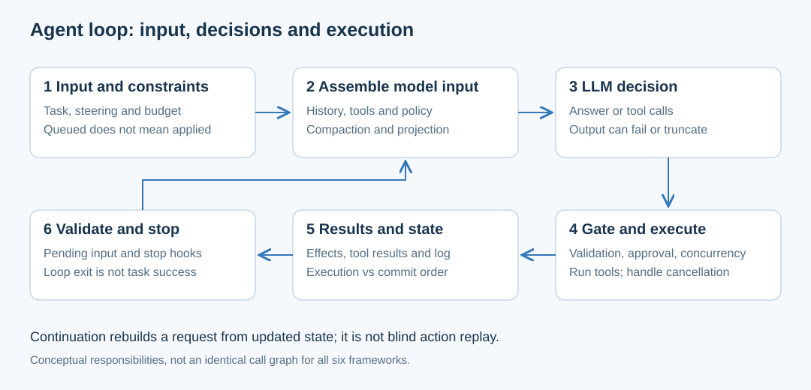
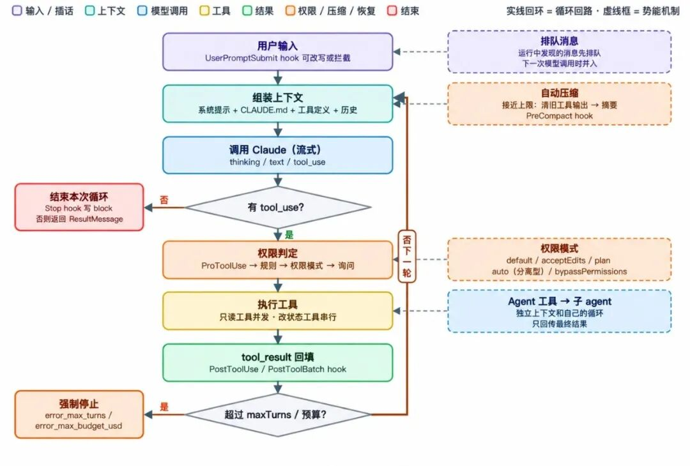
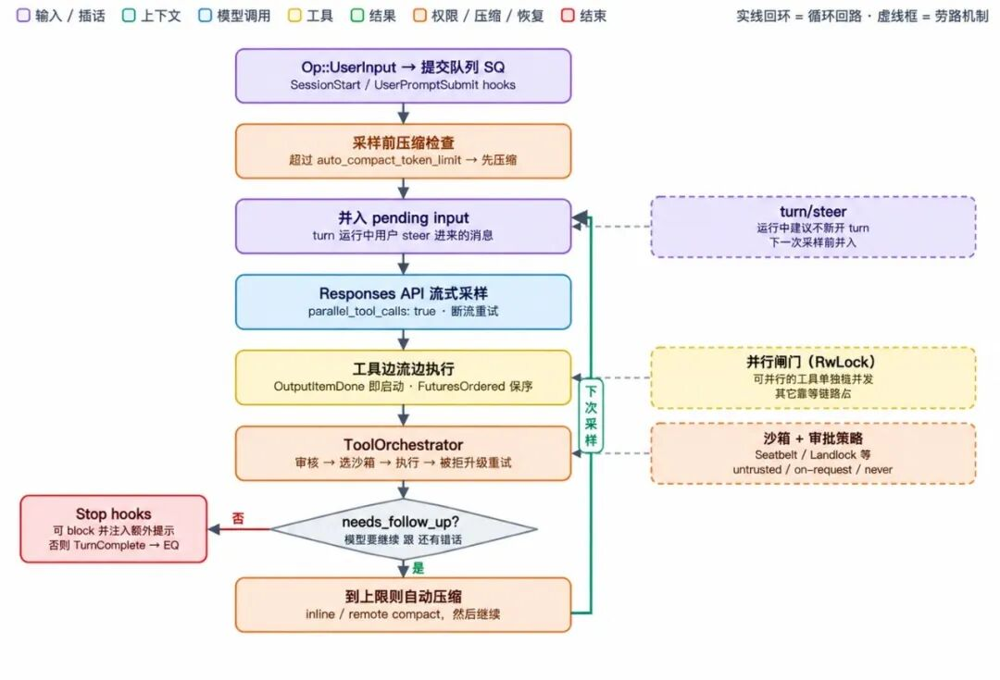
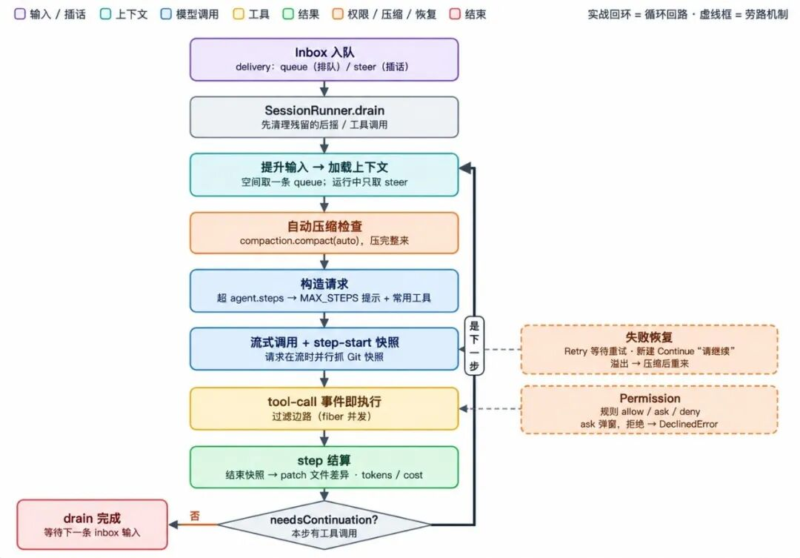
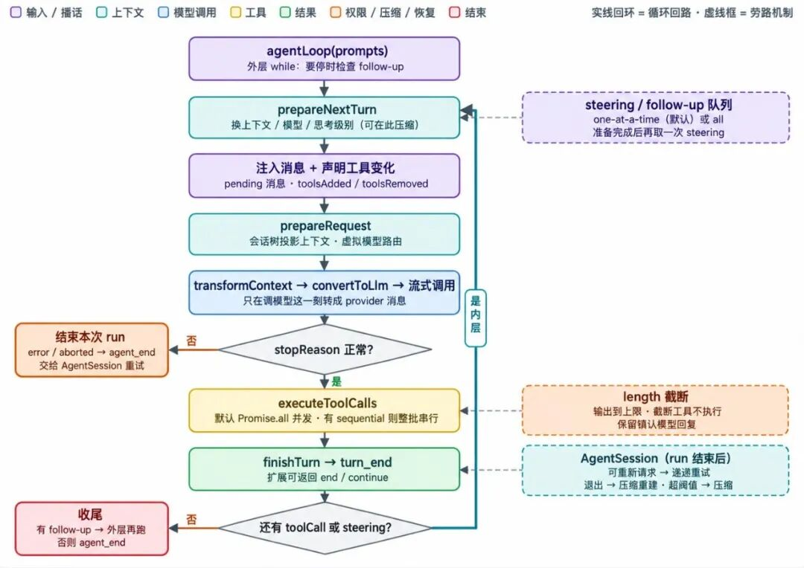
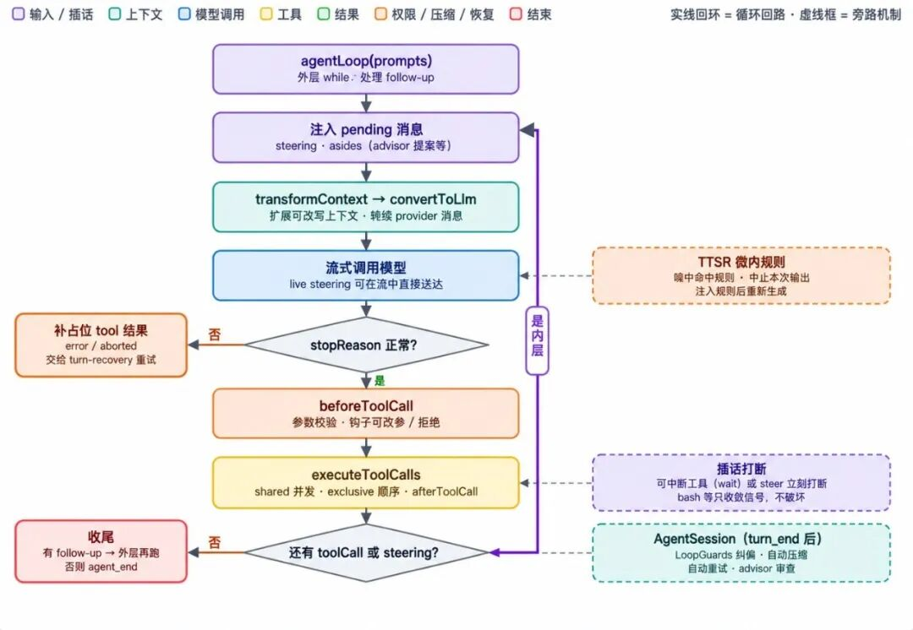
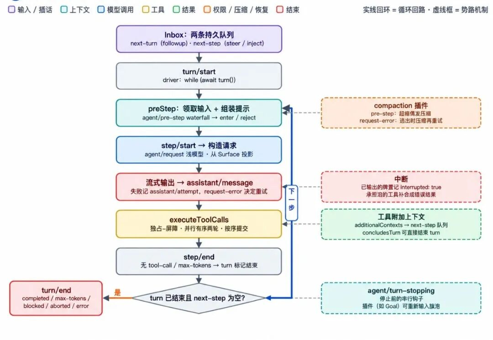
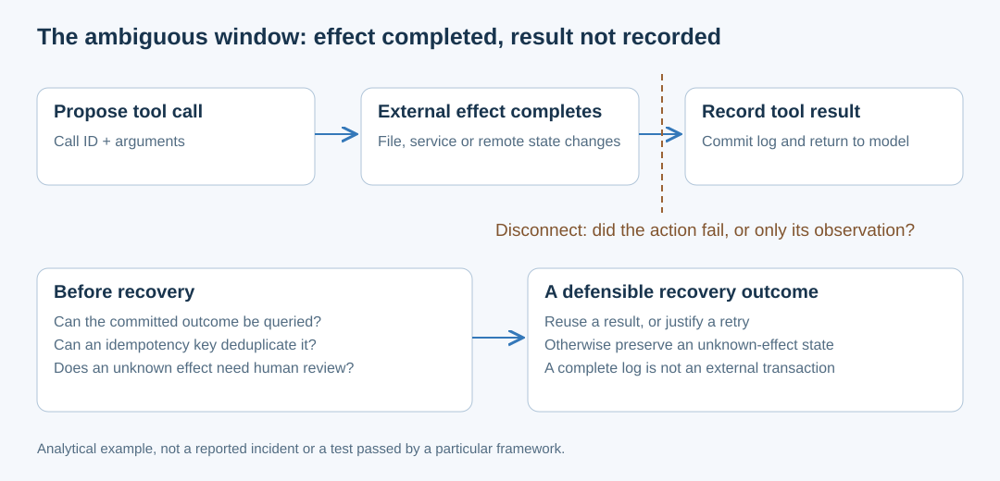

Why can the same model behave differently on the same task when its harness changes? Prompts explain only part of the difference. The surrounding execution system determines when new instructions take effect, which tools overlap, what gets retried and when a claim of completion is accepted.

PaperWeekly's [comparison of six Agent Loop implementations](https://mp.weixin.qq.com/s/GryGhL7SLCPwDQF0VjsPeg) provides the starting point. This close reading follows a coding task and checks selected mechanisms against pinned source versions. **The loop decides whether another step happens; the harness determines the state and constraints under which it happens. Neither can establish task success from a model's final sentence alone.**

## Align the terminology before counting turns

Projects use the same words for different units. Comparisons of cost, retries or “turns to completion” need an explicit counting boundary.

| Level | Meaning here | Observable evidence |
| --- | --- | --- |
| User task | Work from an accepted goal to a delivered outcome | Input, constraints and final acceptance |
| Model request | One call with a selected context | Configuration, messages, output and usage |
| Tool batch | Calls proposed by one model response | Call IDs, arguments, start/end events |
| Request attempt | One send or retry for a request | Error category, backoff and retry count |
| Session | State retained across requests and tasks | History, queues, summaries and checkpoints |

A Codex user turn can contain multiple sampling requests. DeepSeek Harness separates turn, step and attempt. Pi also emits turn events, but that does not make its counting unit identical to either. A CLI is an interaction surface; the runtime advances these states. A stuck command may reflect a model request, tool process, approval wait or an unconsumed queue.

<a class="note-image-link" href="/assets/images/tech/coding-agent-loop-harness-close-reading/loop-en.svg" target="_blank" rel="noopener" aria-label="Conceptual loop from input and context through model, tools, records and stop checks">Enlarge diagram ↗</a>

*Assistant-created responsibility diagram. The next request must reflect both fresh execution evidence and user constraints that have taken effect.*

## Follow one repair task through the whole loop

Consider “fix the failing test without changing the public interface.” This is an explanatory scenario, not an experiment run on a particular framework.

**First, accept the input.** The system resolves the project, session, instructions and tools, then handles queued messages. If the user adds “do not remove compatibility code” during a test run, receipt and application are separate events. A test should identify the request that first sees the new constraint, not merely whether the terminal displayed it.

**Second, assemble model-visible state.** A complete disk log does not imply a complete model context. Summarization, truncation, tool-result filtering and session-tree projection transform the input. If compaction drops the interface constraint, a later violation cannot be attributed solely to instruction-following ability.

**Third, obtain a model decision.** Responses may contain text, tool calls or both. The runtime must distinguish complete calls from truncated arguments and normal completion from stream failure or output limits. Receiving part of a JSON object does not authorize a side effect.

**Fourth, admit and schedule tools.** Name validation, argument completeness, permission and concurrency are separate checks. Independent reads may overlap safely. Reading an old configuration while writing a new one can race even if results later appear in a stable order.

**Fifth, return evidence.** Return values, file changes, exit codes, background-task status and remote effects can disagree. The model needs to know whether failure came from a tool, its environment, approval or the model request, rather than receiving an undifferentiated error.

**Finally, decide whether to stop.** No further tool call means only that the model did not request another action. Passing tests, respecting constraints and completing background operations need separate acceptance checks. A stop hook can request continuation, but a faulty checker can also create an endless loop.

## Where the six frameworks place their complexity

### Claude Code: documented lifecycle and policy boundaries

<a class="note-image-link" href="/assets/images/tech/coding-agent-loop-harness-close-reading/claude-code-original.jpg" target="_blank" rel="noopener" aria-label="Claude Code original Agent Loop diagram in Chinese, showing input, model calls, tools and continuation/stop branches">Enlarge original diagram ↗</a>

*Original diagram (Chinese) · [PaperWeekly / 风儿轻轻er](https://mp.weixin.qq.com/s/GryGhL7SLCPwDQF0VjsPeg). Claude Code: context, tools, permissions and stopping. The article summarizes public documentation; this is not an official internal call graph.*

Official documentation describes context gathering, action and verification, with the harness managing tools and model context. Hooks intervene at lifecycle boundaries, including stopping, where a check can request continuation. See [how it works](https://code.claude.com/docs/en/how-claude-code-works) and the [hooks reference](https://code.claude.com/docs/en/hooks).

This explains how policy configuration can change a trajectory without changing the model. It does not expose a complete internal call graph. This reading therefore does not treat universal read/write scheduling rules or one approval order as guarantees across versions. Experiments should record concrete tools, permission modes and enabled hooks.

### Codex: repeated sampling within a user turn

<a class="note-image-link" href="/assets/images/tech/coding-agent-loop-harness-close-reading/codex-original.jpg" target="_blank" rel="noopener" aria-label="Codex original Agent Loop diagram in Chinese, showing input, model calls, tools and continuation/stop branches">Enlarge original diagram ↗</a>

*Original diagram (Chinese) · [PaperWeekly / 风儿轻轻er](https://mp.weixin.qq.com/s/GryGhL7SLCPwDQF0VjsPeg). Codex: input delivery, sampling, tool execution and continuation within a user turn.*

In the pinned `run_turn`, model continuation and pending user input jointly determine `needs_follow_up`. “No more requested tools” is therefore different from “this turn may end.” Context management before and after requests is also part of execution; model token counts alone do not reveal that maintenance work.

Tool concurrency is controlled by runtime capability checks. `parallel.rs` uses read locks for parallel-capable calls and an exclusive write lock otherwise. This is a scheduling mechanism, not proof that anything named Read is safe. `orchestrator.rs` centralizes approval and sandboxed execution. Instead of labeling this merely a safety wrapper, ask which check rejected an action, whether the model saw that rejection and whether later attempts remain within the same permission boundary.

The [pinned turn, concurrency and orchestration source](https://github.com/openai/codex/tree/d1d1ba0b837d34f314b7f469896e8babbc91f949) supports these distinctions. They separate request, scheduling, approval and environment failures rather than treating every unsuccessful run as a model failure.

### OpenCode: explicit step outcomes and session state

<a class="note-image-link" href="/assets/images/tech/coding-agent-loop-harness-close-reading/opencode-original.jpg" target="_blank" rel="noopener" aria-label="OpenCode original Agent Loop diagram in Chinese, showing input, model calls, tools and continuation/stop branches">Enlarge original diagram ↗</a>

*Original diagram (Chinese) · [PaperWeekly / 风儿轻轻er](https://mp.weixin.qq.com/s/GryGhL7SLCPwDQF0VjsPeg). OpenCode: inbox-driven steps with snapshots, compaction and recovery. This reflects the article’s dev-branch description; current outcome-name differences are discussed below.*

This reading checks the core implementation on the `dev` branch, not every released client. `step.ts` distinguishes `Completed`, `Retry`, `RecoverFull`, `Compacted` and `OutputLimit`. A context-overflow failure can enter compaction recovery rather than sharing the same success exit as a normal answer.

One sequencing detail matters: the starting snapshot can be captured concurrently with the provider request, but must exist before local tools run. The ending snapshot records file changes. This gives tracked files an observation boundary, but **a file snapshot does not include remote APIs, databases or sent messages**. It is not a transaction rollback for the entire task.

The [pinned implementation](https://github.com/anomalyco/opencode/tree/88ca792e024aa2085fa6e15288be37037c4871d2) already differs from some outcome names in the article's simplified pseudocode. Compare a specific branch and commit rather than mechanically reproducing every state name from the article.

### Pi: tools and steering inside, follow-up outside

<a class="note-image-link" href="/assets/images/tech/coding-agent-loop-harness-close-reading/pi-original.jpg" target="_blank" rel="noopener" aria-label="Pi original Agent Loop diagram in Chinese, showing input, model calls, tools and continuation/stop branches">Enlarge original diagram ↗</a>

*Original diagram (Chinese) · [PaperWeekly / 风儿轻轻er](https://mp.weixin.qq.com/s/GryGhL7SLCPwDQF0VjsPeg). Pi: the inner loop handles tools and steering; the outer loop checks follow-up when the agent would otherwise stop.*

Pi's `runLoop` separates two delivery moments. Steering enters the inner loop between rounds; follow-up is checked when the agent would otherwise stop and can restart the outer loop. Because `prepareNextTurn` can take time, the code conditionally polls steering again after preparation. It captures arrivals during preparation without consuming two messages in one-at-a-time mode.

Tool scheduling has a conservative batch rule: global sequential mode, or any tool declaring `executionMode: sequential`, sends the entire batch down the sequential path. For `stopReason: length`, the response's tool calls fail rather than execute because arguments may be incomplete. `finishTurn` can request end or continuation; more retry and compaction policy lives in the surrounding `AgentSession`.

The [pinned source](https://github.com/earendil-works/pi/tree/5a14e69c067d40dfbff4f2fff7d3b34c897e2dc9) highlights the division between loop mechanics and session policy. An extension may change context or continuation, but a callback alone does not provide safe replay after a process crash. Persistent-task mechanisms are a separate subject in the [Pi Durable close reading](/tech/en/pi-durable-runtime/).

### Oh My Pi: control within the tool batch

<a class="note-image-link" href="/assets/images/tech/coding-agent-loop-harness-close-reading/oh-my-pi-original.jpg" target="_blank" rel="noopener" aria-label="Oh My Pi original Agent Loop diagram in Chinese, showing input, model calls, tools and continuation/stop branches">Enlarge original diagram ↗</a>

*Original diagram (Chinese) · [PaperWeekly / 风儿轻轻er](https://mp.weixin.qq.com/s/GryGhL7SLCPwDQF0VjsPeg). Oh My Pi: in-stream correction, tool-concurrency controls and interruption around a Pi-style loop.*

Oh My Pi retains a related loop skeleton while adding finer concurrency and interruption behavior. A tool can resolve shared or exclusive mode from its arguments; if that resolver throws, the current code falls back to exclusive. Scheduling tracks prior exclusive work, shared work and shared calls with possible effects. “Shared” does not mean unrestricted simultaneous execution.

Steering during execution, interruptible waits, in-stream rules and session-level recovery create additional boundaries. They let control information take effect without always waiting for a long tool batch. They also make it more important to distinguish a request to stop from an effect that has already happened.

The [pinned implementation and streaming documentation](https://github.com/can1357/oh-my-pi/tree/57771ae562b9345e0579bceb2d68d585e3e6927e) make this useful for studying interruptible execution. An experiment must record tool cancellation semantics. An error placeholder, abort signal or silent output channel does not establish that an external action has rolled back.

### DeepSeek Harness: log projection and plugin boundaries

<a class="note-image-link" href="/assets/images/tech/coding-agent-loop-harness-close-reading/deepseek-harness-original.jpg" target="_blank" rel="noopener" aria-label="DeepSeek Harness original Agent Loop diagram in Chinese, showing input, model calls, tools and continuation/stop branches">Enlarge original diagram ↗</a>

*Original diagram (Chinese) · [PaperWeekly / 风儿轻轻er](https://mp.weixin.qq.com/s/GryGhL7SLCPwDQF0VjsPeg). DeepSeek Harness: execution organized into turns, steps and attempts. The diagram’s model selection at agent/request reflects the original article; the pinned version fixes selection during step preparation, as explained below.*

DeepSeek Harness derives request context from the session log and separates turns, steps and failed attempts. Its inbox distinguishes next-turn and next-step work. A guarded tool pipeline and observable events expose input claims, request attempts and stop reasons. This helps explain which recorded facts drove the next step, but does not make external effects atomic with local log commits.

**Version differences matter here.** The article presents the `agent/request` waterfall as a place to select provider, model and effort. In the pinned version, step preparation has already captured model selection. Changing provider, model or reasoning effort in `agent/request` is rejected, with an instruction to use `agent.model.select()` before step preparation. The README marks that hook deprecated while retaining compatibility for other request controls.

This does not establish that the article was wrong when published. It shows that extension authority evolves. A model-routing RSI experiment using the old hook may now fail at a runtime guard. The [pinned source and module documentation](https://github.com/deepseek-ai/deepseek-harness/tree/2e39e70496aa02986ca6a820c5d497e816b69d7e) identify where the change must take effect.

## Execution order, result order and determinism are different

| Mechanism | What it can provide | What it cannot establish alone |
| --- | --- | --- |
| Serial tools or exclusive barriers | Restricted overlap | Failure-free tools or an unchanging environment |
| Model-order result delivery | Stable result presentation | External effects occurring in that order |
| Persistent queues and event logs | Traceable input and recorded state | Atomicity between actions and log commits |
| File snapshots | Comparison or restoration of tracked files | Undoing network calls, database writes or notifications |
| Fixed model settings and seeds | Reduced generation variability | A deterministic, correct end-to-end trajectory |

Imagine a tool restarting a service, then losing its connection before recording success. The model sees failure, but the restart may already have happened. Repeating the call could restart it again. Recovery needs an outcome query, an idempotency key or an explicit unknown-effect state requiring escalation. **Synthesizing a missing tool result repairs conversation structure; it does not repair external state.**

<a class="note-image-link" href="/assets/images/tech/coding-agent-loop-harness-close-reading/recovery-en.svg" target="_blank" rel="noopener" aria-label="Failure window between external tool effects and local result commit, with recovery checks">Enlarge diagram ↗</a>

*Assistant-created analytical scenario. Recovery must address actual action state, not only an error string.*

## What skills, plugins, runtimes and models can change

| Editable layer | Typical object | Better suited to | Usually cannot directly repair |
| --- | --- | --- | --- |
| Skill / instruction | Procedures, tool guidance, acceptance checklist | Missing checks, workflow mistakes, domain knowledge gaps | Lost queue entries, leaked processes, non-atomic storage |
| Hook / plugin | Interception, context transformation, continuation | Tool admission, result processing, supported routing and stop checks | State transitions outside the extension boundary |
| Runtime / harness core | Scheduling, cancellation, persistence, retries, projection | Races, recovery, message protocol and resource lifetimes | Incorrect reasoning despite correct input and feedback |
| Model | Weights, reasoning policy, model selection | Planning and judgment with correct evidence | External effects lost by the runtime |

These are not mutually exclusive failure labels. A model may choose a dangerous command while the runtime also lacks a required guard. A bad summary can involve both compression-model behavior and state-retention policy. Attribution needs separate observations: the original instruction, actual request, actual tool action, committed result and reason for termination.

Consequently, an RSI method claiming to optimize the harness should first enumerate its editable surface. Changing only skills or hooks is a different intervention space from changing the scheduler, persistence protocol or model weights. Rich extensions enable fast exploration but do not imply that every execution failure is repairable through extensions.

## Compare stability through controlled failures

Rather than ranking six frameworks first, use a common task and failure location to collect comparable evidence. The following is a proposed experimental design, not a benchmark already run.

| Injection point | Behavior to inspect | Suggested acceptance condition |
| --- | --- | --- |
| Model stream ends inside tool arguments | Whether an incomplete call executes | No side effect from incomplete or unauthorized arguments |
| User adds a constraint during compaction or a long tool | Input claim and first affected model request | No loss or duplication; explainable delivery boundary |
| Write succeeds but result recording fails | Whether the effect can be established | No blind replay; explicit unknown state |
| Tools compete for a file or resource | Actual start/end and commit order | Concurrency follows side-effect contracts |
| Stop hook rejects termination | Whether useful work resumes | Bounded budget and recorded reasons |
| Process restart or implementation change | Queue, history and tool-state reconstruction | Compatible old state; no duplicated effects |

Hold model version, tools, permissions, context and budget constant. Distinguish a higher completion rate due to better recovery from one due to more allowed calls. Measure unrecoverable failures, duplicate effects, constraint violations, recovery latency and total cost as well as success.

For an unstable task, freezing model outputs and replaying the same tool calls can help isolate runtime behavior. Conversely, fixed tool results can expose variation in model decisions on the same context. These are variable-isolation techniques, not replacements for documenting replay fidelity. End-to-end testing is still needed to ensure a local repair has not moved the failure into another layer.

## What to take away

All six systems share a model–tool feedback loop. Their consequential differences concern **ownership and handoff of input, execution, commit, recovery and stopping**. Loop length, hook count or a claim of retry support is not a reliability metric.

This connects two research directions. AI4SRE needs trustworthy investigative evidence and safe action interfaces for the model. SRE4AI tests whether the agent runtime itself remains explainable and recoverable under faults. The former depends on foundations provided by the latter.

### Original article and verification scope

Original: PaperWeekly, 风儿轻轻er, 2026-10-28, [WeChat article](https://mp.weixin.qq.com/s/GryGhL7SLCPwDQF0VjsPeg). This is an independent analysis, not a paragraph-by-paragraph translation. Six original diagrams are reproduced with attribution; this English edition preserves their Chinese labels and adds English captions and explanations. The two additional explanatory diagrams are assistant-created. Open-source links resolve to pinned commits; Claude Code coverage relies on public documentation rather than access to internal source. The proposed failure experiments were not executed on the six frameworks.
