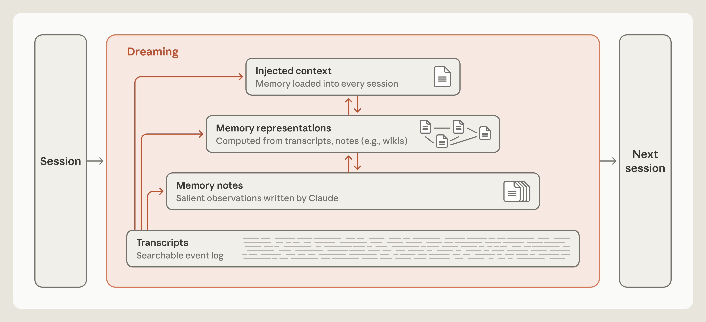

**Anthropic · Lance Martin · 2026-11-06**  
Original: [The components of agent memory](https://www.anthropic.com/engineering/components-of-agent-memory)

Agent memory involves more than returning additional history to a prompt. What survives a session, how it is corrected and how a later session finds it jointly determine whether retained information helps. Anthropic separates searchable transcripts, active notes, derived representations such as wikis, and a small preloaded context layer, then examines their roles experimentally.

## Capturing experience predicts future relevance

Memory here is knowledge gained from interactions and tasks that remains readable across sessions. It excludes weight updates and differs from compaction used to continue one conversation. Writing a note predicts that it will remain useful and justify future retrieval or context cost.

In the CL-Bench 1.0 database task, every question starts a fresh session. After feedback, only a persistent memory directory connects questions. Weaker models leave untested guesses; stronger ones increasingly retain checked rules, past answers and warnings. The useful loop is error, hypothesis, test and reusable rule—not merely a successful file write.

Pokémon supplies an illustrative case. Around ten thousand steps, Sonnet 3.7 has 413 files in 225 folders and one badge; Fable 5 has nine files in two folders plus global.md and four badges. The latter retains goals, route strategies and rules, while the former repeatedly stores visible, rapidly changing game state. These are single-run observations, not an isolated causal estimate of memory policy, but they expose maintenance work displacing task progress.

## Offline organization can repair bad memories

Dreaming revisits original transcripts outside active sessions to check notes, merge duplicates, build links and change what gets promoted. It complements immediate capture: notes can help at once, while offline work combines evidence across sessions at additional compute cost and delay.

<a class="note-image-link" href="/assets/images/tech/components-agent-memory/hierarchy.png" target="_blank" rel="noopener" aria-label="Memory layers from transcripts to notes, representations and injected context · View original image ↗">View original image ↗</a>

*Transcripts preserve traceable evidence; dreaming maintains higher representations, while only a small top layer is preloaded into the next session.*

One navigation example starts with a landmark recorded on the wrong side of a cave. Later detours reinforce the mistaken belief that the cave is already behind the agent. Dreaming corrects the note against the transcript, after which the resumed run reaches the next city; the uncorrected branch repeatedly returns to the earlier route. The mechanism requires traceable primary evidence, not repeated summarization of an already-wrong note.

Preloaded memory is especially consequential: an error injected into every session can contaminate every decision, while long instructions reduce adherence. The post describes Claude Code auto memory loading only the first 200 lines or 25 KB of MEMORY.md as an index. The transferable principle is a small top layer pointing to material retrieved on demand; the exact limit is an implementation detail.

## When a wiki adds value over search

For an internal corpus of roughly 350,000 files and 420M tokens, the authors build and maintain a wiki over 128 sequential sessions and evaluate 25 questions. Scaling dreaming from two to 128 sessions raises wiki-only performance from 13% to 48% of graded criteria. Search plus wiki rises from 54% to 61%, versus about 53% for search alone, while saving around 20,000 tokens per question.

These results support structured navigation across documents, not universal replacement of search. They do not amortize wiki-construction compute. On 24 merger questions, cross-document items score 87% with a wiki versus 73% with search. Some legal-brief tasks drawing mainly from single documents show no clear improvement; another wiki grows larger than its source files. Without useful abstraction, another representation is simply another maintained copy.

## Missing facts can be a write-coordination failure

In a contract task, multiple agents initially edit a shared terms table, compressing away facts or overwriting one another. Only 41 of 57 graded facts survive. Revised construction gives each contract a page and a single responsible agent, preserving key terms verbatim; all 57 survive. Ownership, storage granularity and prompting change together, so this is not evidence for one isolated memory-model improvement.

This is directly relevant to AgentOps: derived knowledge depends on concurrent modification and provenance, not extraction alone. Broken links also hide stored information. A second dreaming pass redirects nine links targeting a missing page to an existing one and adds an index. Managing references and edits is part of delivering reliable knowledge to future sessions.

## Reliable memory has a maintenance budget

A rigid failures-only rule reduces stronger models’ CL-Bench memory gains, while reminders to read notes and test hypotheses help a weaker model. Salience judgment and task structure change the useful capture policy. Offline verification cannot run without limit either; volatility, access frequency and rechecking cadence affect cost.

This is a set of engineering experiments and cases rather than one universally established memory algorithm. Its useful contribution is to observe capture, evidence checking, representation construction and retrieval separately. Cross-document synthesis may benefit substantially, whereas direct search can remain preferable for single-source questions.
