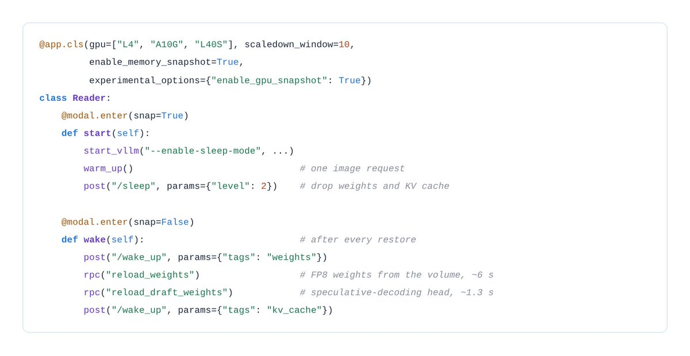

Low-traffic custom models rarely fill batches like shared frontier-model services. Keeping a GPU resident for occasional bursts mostly pays for idle capacity; starting from scratch can make users wait minutes. Sahil Mahendrakar describes a concrete trade-off: preserve expensive initialization results so that the deployment can scale to zero more aggressively without pretending that every startup operation disappears.

Original: [Serving custom models efficiently with fast cold starts](https://x.com/sahilmdkr/status/2121284035968139573) · Sahil Mahendrakar · 2026-11-13

## Timing boundaries explain the “15 seconds” claim

The article compares starting a stopped AWS GPU host, creating a fresh Modal container, and restoring a Modal GPU-memory snapshot. AWS GPU allocation can take a minute or more depending on capacity; Modal allocation takes approximately five seconds. Fresh starts also perform engine initialization, KV-capacity profiling, and CUDA-graph capture, with individual stages taking around a minute.

Weight-loading paths differ as well: more than two minutes over the AWS EBS path versus approximately 35 seconds for the fresh Modal container. The total platform difference cannot all be attributed to snapshots. Prefetching weights, limiting graph capture to the actual batch range, and preparing an FP8 checkpoint reduced the checkpoint from 18 GB to 12 GB and removed almost a minute from a fresh Modal start. Storage and configuration improvements therefore accompany snapshotting.

<a class="note-image-link" href="/assets/images/tech/custom-model-snapshots/restore-sequence.jpg" target="_blank" rel="noopener" aria-label="Warm up and release bulky state; restore weights and then allocate KV · View original image ↗">View original image ↗</a>

*Reading the figure: Warm up and release bulky state; restore weights and then allocate KV.*

Approximately 15 seconds describes readiness at a high level. The cost table assumes a 20-second snapshot start, while the first completed answer in a burst takes about 30 seconds. These are different measurement boundaries. The original three-to-seven-minute range also depends on platform and settings and should not become a universal speedup ratio.

## The snapshot deliberately excludes weights and KV contents

Expensive setup includes Python imports, CUDA-context creation, library loading, kernel compilation, KV-capacity profiling, and graph capture. Much of the resulting state is simply bytes in CPU and GPU memory; restoration can replace repeated computation.

Before snapshotting, the implementation puts vLLM to sleep, freeing weights and KV cache while preserving address reservations so captured graphs remain valid. Including gigabytes of weights would not necessarily restore faster than loading them separately and would make snapshot saving longer, risking container termination during the save. After restoration, weights reload in about six seconds and KV allocation takes another second or two. The avoided work is capacity discovery and graph capture, not all KV allocation.

This depends on platform GPU-snapshot support, vLLM sleep/wake behavior, and retained addresses. It does not imply that ordinary process fork can inherit working CUDA state. The boundary differs from Cairn, which shares compilation artifacts and still recaptures process-bound graphs.

## Savings combine shorter starts with less idle time

For the author’s 9B model on an L4, each snapshot wake costs approximately $0.01–$0.02 versus $0.05–$0.07 for a fresh start. The monthly comparison then uses simulated bursts: five requests per burst, around 12 seconds per request, and a ten-second idle window. Modal L4 plus CPU and memory is priced at approximately $0.95/hour. The calculation assumes a 20-second snapshot start or three-minute fresh start, billing from container startup until scale-down.

Benefits therefore include less billed startup time and a shorter economically tolerable warm-retention window, not only lower initial latency. Conversely, sufficiently dense traffic can favor keeping an instance warm. Monthly figures reflect specific arrival and price assumptions rather than observed bills for arbitrary custom models. The article’s comparison with another model service is also tied to the same task and cannot be generalized independently of quality and output length.

## Scaling to zero does not solve active-period utilization

The model still occupies a dedicated GPU while awake, and small batches may remain memory-bandwidth-bound. Multi-LoRA serving and rapid model switching might share resources further, but their combined end-to-end benefits are not demonstrated here. Nor does the article provide a restoration-correctness matrix across models, drivers, and graph configurations.

The useful engineering contribution is the explicit snapshot content and restoration order: retain valuable setup state, reload bulky data, and identify which initialization can be skipped. Comparable evaluations should distinguish readiness, first token, completed answer, and billed intervals while recording capacity, weight-storage, and graph-capture conditions. That makes the avoided startup work assessable.
