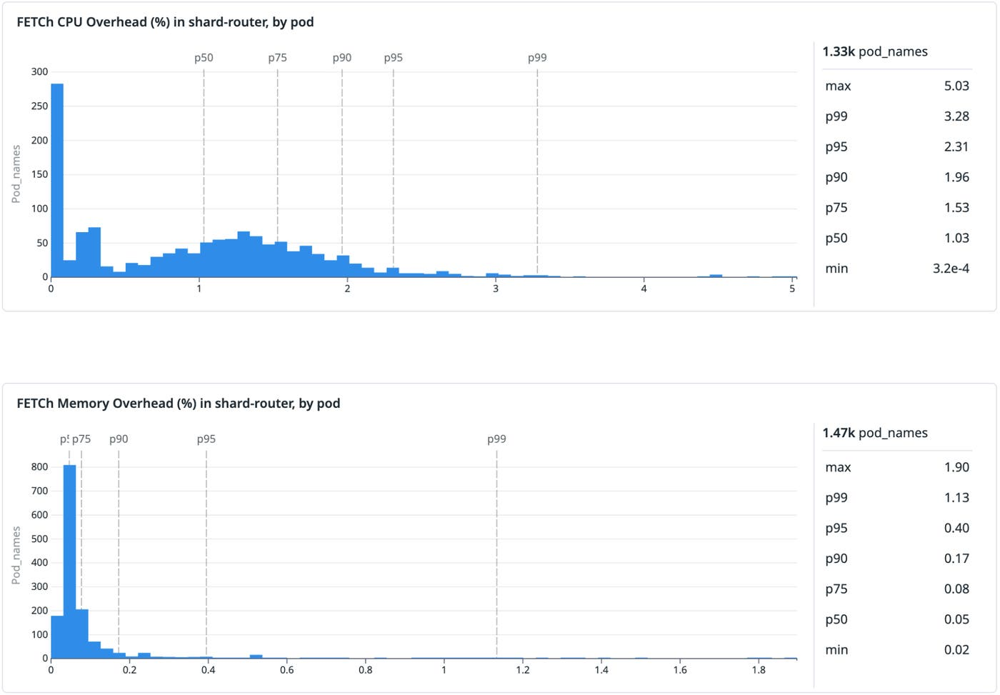

[How we continuously validate formal specifications in production](https://www.datadoghq.com/blog/engineering/continuous-formal-spec-validation/)  
Nicolas Couvrat · 2026-11-05

A model-checked specification can remain internally correct while drifting away from production behavior. Datadog’s FETCh compiles permitted TLA+ transitions into Rust monitors. In Husky’s routing system, it exposed conflicting state that was harmless during normal operation but could break recovery after a separate failure.

<a class="note-image-link" href="/assets/images/tech/datadog-continuous-formal-spec-validation/official.png" target="_blank" rel="noopener" aria-label="Production CPU and memory overhead distributions for the FETCh sidecar · View original image ↗">View original image ↗</a>

*The CPU p90 is 1.96% and memory p90 is 0.17%; these distributions describe this routing deployment, not a universal monitor-overhead guarantee.*

## Why invariants alone are insufficient

Model checking needs bounded state spaces; production monitoring consumes a continuing stream of inputs. Reusing a design model directly can create mismatched abstractions or unmanageable state. The article’s lock example makes a second distinction: checking that a lock counter never exceeds one still permits repeated release to make it negative. An invariant can hold while an action violates the specification.

FETCh connects the two uses through refinement. Abstract specification A describes permitted observable behavior. Model-checkable B introduces tractable bounds while allowing only behavior permitted by A. Engineers check that refinement during design and monitor A in production. The shared formal basis supports different levels of detail for exploration and observation.

## Generating event handlers from TLA+ actions

The generated Rust monitor stores specification variables and implements a handler for each action in `Next`. Incoming events select a handler, which checks preconditions and updates state. A failed precondition indicates a transition forbidden by the specification.

TLA+ does not directly provide Rust types. FETCh uses existential quantification to identify action inputs, annotations such as `fetch:u32` to map constants, and `TypeOK` to describe variables. This works for a supported TLA+ subset, not arbitrary specifications. Engineers must still instrument real events and map them correctly to actions.

## Decomposing correctness into manageable state

Husky needs identical event IDs to reach the same shard. A direct monitor would retain every ID-to-shard mapping across an ingestion window and survive restarts. With trillions of distinct IDs, that is impractical.

The team separates two obligations. A global monitor checks that stored placements do not assign conflicting ID ranges. A sidecar for each routing process checks that events use previously received, unmodified placements and the correct hash function. Thousands of instances distribute event validation, while global checking handles only millions of placements. A formal proof establishes consistent routing when both specifications hold.

Process-local state needs to live only as long as its process, avoiding persistence across restarts and remote validation payloads for every event. The smaller global state still requires substantial storage. `FetchMap` and `FetchSet` allow RocksDB-backed implementations. The key engineering move is to decompose correctness before deciding where monitoring state lives.

## A latent recovery defect

In a deployment processing tens of millions of events per second, the authors report approximately 2% p90 CPU overhead and less than 0.2% memory overhead for sidecars. The chart covers roughly 1,330 and 1,470 pods respectively. Batch placement checking processes several million records from multiple days in about an hour with one CPU and a few GB of memory.

The local routing monitor reports no violations. The storage monitor finds conflicting placements: special balancing cases introduced a year earlier intentionally skipped deduplication, but their records were still persisted. Conflicts are estimated below 0.01%. They are harmless during normal operation, yet two conflicts can prevent the backfill system from recovering after placement data loss. This is a latent recovery-path defect, not a reported large-scale data incident.

## Coverage remains explicit

FETCh supports only part of TLA+ and currently checks preconditions against the current state. Instrumentation, event completeness, and global distributed-state validation still require system-specific work. The case does not prove all Husky behavior correct. It shows how a specification can remain useful years after deployment by detecting when implementation changes invalidate assumptions behind the original correctness argument.
