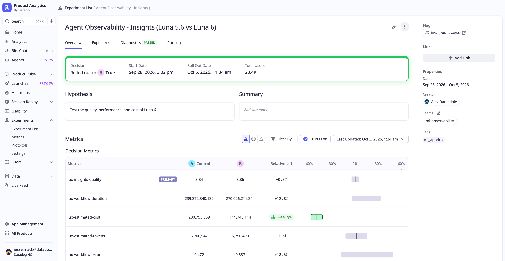

Original: [Compare AI agent changes with Online Experiments in Agent Observability](https://www.datadoghq.com/blog/online-experiments-agent-observability/)  
Alex Barksdale, Yakov Shapiro, Demetri Pananos, Miguel Tulla Lizardi · 2026-11-04

## Measure the whole investigation

A lower token price does not guarantee a cheaper task. A replacement model may make more calls, supply invalid parameters, or recover through retries. Datadog’s internal Insights-agent experiment shows why quality, estimated cost, duration, and errors should be measured separately and interpreted through traces.

Traffic was split evenly between GPT-5.6 Luna and GPT-6 Luna, with the former as the reference. Insights investigates agent behavior using trace evidence. An LLM judge scored investigations from 1 to 5 using the request, tool inputs and outputs, and conclusions, including accuracy, completeness, evidence support, and acknowledgment of uncertainty. Operational measures were collected separately.

## Connect random assignment to observability

Offline tests catch known regressions but may miss new requests and long-tail tool outputs. Online experiments retain a contemporaneous control and use random assignment to reduce differences in workload difficulty between variants. Evaluation quality still depends on the rubric; live traffic does not make a judge automatically correct.

Datadog connects Agent Observability evaluator scores to Experiments alongside operational metrics, calculating relative changes and confidence intervals. Feature Flags can manage exposure after variants are wired into the application. Traces provide the underlying tool selections, arguments, and responses when an aggregate result needs explanation.

<a class="note-image-link" href="/assets/images/tech/datadog-online-experiments-agent-observability/results.png" target="_blank" rel="noopener" aria-label="Datadog experiment comparing quality, duration, estimated cost, and workflow errors · View original image ↗">View original image ↗</a>

*Only the estimated-cost interval lies entirely below zero. Duration and error intervals cross zero and do not establish absence of regressions.*

## Similar averages do not prove equivalent quality

The reported estimated cost falls by 44.3%, with an interval of 37.5%–51.2% lower. Mean quality scores are 3.84 and 3.86, but the article explicitly notes that close averages do not establish equivalence.

Duration has a point estimate of 12.8% higher, with an interval from 4% lower to 30% higher. Workflow errors are estimated at 13.6% higher, with an interval from 16% lower to 43% higher. These ranges accommodate both little change and operationally meaningful increases. Lack of a clear difference is not evidence that latency and errors cannot worsen.

In inspected traces, Luna 6 supplied invalid tool parameters more often, usually correcting them through retries. The final investigation could still score well while requiring more recovery work. The team addressed the parameter issue before proceeding with the lower-cost model. Cost evidence supported further adoption work; traces identified what still needed repair.

## Feed online failures back into regression tests

Failed calls can become offline cases, and a follow-up online experiment can evaluate revised tool definitions or error feedback. This connects production discovery to a growing regression suite without discarding controlled online measurement.

The result remains a vendor-reported experiment on one agent, not a universal model-switching saving. The article does not provide a complete protocol sufficient to reconstruct every statistical result independently. Its stronger transferable lesson is to retain a control, separate quality from resource measures, read intervals rather than point estimates alone, and use traces to locate the mechanism behind the change.
