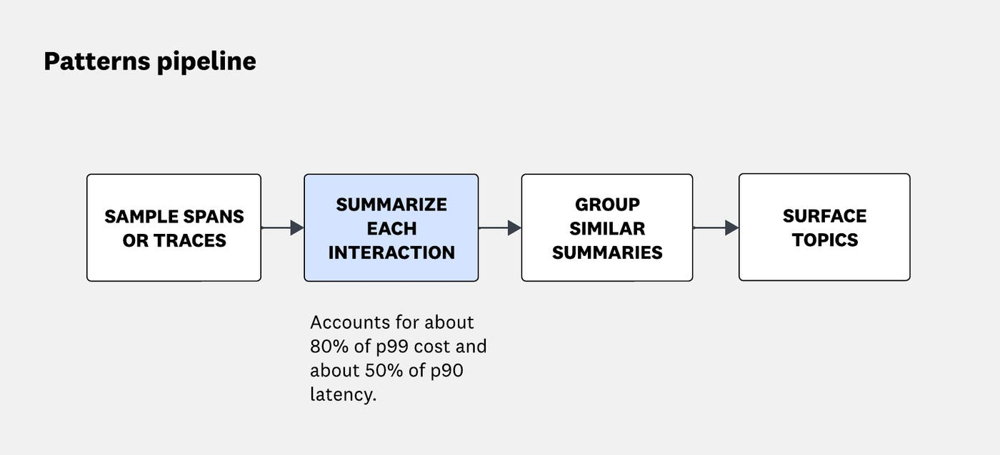

Patterns clusters production agent interactions by topic. A run can sample thousands of traces, each potentially containing megabytes of prompts, tool calls and responses. Before clustering, the system summarizes each interaction in one sentence according to a user-specified instruction. Datadog attributed about 80% of a run's p99 cost and 50% of p90 latency to this stage. A repetitive transformation with identifiable inputs and outputs made a tractable optimization target.

## Turning observability records into supervision

The summarizer's own calls are recorded as LLM spans. With pup finetune, the team turns each interaction and its instruction into input and uses the original summarizer's response as the target. Different instructions emphasize different aspects of an interaction, so retaining the instruction is essential. Splits are assigned by trace, with duplicates kept together, reducing leakage from related rows. Capping rows per trace can also prevent a few busy sessions from dominating training.

<a class="note-image-link" href="/assets/images/tech/datadog-patterns-baseten/overview.png" target="_blank" rel="noopener" aria-label="View original image ↗ — Each interaction is summarized before grouping and topic display. The measured generation speedup concerns the second box.">View original image ↗</a>

*Each interaction is summarized before grouping and topic display. The measured generation speedup concerns the second box.*

## Diagnosing the base model before training

On Baseten, Qwen 3.5 9B frequently spent its token budget reasoning before writing a usable summary. When it finished, the summaries were often adequate. Fine-tuning therefore had a specific target: consistently deliver a short parseable answer within budget. A coding agent using the skill coordinated dataset review, baseline evaluation, training and comparison, stopping for human approval of paid operations. Subsequent deployed calls can be traced again to inspect changes in the production distribution.

The overall judge score can suggest a large improvement in summary quality. Failure categories tell a more precise story. Of the base model’s 83 failures, 78 exhausted the budget or could not be parsed. Among the 72 parseable answers, 67 passed, about 93%. Among the 150 parseable tuned answers, 140 passed, again about 93%. The main gain was successfully delivering an answer.

## What became fifty times faster

The held-out evaluation contained 150 cases from five separate traces. The base model finished with parseable output on 72 cases, versus all 150 after tuning. A judge evaluating substitutes for the recorded summaries accepted 67 base answers and 140 tuned answers. On dedicated Baseten samplers, average generation per case fell from 44.7 to 0.89 seconds. Avoiding long generations that exhausted the budget before delivering an answer contributed directly. An entire Patterns run still includes sampling, embedding and clustering. The 150 judgments also come from five traces, not 150 independent production environments.

[How we fine-tuned a faster model for Patterns on Baseten](https://www.datadoghq.com/blog/fine-tuning-patterns-baseten/) · Fouad Wahabi, Vincent Cornet, Alex Barksdale · 2026-11-18
