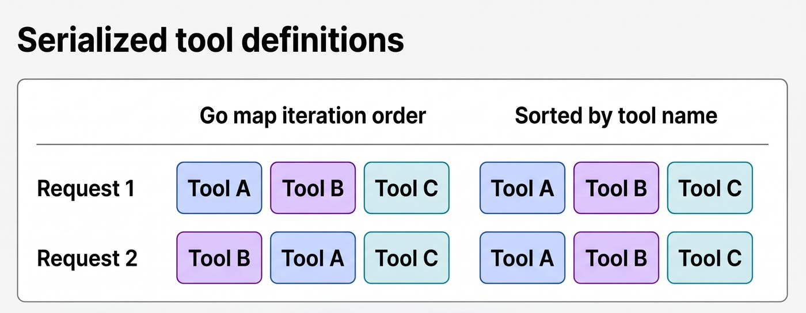

[How we investigated prompt cache misses with Datadog](https://www.datadoghq.com/blog/prompt-cache-investigation-ccm-agent-observability/)  
Bruno Volpato, Will Potts, JC Mackin · 2026-11-06

Enabling a cache option does not establish that an agent will reuse input. Datadog traces this problem through a concrete chain: provider spending identifies expensive applications, traces expose cache activity, and outgoing requests explain why reuse fails. The contribution is a set of specific failure mechanisms rather than a universal savings percentage.

<a class="note-image-link" href="/assets/images/tech/datadog-prompt-cache-investigation/official.png" target="_blank" rel="noopener" aria-label="Serialized tools from Go map iteration versus sorting by name · View original image ↗">View original image ↗</a>

*The tools are unchanged, but reordered serialization on the left changes the prefix. Sorting on the right keeps the reusable sequence stable.*

## Establish what one recorded call means

The team starts with Cloud Cost Management, then uses Agent Observability to compare initial and later calls within a task. System instructions, tools, and history recur, so later cache reads can reveal reuse. Input volume, estimated cost, and time to first response provide additional context.

An uncached example contains over 180,000 input tokens per call and estimated input costs of $0.74–$0.82. A separate cached example has total request costs of $0.02–$0.14. These are not a controlled before-and-after comparison of the same workload and do not establish a savings ratio.

Before inspecting application code, the team checks telemetry. Application and gateway spans can duplicate a provider call; missing cache fields can conceal reuse. Traces omitting tools or system instructions cannot explain prefix differences. Measurement integrity is part of the investigation.

## Identical information can produce different prefixes

Caching depends on matching the beginning of a request. Timestamps, organization details, feature flags, or incident context placed before stable instructions can invalidate reuse of everything following them. The proposed structure puts stable material first and changing context later, with a cache boundary where supported.

Each suspected field still needs verification. A UTC date explains misses across midnight, not every request throughout a day. Another apparent leading timestamp belonged to recorded user content, so changing system instructions would not fix it.

Ordering creates a subtler failure. One service builds its tools by iterating over a Go map, allowing A/B/C to become B/A/C. The patch sorts tool names; its test constructs maps in different insertion orders and checks identical lists. A source-code prompt generator has the same problem with file ordering, also changing what survives truncation. Sorting establishes deterministic output, while provider requests are still needed to verify cache gains.

## Configuration can disappear before the provider sees it

One service’s `WithPromptCaching` option adds a beta header but omits cache controls in the body. Another application fails to forward the SDK option to the component assembling the provider request. A configuration flag is therefore insufficient evidence; the outgoing payload must contain the required controls.

Routing also matters. The team observes cache reads on Anthropic’s native Messages route but none on its OpenAI-compatible route; documentation consulted during the investigation states that the latter does not support prompt caching. Migration still requires checking message roles, tool results, and streaming semantics. A caching opportunity does not guarantee a behavior-preserving protocol change.

## Evaluate complete tasks

Cache writes can carry additional charges. Repeatedly writing material that is rarely reused can increase cost, while longer histories can increase both cached tokens and total input. Comparisons should hold application route and task type constant and include subsequent reads, output charges, retries, fallback models, first-response latency, and total task time. Provider bills confirm financial savings.

Datadog’s normalized input total already includes cache reads and writes; adding them again double-counts input. For teams maintaining layered SDKs, gateways, and agent orchestration, this case provides concrete diagnostic targets: request order, control propagation, and route capabilities, rather than the state of an application-level switch.
