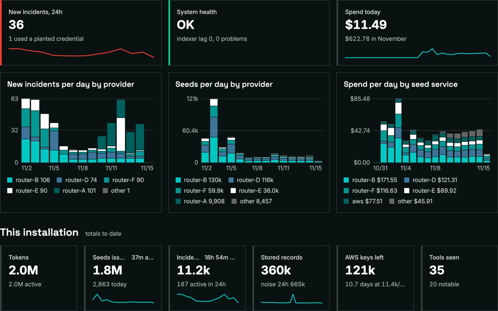

Inference telemetry usually ends with the response. HD Moore’s investigation at Dragos follows another timeline: where does information from a request surface hours, days or months later? Researchers sent nearly two million prompts with unique markers to AI services. Information introduced in a single inference call subsequently produced observable activity on other systems.

## Linking a later event to an earlier request

Each test request carried distinct markers associated with its model, route and privacy setting. A private link opened days later could therefore be traced to a completed call. Use of a test credential provided a different signal from fetching a link. A match identifies the originating request. Establishing which intermediary disclosed it requires additional evidence.

<a class="note-image-link" href="/assets/images/tech/dragos-prompt-canaries/console.png" target="_blank" rel="noopener" aria-label="Dragos console showing daily observed incidents, seeds issued and spending in separate panels">View original ↗</a>

The middle row displays incidents, seeds and spend by day. Sampling volume varies substantially, and an event today can come from a request sent weeks ago. Dividing the first two bars for one date would give a misleading leak rate.

## Holding the model constant and changing the seller

The researchers describe two prompts sent through one seller. About a day and a half later, both private links were opened. Control requests to the same model through a different seller produced no corresponding activity. The report also explains that ordinary platform logging gave some resellers visibility into customer inputs. An investigation limited to host compromise would miss exposure through the access intermediaries already possessed.

In a separate set of tests involving one lab’s models, private links were fetched from more than half the prompts sent between July and October, including roughly two-thirds of those marked for no data collection or ZDR. These proportions describe the tested models and routes. They cannot estimate noncompliance across the market, and a link fetch alone cannot establish the reader’s identity or purpose.

## Separating exposure, discovery and attribution

The researchers classified incidents involving at least three hosting providers as breaches and say the providers were unaware before notification. Another marked link from a ZDR request surfaced in a company chat 24 days later. In its disclosure the team had shared only the first eight characters, yet the full link was subsequently opened. That detail strengthens the inference of retention beyond what a timestamp alone could show.

The operational value lies in how the evidence narrows the explanation. A marker identifies a request, comparison across routes isolates differences, and a provider investigation can account for what happened internally. A quiet marker means only that recognizable subsequent use was not observed. Passive reading, unsampled routes and processors that never touch the marker can remain invisible.

HD Moore · 2026-11-19 · [Three breaches, endless leaks: Your AI supply chain needs canaries](https://www.dragos.com/blog/ai-supply-chain-security-canary-tokens)
