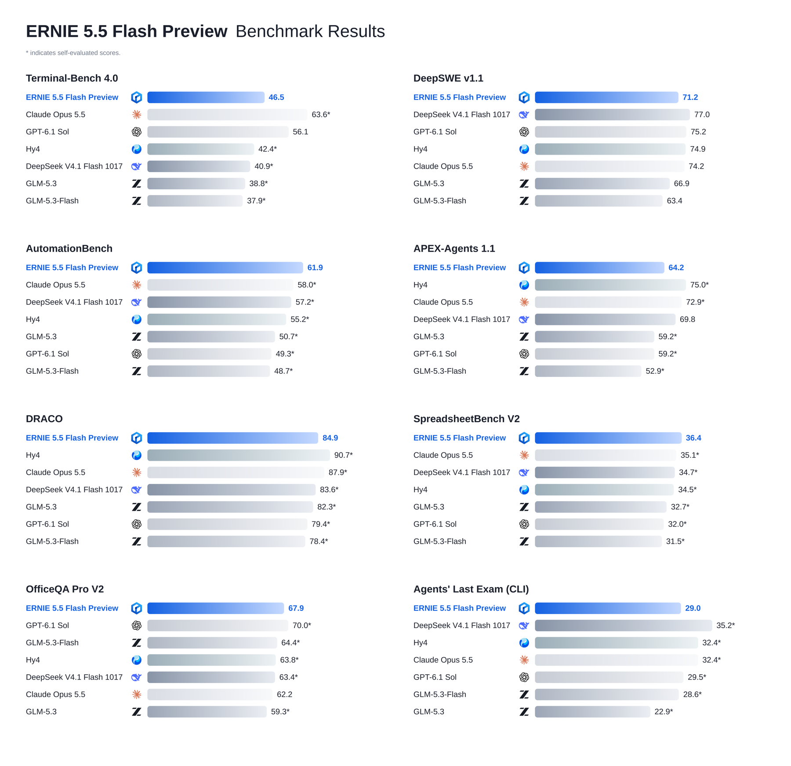

A working demo establishes that a task was completed once. It says much less about the next attempt. Two parts of the ERNIE 5.5 Flash Preview release help answer different questions: the benchmark conditions in its model card and the engineering environment that provides feedback to a text-only model.

Baidu ERNIE · Source date 2026-11-11 · [Introducing ERNIE 5.5 Flash Preview](https://ernie.baidu.com/release/ernie-5-5-flash-preview/)

## Identifying the checkpoint and operating mode

This is the first post-trained checkpoint built on ERNIE 5.5 Flash Base, an intermediate point in continuing post-training. It has 280B total and 14B active parameters per token and supports 1,048,576 context tokens. Input and output are text. The model card lists a switchable thinking mode with low, medium and high effort, defaulting to high when enabled. Recording only the model name leaves both effort and weight precision open in a repeat evaluation. The card specifies Apache 2.0 for Preview weights and a separate license for Base.

<a class="note-image-link" href="/assets/images/tech/ernie-5-5-flash-preview-release/ernie-5-5-flash-preview-release.png" target="_blank" rel="noopener" aria-label="View original image">View original image ↗</a>

*Each task has its own scoring rule. Compare bars within the same benchmark.*

## Giving a text-only agent actionable feedback

One reported Unreal Engine 5.8 coding task ran for eleven hours. The model implemented the game in C++ and translated playtest observations about wall distance, collision timing and camera position into measurable code tests. The growing test suite supported successive corrections. A text-only model cannot directly inspect the screen, so playtest feedback, model-authored checks and visual output are separate pieces of evidence. The release also identifies external assets used for the scene and character.

In another set of games, rules were separated from rendering and run as deterministic simulations. Bot playthroughs, state-space search and level replays checked whether levels could be cleared. This makes project generation and the existence of a playable route separately testable. The showcased projects are selected examples. The release gives neither repeated-project failure rates nor the cost of human playtest feedback.

## Putting demonstrations alongside benchmark results

The card reports 46.5 on Terminal-Bench 4.0 and 71.2 on DeepSWE v1.1. Its ProgramBench figure of 29.5 uses the Almost Solved criterion. Different tasks and scoring rules prevent a direct ranking of engineering difficulty from those numbers. The project descriptions document artifacts and execution choices for long tasks involving tools and tests. The benchmarks measure performance across task sets. Neither supplies a latency distribution or cost per success for an eleven-hour project.

[Official model card and evaluation table](https://huggingface.co/baidu/ERNIE-5.5-Flash-Preview)
