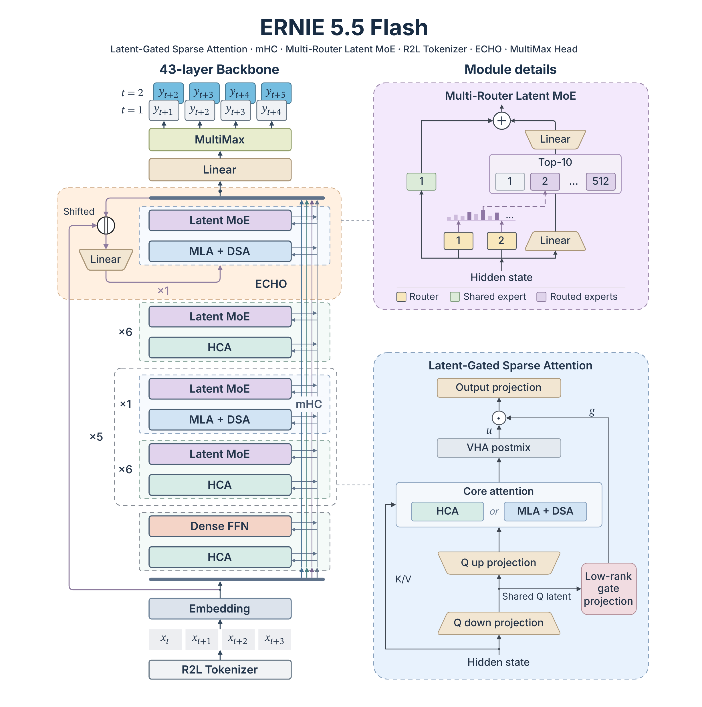

ERNIE-5.5-Flash-Base combines hybrid attention, latent-space MoE, and a reusable drafting layer, with SGLang deployment recipes. The first distinction is behavioral: the released checkpoint ends pretraining. It is not already a chat-, reasoning-, or tool-trained agent model.

Original: [ERNIE-5.5-Flash](https://docs.sglang.io/cookbook/autoregressive/Baidu/ERNIE-5.5-Flash) · SGLang deployment documentation; architecture and release date from [ERNIE 5.5 Flash Base](https://ernie.baidu.com/release/ernie-5-5-flash-base/) · Baidu ERNIE · 2026-11-05

## Total capacity, activated compute, and context differ

The model has 280B total and 14B activated parameters per token, pretrained on 33.5T tokens. Total parameters include input embeddings and the output head; activated parameters include the output head but exclude embedding lookup. Both exclude 0.36B ECHO parameters. The forty-three-layer backbone begins with a dense FFN and uses MoE thereafter. Activating 14B parameters does not reduce weight-storage requirements to that size.

Pretraining context grows to 128K, while configuration supports fine-tuning and inference to 1M. These describe different stages: accepting a 1M request does not establish pretraining at that length or precise long-distance retrieval quality. Deployment also needs KV and prefill activation memory beyond weights.

<a class="note-image-link" href="/assets/images/tech/ernie-5-5-flash-sglang/architecture.png" target="_blank" rel="noopener" aria-label="The backbone alternates compressed and full-history-access layers; details show latent MoE and attention gating, with ECHO reusing the final layer. · View original image ↗">View original image ↗</a>

*The backbone alternates compressed and full-history-access layers; details show latent MoE and attention gating, with ECHO reusing the final layer.*

## Compress most history while retaining selected token-level access

Thirty-seven HCA layers compress every 128 tokens into one cache entry and retain a recent 128-token window. Six MLA layers retain token-level history and use a DSA indexer to select top-k positions for core attention. Distant context is therefore represented coarsely in most layers, with selected fine-grained access in a minority.

Cheaper HCA layers use 512-dimensional heads; more expensive MLA layers use 256 dimensions. Attention adds a gate derived from the low-rank query latent and low-rank cross-head VHA mixing. The claimed 75% gate-projection weight reduction is a local module comparison, not a 75% reduction of the whole model. Similarly, a bounded DSA core-attention selection does not make indexing, caching, or total inference independent of context length.

MoE experts operate in a 2048-dimensional latent space instead of the 4096-dimensional hidden width, reducing dispatch/combine tensors. Each MoE layer selects ten of 512 routed experts and includes one shared expert. Multiple independently initialized sigmoid routers jointly score experts to reduce self-reinforcing selection errors. This concerns routing representation and training, unlike vExpert's runtime placement of hot expert copies.

## ECHO reuses the final layer, but acceptance is not speed

ECHO trains the backbone's own final layer to predict future tokens, directing future-token loss into backbone parameters and reusing that layer for speculative drafts. It trains one future step but can draft recursively. SGLang enables it through EAGLE or NEXTN; the attention backend currently supports chain drafts only, requiring top-k one.

On GSM8K at batch one with greedy decoding, one, two, and three draft steps yield mean accepted lengths of 1.93, 2.28, and 2.36, with unchanged accuracy. The third step adds little acceptance. These are not throughput multipliers because drafting and verification also cost time. Documentation recommends two-step ECHO for low latency and attention DP without drafting for high throughput, illustrating the difference between single-request and concurrent optimization.

Base checkpoints do not include a DSpark draft. The forthcoming post-trained ERNIE-5.5-Flash plans chat, reasoning, tool calling, and DSpark. Parser examples shown ahead of release do not make those capabilities part of the available Base checkpoint.

## Verified recipes and operational limits

FP8 weights occupy roughly 280 GB and BF16 roughly 560 GB. Minimum FP8 recipes use two 288 GB B300/GB300 GPUs, four B200/GB200 GPUs, or eight H100s. The team verifies these single-node FP8 configurations and B300 BF16; other BF16 recipes are capacity-derived and unverified. That evidence distinction matters.

The model selects the ernie55 backend, page size 256, and FP8 KV defaults. Attention TP must divide eight. DeepEP expert parallelism needs at least four ranks, and CUDA Graph batch size multiplied by per-request speculative tokens must fit the rank dispatch limit. For 1M context, concurrency must fall: the documentation recommends single-digit requests on two B300s and tens of GB of additional prefill activation space. The default 256-request setting is unsuitable there.

HiCache can extend shared prefixes into host memory and optionally Mooncake storage. Prefill/decode disaggregation has a concrete restriction: parallel sampling with n>1 currently hangs because subrequests share a bootstrap room; n=1 requests are required. These details carry more deployment information than a Day-0 support label.

## Assess the efficiency combination separately

The release provides training and architectural ablations; serving documentation provides acceptance lengths and a verified hardware matrix. Neither proves a fixed business-workload speedup. The research opportunity is a common pretraining checkpoint combining sparse activation, long-context state, and drafting for controlled follow-on training. Engineering evaluation must separately test Base adaptation, long-context quality, memory headroom, and latency at target concurrency, rather than treating fewer active parameters, longer supported context, and faster service as one result.
