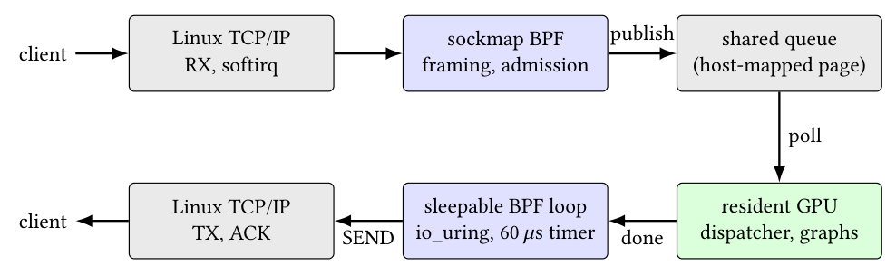

When small-model inference and short GPU operations become fast, receiving requests, queueing work and sending replies can expose substantial host overhead. bpf-gpu-server gives that request loop to eBPF, io_uring and a resident GPU dispatcher. Its useful negative finding is that moving the loop into the kernel produced no discernible CPU or tail-latency benefit against a comparator sharing the GPU executor. Capacity, TCP behavior and connection reclamation changed the results much more.

**yunwei37 (the accompanying report is credited to Yusheng Zheng) · Official article published 2026-10-17**  
Original: [Does moving a GPU server's request loop into the kernel save CPU?](https://eunomia.dev/blog/2026/10/17/bpf-gpu-server/) · Accompanying report: [Does Kernel-Owned Networking Make GPU Serving Cheaper? Lessons from an eBPF-Driven GPU Server](https://eunomia.dev/_content-assets/docs/papers/bpf-gpu-server.pdf)

## How requests avoid a userspace loop

At startup, a userspace process creates the listening socket, captures CUDA graphs, maps CPU/GPU shared memory, attaches BPF programs and launches the resident GPU dispatcher. It retains ownership of allocations and handles shutdown, but stops handling individual requests. This removes userspace request handling, not all CPU work.

Requests still traverse ordinary Linux TCP/IP. After TCP reassembly, sockmap BPF frames and validates requests, admits them and publishes work to a shared queue. The GPU dispatcher reads that queue, launches the corresponding graph and publishes outputs. A sleepable BPF loop observes completions, sends responses through io_uring, preserves reply order and reclaims connections. While work is outstanding, it waits for completion events or a 60-microsecond timer.

<a class="note-image-link" href="/assets/images/tech/eunomia-bpf-gpu-server/architecture.png" target="_blank" rel="noopener" aria-label="Kernel request path and resident GPU executor · View original image ↗">View original image ↗</a>

*Follow the upper arrows toward the GPU, then the lower arrows back to the client. The blue components take over the request loop, while the gray TCP receive and send components remain. Their continued presence helps explain the remaining cost.*

The same transport executes unchanged cuBLAS/cuFFT graphs and replays upstream vLLM or Hugging Face prefill/decode graphs for Qwen2.5-0.5B and SmolLM2-135M. The reported prototype uses Linux 7.3-rc3 without a custom kernel module; this is a version requirement, not a claim of compatibility with arbitrary deployed kernels.

## Change only where the request loop runs

The main comparator is a tuned C++ nonblocking epoll server sharing the queue, GPU dispatcher and computation graphs. This isolates transport placement. Official vLLM 0.31 provides an external reference, but differs in API, scheduling and KV management. Its overall difference cannot be attributed to eBPF.

The test server has an Intel Core Ultra 9 285K, 24 logical CPUs and an RTX 5090, with load generated by another host. Each condition uses five paired process blocks with counterbalanced ordering, and outputs are checked by exact replay. CPU accounting separates the service process group from whole-host counters. The former includes user and system time and io-wq workers, but excludes softirq work charged elsewhere. These scopes must not be added together.

Qwen2.5-0.5B runs in FP16 with short prompts and 64 output tokens, at 192 requests/s for 60 seconds. With 16 GPU slots, both transports deliver 11,645 tokens/s. Completion P99 is 3,304 ms for the kernel path and 3,314 ms for epoll, with the difference's confidence interval crossing zero. Process-group CPU is respectively 0.835 and 0.812 ms per request, also without a discernible advantage. These figures do not support describing CPU differences as below 2% for every workload.

The small-operation experiment uses 280-byte requests, 256-byte responses and 128 persistent connections, sweeping computation size, load and CPU affinity before confirming three selected points with fresh seeds. All 3.12 million requests complete without observed failure, but none of the confirmation points meets the predefined CPU/tail improvement criterion. On one logical CPU, kernel-path P99 is approximately 2.6 times the comparator's.

## Lower user time moves the cost elsewhere

At 1,000 FFT requests/s, user time falls from 11.3 to 2.8 microseconds per request, while system time rises from 26.2 to 35.2 microseconds. High-resolution total CPU is 37.56 versus 37.96 microseconds, a difference of about 1.1%; the corresponding GEMM difference is about 1.9%. The component split uses coarser accounting, so rounded components should not be treated as exact totals.

Sockmap runs after TCP reassembly. Both paths therefore pay for interrupts, softirqs, socket buffers, the TCP state machine and acknowledgments. GPU completion still needs a CPU execution context to inspect queue state and submit sends, while BPF map operations and io_uring coordination add work. epoll can retrieve multiple ready sockets together; the kernel path still handles program invocations and queue entries per request. Eliminating a boundary crossing does not eliminate the dominant work.

The report also describes an earlier result that failed to persist: after fixing busy polling, one kernel-path variant used less process CPU than the comparator, but that advantage did not reproduce in the final integrated path or appear in whole-host CPU. This distinction strengthens the negative finding. A local improvement during development and a net advantage in the final controlled comparison are different claims.

## Capacity and protocol details changed the tail

With 16 slots, offered traffic exceeded the executor's delivery capacity and the queue kept growing. On the epoll path, time to first token rose from roughly 235 ms in the first ten seconds to 3,003 ms in the last ten, while generation remained around 86 ms. In a separate native-transport experiment, increasing capacity to 32 slots reduced completion P99 from 3,337 to 217 ms; vLLM measured 406 ms at comparable throughput. Costs included additional graph/KV memory and about 0.34 J more device energy per request than vLLM. This supports a capacity improvement, not a kernel-networking speedup.

Another delay came from Nagle's algorithm interacting with delayed acknowledgments: a four-byte write left another 36 bytes waiting roughly 41 ms for an ACK. Setting `TCP_NODELAY` reduced token-gap P99 from 40.5 to 2.3 ms and raised throughput from 8,842 to 11,260 tokens/s. Connection lifetime also caused actual failures. Completed connections waited for an unrelated global queue to drain before reclamation, leaving 2,947 sockets in `CLOSE_WAIT` and exhausting the socket map. Reclaiming each connection independently reduced the 4,157 timeouts in that experiment to zero.

## What this contributes to inference optimization

The distinctive contribution is a shared-executor comparison that separates benefits from GPU-resident scheduling from benefits of kernel-owned networking. Lower process CPU relative to vLLM also reflects protocol differences, including returning token IDs rather than JSON text. Kernel transport itself shows no net advantage on this testbed. For Ops4LLM, capacity shortages, small TCP writes and connection leaks can produce similar latency symptoms; distinguishing these mechanisms is more informative than comparing a single throughput number.

The evidence covers one server, one remote client, small models, fixed-shape requests, a binary protocol and no TLS. Whole-host counters include observation overhead, and five process pairs do not offer strong multiple-comparison guarantees. A NIC-to-GPU path bypassing the host stack or different hardware could change the outcome. The most useful parts of the report are the controlled design, CPU attribution and before/after fixes, rather than a generalized claim that eBPF cannot accelerate serving.
