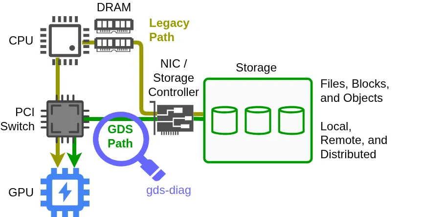

A GPU being able to access storage does not establish that an application uses the intended GPUDirect Storage path. Platform support, CUDA and driver configuration, containers, mount points, and configuration overrides all matter. NVIDIA’s gds-diag organizes these questions into independent diagnostic subcommands, with an optional agent skill providing a natural-language entry point.

Original: [How to Check and Configure NVIDIA GPUDirect Storage for Your Platform](https://developer.nvidia.com/blog/how-to-check-and-configure-nvidia-gpudirect-storage-for-your-platform/) · Phil Carns · NVIDIA · 2026-10-30.

## The addition is a diagnostic layer

GDS provides a GPU–storage data path that reduces traditional CPU and host-memory staging overhead. The new contribution here is an environment-assessment tool for blockers, configuration risks, and optimization opportunities. The article introduces neither a new transfer algorithm nor a universal training or inference speedup.

<a class="note-image-link" href="/assets/images/tech/gds-diagnostics/overview.webp" target="_blank" rel="noopener" aria-label="Traditional CPU/DRAM staging compared with the GDS path · View original image ↗">View original image ↗</a>

*The green path connects storage and GPU; the magnifier represents environmental diagnostics. Installing the tool alone does not establish that an application actually uses this path.*

The tool is a single Python script requiring Linux and Python 3.8 or later. The article lists a datacenter-class NVIDIA GPU and CUDA Toolkit 12.2 or later for GDS itself. Running diagnostics before the target environment is complete is useful for pre-deployment checks; tool dependencies and GDS dependencies are distinct.

## Select evidence by deployment stage

`all` selects checks for a specified path across bare-metal, VM, and container environments. Before installation, `pre-install` checks GPU/CUDA conditions and `support-matrix` explains storage support. After installation, `post-install` finds blockers and `config-audit` inspects configuration and environment-variable modifiers. `container-check` and `mount-check` examine the container or directory boundary more closely.

This avoids assuming that a valid host installation makes every container mount usable. The support matrix has static and live modes: general compatibility versus the currently configured system. Conditional support still requires reading the associated caveats.

Findings contain status, explanation, and mitigation. FAIL identifies a hard blocker, WARN a potential blocker, and INFO notable information. PASS appears only with verbose output. JSON reports support archiving or integration into other workflows. These findings assess the environment; they do not certify application throughput or end-to-end correctness.

The configuration example detects a misspelled entry in a candidate file and checks it again after correction. Auditing without a supplied file considers effective configuration, including environment modifiers. A correct-looking file is therefore not necessarily the configuration the process actually uses.

## Agents interpret without replacing deterministic checks

The optional skill selects subcommands, coordinates multi-step diagnosis, and interprets results using system context. The CLI still performs the deterministic checks. In the container example, the agent inspects a launch script, chooses the diagnostic tool, and proposes and verifies a change.

The action boundary matters: gds-diag itself does not apply mitigations or modify the system, but a coding agent invoking it may perform requested remediation. Local policy and permissions determine confirmation requirements. Read-only checks do not make the entire agent workflow read-only.

For AIOps, the transferable pattern is composable domain checks beneath an agent that handles intent, context, and follow-up investigation, with structured findings retained for comparison. The article reports neither diagnostic coverage and miss rates nor measured performance improvements. Read the finding format and configuration-audit example before deciding which evidence interfaces your existing operations workflow lacks.
