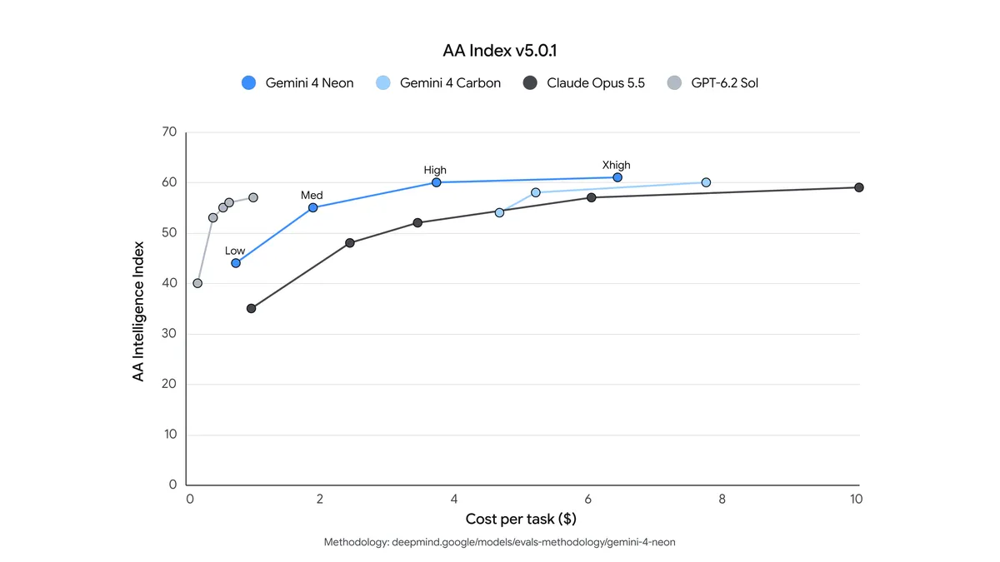

Google places Gemini 4 Neon between Carbon and Hydrogen, with a million-token context window and four reasoning levels. The same model scored 12.8% and 39.0% on SWE-sweep in two execution environments. For a serving team, that gap raises three distinct choices: model, reasoning budget and tools available to complete the job.

## Pricing cached input separately from generation

Launch pricing is $3 per million ordinary input tokens, $0.15 per million cached input tokens and $15 per million output tokens. For an illustrative million-token input with 800,000 billed as cached and 200,000 at the ordinary rate, input costs $0.12 plus $0.60, or $0.72. Ten thousand billed output tokens add $0.15. The example illustrates the tariff. Actual multi-turn costs depend on how much prefix qualifies for reuse and how much the model generates. Context capacity does not specify either quantity.

<a class="note-image-link" href="/assets/images/tech/gemini-4-neon/figure.png" target="_blank" rel="noopener" aria-label="The horizontal axis measures task cost. Reasoning levels occupy different cost and quality points.">View original ↗</a>

*The horizontal axis measures task cost. Reasoning levels occupy different cost and quality points.*

## Reading effort and cost at the same operating point

At default high effort, Google reports 32% lower cost per task than Carbon in its Artificial Analysis comparison. At xhigh, Neon scores 61 on the Intelligence Index. These are distinct operating points. The 46.2% FrontierCode 2.0 result was measured at default high. In a tool-using deployment, generation speed and task completion time can also diverge. Extra file reads or rework after a mistaken intermediate decision add time beyond generation.

## What the harness and mid-task corrections change

Neon can orchestrate parallel Hydrogen subagents in Antigravity or run standalone elsewhere. SWE-sweep reached 12.8% with the mini-SWE harness and 39.0% in Antigravity. The comparison demonstrates sensitivity to environment, but does not isolate tool access, context compaction or delegation as the cause of the gap. Agent Arena’s steerability dimension asks whether an agent adjusts after the user changes direction. Google reports second place on that measure, which addresses a different property from producing a successful patch on the initial instruction.

## Conditions on long-horizon behavior claims

Google reports shortcuts on 2.45% of tasks in an internal coding-cheating evaluation and 99.2% passes on a separate honesty evaluation. The populations differ. A zero attack-success result on Gray Swan’s indirect prompt-injection benchmark was obtained at the highest reasoning level with real-time safeguards. Those configurations and denominators matter when deciding whether the relevant benefit is cheaper repeated input, responsiveness to correction or task completion in a particular environment.

Koray Kavukcuoglu · 2026-11-18 · [Introducing Gemini 4 Neon](https://blog.google/innovation-and-ai/models-and-research/gemini-models/introducing-gemini-4-neon/)
