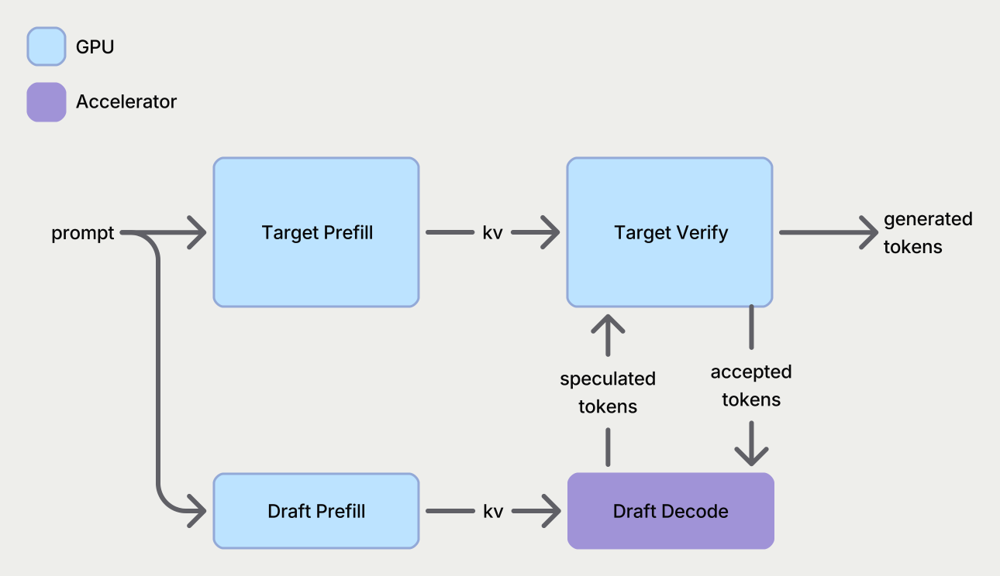

Phillip Kuznetsov, Omid Azizi (Gimlet Labs) · Originally published 2026-11-10 · [Gimlet Blog: "Disaggregating the Disaggregated Model"](https://gimletlabs.ai/blog/draft-model-disaggregation) · Prior Context: [Moving the Draft Model onto a Faster Accelerator (Corsair)](https://gimletlabs.ai/blog/low-latency-spec-decode-corsair) · [SRAM-Centric Chips](https://gimletlabs.ai/blog/sram-centric-chips)

Most speculative-decoding discussions optimize the target verifier or raise draft acceptance rates. Building on its earlier work moving the entire draft model onto a faster accelerator ([prior post](https://gimletlabs.ai/blog/low-latency-spec-decode-corsair)), Gimlet Labs poses a sharper systems-placement question grounded in Gimlet Cloud deployments: **when specialized high-bandwidth accelerators deliver fast draft decode as expected, yet exhibit slow or energy-hungry draft prefill, why keep both draft phases tied to the same chip?** Gimlet's answer is to disaggregate the disaggregated drafter itself—retaining **draft prefill on GPUs** alongside target prefill and target verification, while offloading only **draft decode** to the fast accelerator.

> **Evidence & Modeling Scope**: Every latency, interactivity, and energy curve in Gimlet's post comes from an **analytical utilization-optimizing model and single-parameter scenario perturbations** (`ISL = 4,096`, `OSL = 512`, zero prefix caching, fixed batching, fractional device ratios, zero prefill–decode interference, and zero modeled KV-transfer latency or energy)—**not controlled end-to-end production cluster benchmarks**. Although the site header links an announcement bringing Cerebras to Gimlet Cloud ([Cerebras announcement](https://gimletlabs.ai/blog/cerebras-announcement)), the authors state explicitly that GPU numbers are inspired by real workloads while "Accelerator" parameters reflect generic purpose-built inference hardware tradeoffs rather than a product-specific energy ranking of Cerebras or any vendor. Note also that the introductory figure uses a `5 ms → 1 ms` draft-latency sweep (`D*: 9 → 15`), whereas the full system model uses `8 ms → 1.5 ms` (`D*: 8 → 15`), and the slow-prefill (`150 ms`) and high-energy-prefill (`100,000 mJ`) scenarios perturb one parameter at a time.

## Why Faster Drafting Shifts Optimal Depth—and Where GPUs Diverge from SRAM Accelerators

In linear speculative decoding, a small, fast draft model sequentially proposes `D` candidate tokens that the larger target model verifies in one parallel forward pass. Gimlet's Figure 1 illustrates the basic leverage: in the time the target model would spend decoding two tokens (`"capital of"`), speculative decoding emits five tokens (`"capital of France is Paris"`).

Choosing how far ahead to speculate—the **draft length `D`**—is an optimization problem rather than "longer is always better." Extending `D` raises the potential yield per target verification pass, but acceptance probability decays and wasted draft compute grows. In the appendix (Figure 13), Gimlet models expected accepted draft length as a **saturating exponential** to capture these diminishing returns. Because extra proposals eventually produce little additional yield while consuming draft steps, faster drafting shifts the optimum outward: in the introductory conceptual model (Figure 2), making draft generation 5x faster—from **`5 ms` down to `1 ms` per token**—lifts interactivity at every depth and moves peak interactivity from **9 tokens to 15 tokens**.

The underlying hardware asymmetry comes straight from the roofline curve. Citing **Wang et al.** ([`arXiv:2512.01644v1`](https://arxiv.org/pdf/2512.01644v1), Figure 3) alongside Gimlet's earlier post on [SRAM-centric chips](https://gimletlabs.ai/blog/sram-centric-chips), the authors distinguish two compute/memory regimes: **prefill** evaluates many prompt tokens in parallel and saturates GPU compute, whereas small-batch **decode** becomes **memory-bound** on GPUs because every step must stream model weights into compute cores. Moreover, arithmetic intensity varies not only between prefill and decode, but also across distinct operations within each phase.

SRAM-centric and similar purpose-built inference accelerators target that memory-bound decode bottleneck by providing far higher weight-read bandwidth. Yet high bandwidth typically trades off against per-chip memory capacity: holding the same model demands **more chips**, raising aggregate power draw and reducing **system throughput per kW**. Offloading memory-bound drafting to such accelerators therefore creates a classic **interactivity versus energy-efficiency frontier**.

<figure class="note-figure">
  <a class="note-image-link" href="/assets/images/tech/gimlet-draft-model-disaggregation/gimlet-draft-disagg-topology-en.svg" target="_blank" rel="noopener" aria-label="Click to zoom in on drafter disaggregation hardware asymmetry and three-stage topology diagram">
    
    Click to zoom ↗
  </a>
  <figcaption>Assistant diagram (not an original figure): Synthesizing Gimlet Labs' (2026-11-10) roofline hardware split, three-stage placement evolution, and out-of-model system boundaries.</figcaption>
</figure>

## Inside the Baseline Model: The Interactivity–Efficiency Frontier and Verification Knee

To ground those tradeoffs numerically without tying the analysis to a single vendor datasheet, Gimlet configures a fixed-workload utilization model (`ISL = 4,096`, `OSL = 512`, no cached prefix) with fractional device scaling, evaluating what happens when the entire draft model moves from GPU to the fast accelerator (Figures 4–8).

| Phase & Modeled Metric | GPU Baseline Parameter | Accelerator Parameter | Mechanism & Formula Notes |
| :--- | :--- | :--- | :--- |
| **Target Prefill latency / energy** | `150 ms` · `250,000 mJ/prompt` (`~60 mJ/tok`) | — (stays on GPU) | Compute-saturated parallel pass; `250 J` dominates aggregate forward energy |
| **Target Verify latency** | `max(40, 2.5 × (D + 1)) ms` | — (stays on GPU) | Memory-bound flat `40 ms` floor for `D ≤ 15`; linear compute scaling past `D = 15` |
| **Target Verify energy** | `720 + 40 × (D + 1) mJ/verify` | — (stays on GPU) | Fixed `720 mJ` per verification step plus `40 mJ` per candidate/bonus position |
| **Draft Prefill latency / energy** | `20 ms` · `20,000 mJ/prompt` (`~5 mJ/tok`) | `10 ms` · `40,000 mJ/prompt` (`~10 mJ/tok`) | Faster yet 2x costlier in baseline; stressed to `150 ms` & `100,000 mJ` in Scenarios A/B |
| **Draft Decode latency / energy** | `8 ms/tok` · `30 mJ/tok` | `1.5 ms/tok` · `150 mJ/tok` | `5.33x` faster decode step at `5x` higher per-draft-token energy cost |
| **Peak interactivity & optimal D** | `~61 output tok/s/req` (`D* = 8`) | `~137 output tok/s/req` (`D* = 15`, `2.25x`) | Changing only the small draft model more than doubles peak single-request speed |
| **Energy efficiency (`D = 10` share)** | Higher `throughput/kW`; draft decode `~5.8%` | Lower `throughput/kW`; draft decode `~22.4%` | Real prefix caching shrinks target prefill, magnifying draft decode's relative energy share |

Evaluating Gimlet's stated verification formula (assistant arithmetic check directly on the authors' published equation) reveals why the optimum shifts specifically to **`D = 15`**. In `max(40, 2.5 × (D + 1)) ms`, the compute term `2.5 × (D + 1)` reaches `2.5 × 16 = 40.0 ms` at exact `D = 15`. Throughout `D ≤ 15`, **target verification remains completely memory-bound on its 40 ms floor—meaning checking extra draft tokens costs zero marginal verification wall-clock time**. With an `8 ms/tok` GPU drafter, sequential draft steps are expensive enough that interactivity peaks early at `D = 8`. Dropping draft decode to `1.5 ms/tok` makes waiting for extra draft proposals cheap enough to push optimal depth all the way to the `D = 15` verification knee, lifting peak interactivity from **~61 to 137 output tokens/s/request (2.25×)**. Beyond `D = 15`, both saturating acceptance returns and linear `2.5 × (D + 1)` verification scaling penalize deeper speculation.

That `2.25×` speed boost carries an explicit energy penalty. Because modeled accelerator drafting consumes `150 mJ/token` versus `30 mJ/token` on GPU, at draft length `10` **draft decode grows from roughly 5.8% of total forward energy on GPU to 22.4% on the accelerator**, lowering overall `throughput/kW` (Figures 6–8). Furthermore, in real multi-turn or prefix-cached traffic where the `250 J` target-prefill base drops sharply, a `5×` per-draft-token decode energy penalty would represent an even larger share of total cluster power.

## Disaggregating the Drafter in Gimlet Cloud: Rescuing TTFT and Efficiency Without Hurting Interactivity

When Gimlet moved from modeling to real deployments in Gimlet Cloud, field measurements diverged from uniform accelerator assumptions in one specific stage: **while draft decode consistently matched modeled speed across accelerators, draft prefill varied widely**. On one accelerator, slow draft prefill raised overall system **TTFT** above a GPU-drafter baseline; on another, expensive draft prefill inflated power consumption and depressed **`throughput/kW`**.

Those production observations motivated the split-drafter topology illustrated in Gimlet's Figure 9 (preserved below as `figure.png`): the incoming prompt fans out to both **Target Prefill and Draft Prefill on GPUs**; Target KV stays on GPU for **Target Verify**, while **Draft KV transfers across devices to the accelerator**, which runs **Draft Decode** and exchanges only speculated and accepted tokens with GPU verification.

<figure class="note-figure">
  <a class="note-image-link" href="/assets/images/tech/gimlet-draft-model-disaggregation/figure.png" target="_blank" rel="noopener" aria-label="Click to zoom on Gimlet Labs original Figure 9 split-drafter architecture">
    
    Click to zoom ↗
  </a>
  <figcaption>Preserved primary-source diagram (Gimlet Labs Figure 9): Blue stages execute on GPUs (target prefill, target verify, and draft prefill); the purple stage executes on the fast accelerator (draft decode only), separated by a one-time draft KV transfer.</figcaption>
</figure>

Under baseline parameters, splitting the drafter produces **an interactivity curve that perfectly overlaps the unsplit accelerator curve** (Figure 10) and shows no clear baseline efficiency gain or penalty—because steady-state token generation speed depends on the `Draft Decode ↔ Target Verify` loop, not prefill placement. The payoff emerges cleanly when Gimlet perturbs the baseline model to mirror the two field failure modes independently:

- **Scenario A — Slow-Prefill Accelerator (TTFT rescue, Figure 11)**: Setting accelerator draft prefill to **`150 ms`** (`15×` baseline `10 ms`, all other parameters held fixed) pushes unsplit TTFT at `D = 15` to **`212.5 ms`**. Moving draft prefill back to the `20 ms` GPU cuts modeled TTFT to **`190 ms`** (`-22.5 ms`), matching the GPU-only baseline while retaining full `137 tok/s/req` accelerator interactivity. Checking the critical path against the published parameters confirms the mechanism: on GPU, `20 ms` draft prefill plus the initial `15 × 1.5 = 22.5 ms` draft decode totals `42.5 ms`, which hides completely inside the parallel `150 ms` target prefill so target verify (`40 ms`) begins right at `150 ms` (`150 + 40 = 190 ms`); when accelerator draft prefill stretches to `150 ms`, the first `22.5 ms` draft decode burst lands serially after `150 ms` (`150 + 22.5 + 40 = 212.5 ms`).
- **Scenario B — High-Energy-Prefill Accelerator (`throughput/kW` rescue, Figure 12)**: Raising accelerator draft prefill energy from baseline `40,000 mJ` to **`100,000 mJ/prompt`** (`2.5×`, vs. `20,000 mJ` on GPU, all else fixed), splitting draft prefill back to GPU raises peak system `throughput/kW` by **approximately 17%** (**`17.7%`** per Figure 12's image alt text), again with zero interactivity loss.

Beyond immediate TTFT and power relief, Gimlet highlights an engineering-velocity advantage: teams can leverage mature GPU prefill optimizations immediately while focusing accelerator kernel work exclusively on fast decode—and retain the option to migrate draft prefill back if a future accelerator matches or beats GPU prefill.

<figure class="note-figure">
  <a class="note-image-link" href="/assets/images/tech/gimlet-draft-model-disaggregation/speculative-disagg-tradeoffs-en.svg" target="_blank" rel="noopener" aria-label="Click to zoom in on Gimlet Labs modeled tradeoffs and scenario sensitivity four-panel diagram">
    
    Click to zoom ↗
  </a>
  <figcaption>Assistant diagram (not an original figure): Synthesizing Gimlet Labs' (2026-11-10) Figs. 5–12 and appendix model formulas while isolating Scenarios A and B as single-parameter perturbations.</figcaption>
</figure>

## Costs Outside the Model: KV Transfer Tails, Fractional Rounding, and Non-Linear Extensions

Extracting durable engineering judgment from an analytical model requires reading the appendix as closely as the headline charts. Gimlet documents **seven explicit modeling simplifications** whose unmodeled costs determine whether split drafting keeps its gains in production:

| Modeling Assumption (Gimlet Text & Appendix) | Author-Disclosed Pitfall & Directional Risk | Production Verification Requirement (Derived from Model Scope) |
| :--- | :--- | :--- |
| **KV transfers incur zero latency & zero energy** | Transfers overlap mostly with prefill compute, yet **up to ~10% of prefill latency can remain unhidden** (hitting TTFT, not interactivity); energy is estimated around **`1 J`** (`~0.4%` of `250 J` target prefill) | Shipping only **Draft KV** keeps energy overhead negligible, but interconnect congestion must keep unhidden transfer delay smaller than the TTFT saved by avoiding slow accelerator prefill |
| **Fractional device counts** (e.g., `1.8` decode workers) | Removes quantization math; authors warn this **"looks really bad" at small deployments**, only smoothing out at large cluster scale | Splitting into three pools (GPU target + GPU draft prefill + accelerator draft decode) adds an extra rounding dimension where small-cluster stranded capacity can erase a `~17%` efficiency gain |
| **Fixed `ISL = 4,096`, `OSL = 512`, 0% prefix cache** | Live multi-turn traces vary sequence lengths and exhibit heavy prefix cache reuse | Prefix caching compresses target prefill's `150 ms` / `250 J` base—reducing the slack available to hide GPU draft prefill plus initial draft decode, and enlarging decode's share of total energy |
| **Fixed batch sizes & zero P/D interference** | Dynamic batching strongly alters latency/efficiency; co-located prefill and verify contend on GPU | Heavy target/draft prefills sharing GPUs with target verification still require scheduling/chunking isolation so `40 ms` verification steps do not jitter |
| **Fixed stage costs & saturating exponential acceptance** | Real acceptance depth varies across code, reasoning, chat, and temperature settings | Optimal depth `D*` must track task acceptance dynamically; overshooting past `D = 15` triggers linear `2.5 × (D + 1)` verification slowdowns without proportional yield |
| **Scoped strictly to linear speculative decoding** | Tree methods ([SpecInfer](https://arxiv.org/abs/2305.09781)) and hidden-state drafters ([DSpark](https://arxiv.org/abs/2607.05147)) alter communication patterns | Tree drafters can convert faster decoding into wider or deeper candidate trees, whereas **DSpark must transfer hidden state between target and draft**, imposing far tighter interconnect demands |

Taken together, Gimlet's modeling work and appendix caveats translate into three concrete engineering checks for heterogeneous serving teams:

1. **Keep interactivity, TTFT, and `throughput/kW` decoupled in evaluation**: Interactivity tracks the `Draft Decode + Target Verify` step loop, TTFT tracks the critical path through prefill plus any unoverlapped KV handoff, and cluster energy efficiency tracks total forward energy after integer node sizing—never extrapolate a `2.25×` interactivity gain into a cluster-wide cost speedup.
2. **Audit the overlap window before splitting**: Disaggregating draft prefill pays off when accelerator draft prefill either spills past target prefill latency (slow prefill) or dominates draft power (costly prefill), provided cross-device Draft KV transfer stays near the modeled `~1 J` energy budget and well under the TTFT savings. As prefix caching shrinks target prefill latency, that overlap window narrows and must be re-measured on real traces.
3. **Separate KV-handoff speculation from hidden-state speculation**: Linear drafting and tree verification ([SpecInfer](https://arxiv.org/abs/2305.09781)) pay a one-time Draft KV transfer per prompt and only small token-ID exchanges per verify cycle; architectures such as **[DSpark](https://arxiv.org/abs/2607.05147)** that shuttle dense hidden states between target and draft introduce an open interconnect-constraint problem that cannot be predicted from Gimlet's current model.

---

### Primary Sources & Cited Literature

- Primary engineering post: Phillip Kuznetsov, Omid Azizi, *[Disaggregating the Disaggregated Model](https://gimletlabs.ai/blog/draft-model-disaggregation)*, Gimlet Labs Blog, 2026-11-10.
- Prior Gimlet hardware & drafting posts: *[Moving the Draft Model onto a Faster Accelerator](https://gimletlabs.ai/blog/low-latency-spec-decode-corsair)*, *[SRAM-Centric Chips](https://gimletlabs.ai/blog/sram-centric-chips)*, and site announcement *[Bringing Cerebras to Gimlet Cloud](https://gimletlabs.ai/blog/cerebras-announcement)*.
- Cited academic literature: Wang et al., *[Roofline Analysis Reference (arXiv:2512.01644v1)](https://arxiv.org/pdf/2512.01644v1)* (Figure 3 source); Miao et al., *[SpecInfer: Accelerating Generative Large Language Model Serving with Tree-based Speculative Inference and Verification](https://arxiv.org/abs/2305.09781)*; *[DSpark (arXiv:2607.05147)](https://arxiv.org/abs/2607.05147)*.

> **AI-Assisted Curation & Archival Note**: Rewritten and expanded by the assistant (`authoring_source: assistant`, `translation_source: assistant`) from the frozen capture of Gimlet Labs' November 10, 2026 post, paired with the Chinese edition ([中文笔记](/tech/zh/gimlet-draft-model-disaggregation/)). Original `id`, `date: '2026-11-13'`, `permalink`, `source_url`, `source_published_at: '2026-11-10'`, `published_at`, and canonical tag `inference-serving` are preserved. The primary-source architecture diagram (`figure.png`, Figure 9) remains intact alongside two newly created `v3-blue` diagrams (`gimlet-draft-disagg-topology-en.svg`, `speculative-disagg-tradeoffs-en.svg`). All quantitative results remain strictly scoped to Gimlet's stated analytical model and single-parameter scenarios rather than vendor-specific hardware benchmarks.
