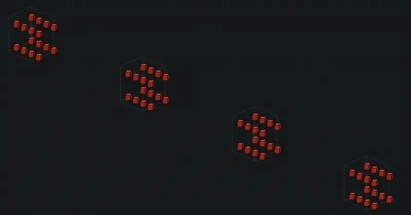

TPU jobs change topology requirements, while traditional GKE deployments often provision a fixed node pool per slice. Changing shape requires rebuilding pools, and a hardware fault can disrupt the entire slice. Dynamic Slicing separates physical provisioning from logical assembly, affecting both startup and the unit of repair.

Original: [GKE dynamic slicing for higher resilience, and efficiency for TPUs](https://cloud.google.com/blog/products/containers-kubernetes/gke-dynamic-slicing-on-tpus/)  
Kavitha Gowda, Wenzhe Li · 2026-11-10

## Provision cubes, then assemble the job topology

Capacity is organized into TPU cubes: each 4×4×4 cube contains 16 VMs. Super-slicing uses optical circuit switching (OCS) at scheduling time to connect several cubes into the topology requested by a manifest. The article illustrates four cubes forming a 4×4×16 slice with 64 Ironwood VMs and 256 chips.

<a class="note-image-link" href="/assets/images/tech/gke-dynamic-slicing/official-0.webp" target="_blank" rel="noopener" aria-label="Four TPU cubes assembled into a larger super-slice · View original image ↗">View original image ↗</a>

*Reading the animation: separate cubes become one logical topology. Runtime connectivity changes over preprovisioned physical capacity.*

The avoided work is repeated node-pool creation before logical topology formation. Physical capacity must already be available. This relies on TPU’s reconfigurable interconnect rather than a software overlay on an arbitrary network, so the startup claim should not be transferred directly to ordinary GPU clusters.

## Sub-slicing uses healthy local capacity

Sub-slicing divides a preprovisioned cube into independent smaller slices for workloads with different topology needs. The scheduler reads workload annotations; the slice controller creates a Slice custom resource and configures the interconnect before placement. Completion dismantles the logical slice and returns its partitions without deleting the physical pool.

Healthy partitions in a partially unhealthy cube can remain useful. The article requires incremental provisioning to support dynamic ICI-mesh configuration. Adding a workload annotation alone does not replace the underlying setup.

## What changes during repair

For slices larger than a cube, the scheduler removes an unhealthy cube and reforms the topology using healthy ones. Smaller slices reform from available healthy partitions. Google reports cube replacement in one to two minutes, up to five-times faster startup and 4.5-times faster recovery. The mechanism reduces the resource-replacement and reconfiguration unit. It does not establish uninterrupted processes or eliminate application checkpoints.

The post lacks complete workload, baseline-distribution and repeated-trial tables for the headline maxima. They remain vendor-reported announcement results rather than per-job SLOs. Interconnect assembly, scheduling and application-state recovery are separate stages; healthy hardware does not itself restore training progress.

## Availability and reliability implications

The announcement marks the feature generally available, exclusively under reservation-mode TPU All Capacity. Deployment still needs the appropriate reserved hardware and cluster configuration. Uniform preprovisioned cubes improve flexibility while leaving the platform responsible for idle reservations and logical allocation.

The reliability change is a shift from a fixed whole-pool failure domain toward reconfigurable units, avoiding full topology reprovisioning and abandonment of healthy partitions. It shares the importance of clear resource ownership with the cache study, but addresses hardware topology rather than byte accounting and reclamation.
