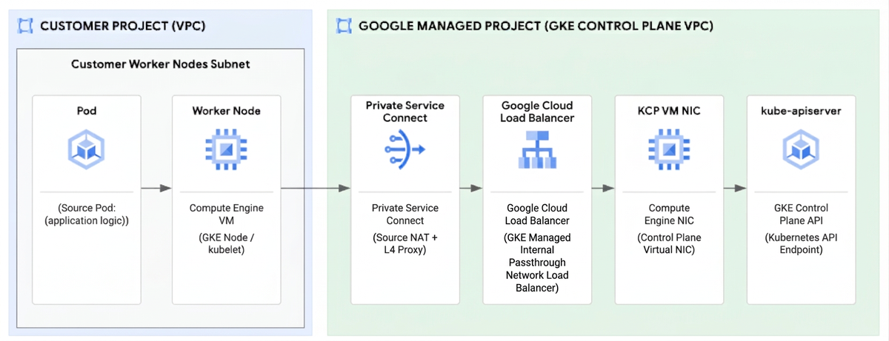

The same `i/o timeout` can originate at different layers. This Google Cloud incident account shows something more subtle: interacting behaviors preserved stale connection state, then blocked the protocol path that could clear it. Its strongest contribution is the evidence chain from an unavailable Kubernetes API to TCP state transitions.

Original: [When the Kubernetes API went silent: A three-layer networking mystery](https://cloud.google.com/blog/products/networking/the-three-layer-gke-network-mystery/) · Akash Thakur · Google Cloud · 2026-10-30. The article describes an anonymized customer incident in early 2026 affecting multiple europe-west clusters and blocking roughly 800 developers from normal production deployment for weeks. That scope refers to this customer’s environment.

## Test the plausible explanations

A newly deployed custom operator was an early suspect, but errors started eight days before its deployment and persisted after shutdown. Removing External Secrets Operator and security agents did not resolve the timeouts. Control-plane conntrack usage was around half capacity; enlarging the control-plane VM did not help, while kube-apiserver latency looked healthy.

These checks turned recent changes into testable hypotheses instead of assumed causes. System pods, application workloads, and external clients were all affected, narrowing attention to the shared access path. Healthy processing on established connections can coexist with clients failing to establish new ones.

<a class="note-image-link" href="/assets/images/tech/gke-network-mystery/overview.png" target="_blank" rel="noopener" aria-label="Pod-to-API path through the worker, Private Service Connect, load balancer, and control-plane NIC · View original image ↗">View original image ↗</a>

*Follow the boundaries from left to right. Simultaneous captures distinguish packets that never arrive, packets filtered in transit, and packets rejected because stale connection state remains.*

## Why a fresh SYN received an old connection’s ACK

Captures at the control-plane VM NIC and container showed SYNs arriving, but the response was an ACK associated with an earlier connection rather than the expected SYN-ACK. Port reuse supplied the clue: after NAT, a fresh connection reused the same five-tuple while the server’s old socket remained in FIN_WAIT_2.

TCP challenge ACKs can help resolve such stale state. The new client responds to the unexpected ACK with a reset, permitting another handshake. However, a previous USPS packet-switching change in Private Service Connect classified these pre-handshake ACKs as invalid and silently dropped them. A rising invalid-ACK drop counter correlated with the rollout, providing a second line of evidence.

Rolling back the USPS change reduced drops, and the customer confirmed recovery by early March. **The rollback identified a triggering path without explaining why old connections persisted.** Investigation continued into FIN_WAIT_2 lifetime after service recovery.

## Three conditions kept the old state alive

First came reordering. A Private Service Connect flow miss takes a slower path to establish NAT state and add the proxy-protocol header, while subsequent packets can take a fast path. Simultaneous host-NIC and virtual-NIC captures exposed changes in FIN/ACK arrival order along this path.

Second came socket ownership. Envoy used `shutdown(SHUT_WR)` to close its write side while retaining the socket for reads. The configured 60-second `tcp_fin_timeout` applied to orphaned sockets, not this still-owned socket. A timeout setting therefore did not establish a 60-second lifetime bound for the affected connection.

Third came kernel handling. The account describes `tcp_ack()` returning zero for an old but still acceptable ACK, with the closing path consequently failing to process its FIN. Reordering exposed the path, the kernel failed to consume the FIN, and Envoy’s ownership made orphan-socket cleanup inapplicable. NAT then reused the port; filtering the challenge ACK prevented recovery and the new connection timed out.

These are conditions in one state chain, not interchangeable root-cause labels. Envoy’s half-close is valid behavior in isolation. Calling it independently defective would obscure its interaction with the kernel issue and network filtering.

## Separate mitigation from protocol and root-cause fixes

Resolution had three levels: roll back the filter to restore availability; correct challenge-ACK handling in the proxy-protocol layer and add a PacketDrill regression test; and deliver the Linux TCP closing-path fix through COS images. The article identifies upstream commit `795a7dfbc3d9` and describes its GKE/COS delivery. Assessing a particular environment requires checking its image and backports, not merely comparing a major kernel version.

For AIOps and chaos engineering, the transferable method is organizing simultaneous path observations, protocol state, and rollout events while distinguishing symptom recovery from state-machine correction. This anonymized case supplies no population failure rate and does not explain all API timeouts. Read the capture locations, stale-socket lifetime conditions, and post-rollback investigation first; they are more useful than memorizing one kernel setting.
