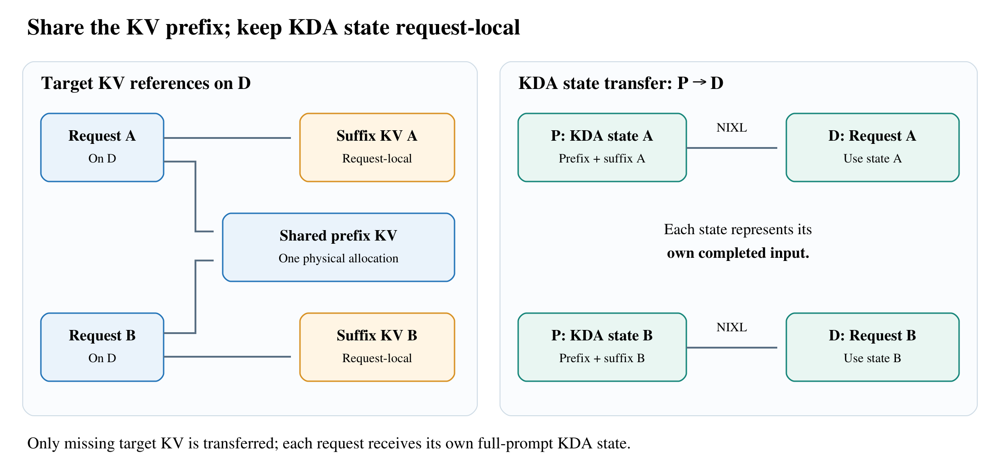

[Accelerating GLM-5.3-Flash on H200: High-Throughput Disaggregated Serving](https://www.lmsys.org/blog/2026-11-01-glm53-h200-pd/) · LMSYS / Ant International AI Infra · 2026-11-01

GLM-5.3-Flash combines sparse attention, recurrent linear attention, and MoE. These bring different state semantics and shape-dependent execution costs. Ant International AI Infra’s SGLang report optimizes memory reuse, speculative cycles, and prefill dataflow together. Its strongest contribution is the explanation of interactions behind the throughput numbers.

## Share historical KV, keep recurrent state request-local

Sparse-attention KV represents historical positions; KDA recurrent state represents a particular sequence boundary. Requests A and B can share prefix KV when their suffixes differ, but their full-prompt recurrent states are distinct.

<a class="note-image-link" href="/assets/images/tech/glm53-h200/architecture.png" target="_blank" rel="noopener" aria-label="GLM-5.3-Flash: separate state semantics and balance prefill with decode · View original image ↗">View original image ↗</a>

*The left shares prefix KV; the right transfers separate KDA states for A and B after their respective complete inputs.*

KV-only decode RadixCache references existing target-model prefix KV and allocates/transfers only missing KV. Prefill independently provides each request’s recurrent state at the end of its complete input. Decode therefore need not replay the cached prefix through KDA to reconstruct that state. Ignoring alignment, N requests sharing a prefix Lp with separate suffixes Ls use Lp+N·Ls target-KV slots instead of N(Lp+Ls); recurrent state does not collapse into one shared copy.

Multiple memory pools constrain capacity. Initially, KV was nearly full while the recurrent-state pool used only about 5%. Raising request limits could reserve additional state and squeeze KV further. The optimized setup combines FP8 KV, BF16 recurrent state, and ReplaySSM, which keeps compact replay information and advances accepted state instead of retaining full state-matrix snapshots for speculative steps.

## More accepted tokens per cycle need not mean higher throughput

Near saturation, active requests, useful output per cycle, and full cycle time jointly determine throughput. DFlash2 block8 and seven-step serial MTP718 both verify eight tokens at roughly 128 active requests with the same MoE configuration. DFlash2 accepts slightly fewer tokens, 7.03 versus 7.37, but drafting falls from 9.13 to 3.15ms and the full cycle from 86.94 to 74.14ms. Throughput rises from 10,570 to 11,459 tokens/s.

Acceptance length alone misses this trade-off. Faster cycles can outweigh fewer accepted tokens, while draft KV and speculative state consume memory that could otherwise support concurrency.

Kernel tuning also follows measured workloads. MoE tuning uses real routing samples across layers, ranks, and execution points, then checks held-out routes, rather than treating total row count as sufficient. DSA Partial increases KV tiles from 32 to 128 when query parallelism is adequate, reducing loops, softmax updates, and accumulator rescaling without changing the effective selected KV positions.

## Prefill improves by moving and waiting less

With TP4/EP1/CP4, routing and quantization move to local token shards. Routing still consumes BF16 inputs; FP8 activations, scales, expert IDs, and routing weights are packed for AllGather and directly reused by expert GEMMs. This specific collective’s payload falls about 47.5%, not all communication throughout the service.

The implementation also fuses SwiGLU with FP8 quantization and KDA normalization with layout preparation, raises prefill chunks to 32K, overlaps arriving communication tiles with projection, and delays rather than removes synchronization protecting buffer reuse. On four H200s with 64K input, ten output tokens, and no shared prefix, the combined result is 23,305→48,064 input tokens/s and mean TTFT of 5.61→2.72 seconds.

## Prefix reuse determines the integrated gain

The four-GPU decode result of 4.32× uses 64K/1K requests with a 99.9% shared prefix to minimize prefill supply constraints. Running-request capacity rises from 56 to 132, and mean TPOT falls from 16.28 to 10.07ms. It is not the expected gain for no-reuse traffic.

Across sixteen-GPU 3P1D tests, output throughput improvements at 0%, 50%, and 93.75% shared prefix are approximately 2.30×, 2.11×, and 4.28×. The first two remain prefill-bound and use higher client loads after optimization: mean TTFT rises from 3.58→4.00 seconds and 2.59→4.72 seconds. At 50% reuse, p99 TTFT reaches 7.56 seconds. High-throughput operating points satisfying mean TTFT<6s and TPOT<25ms therefore do not imply universally better tails.

The integrated baseline is SGLang v0.5.20 and the optimized build is pinned to 3cb45d3dc. Two GSM8K checks score 95.7% and 95.4%, each on 1,314 examples. This supplies one quality check rather than comprehensive long-context or multimodal validation. The report covers text inputs; vision-encoder integration remains future work.
