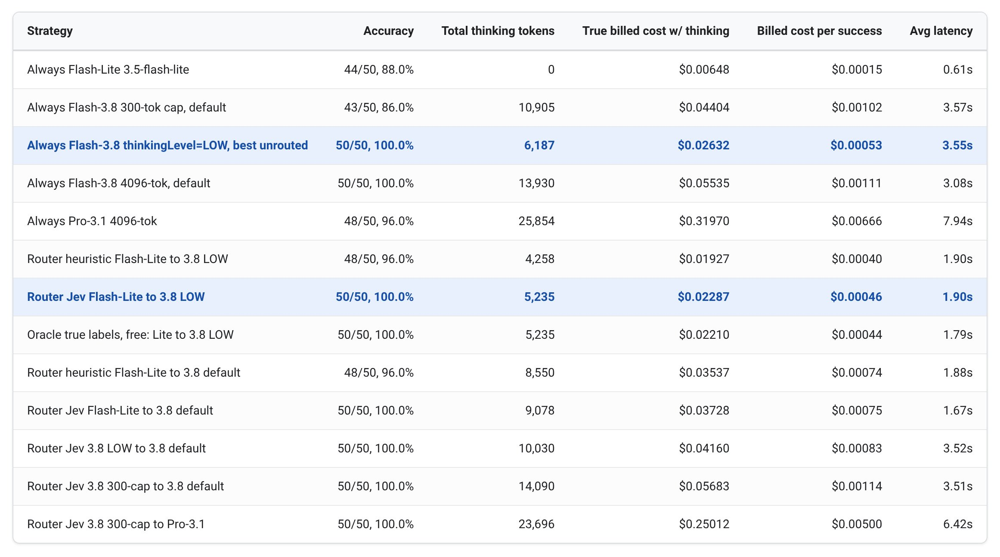

Original: [Cost per task: Using cheap classifiers to route across Gemini models and thinking levels](https://developers.googleblog.com/cost-per-task-using-cheap-classifiers-to-route-across-gemini-models-and-thinking-levels/) 
Sergio Villani · 2026-11-03

Google Developers tests a cheap classifier that identifies short tasks requiring multiple reasoning steps and routes across Gemini models and thinking levels. The useful lesson is to establish two baselines: whether the supposed cheap path actually costs less, and whether a lighter fixed thinking configuration already solves the workload.

The experiment uses 16 development questions and 34 unseen questions, totaling 50 short, automatically graded coding-agent tasks. A frozen keyword/length heuristic drops from 93.8% agreement on development labels to 70.6% on held-out labels. Jev agrees on 34/34 held-out questions and 48/50 overall. These figures measure agreement with hand-assigned difficulty, not complete software-engineering task success.

Reducing maxOutputTokens from 4096 to 300 does not reduce thinking on easy questions and breaks seven of 25 hard questions. Routing easy tasks to that capped configuration therefore need not save money. The stronger non-router baseline is Flash with low thinking, which solves all 50. The Jev combination of Flash-Lite and low-thinking Flash also solves all 50 and reduces measured cost and response time. That is the meaningful comparison, rather than only an expensive default setting.

<a class="note-image-link" href="/assets/images/tech/google-cost-per-task-routing/routing-strategy-comparison.jpg" target="_blank" rel="noopener" aria-label="View figure">View figure ↗</a>

*The two blue rows show that both fixed low-thinking Flash and Jev routing solve all 50 tasks. The router has a lower cost per success and lower average latency in this test.*

Each configuration runs once on short prompts; difficulty is manually labeled and benchmark code awaits open-source review. Long-running coding agents may behave differently. Model-specific caches also create a trade-off: switching models can require duplicate caches or lose reuse discounts. Routing short log-parsing tasks need not help repository-heavy conversations.

The transferable objective is total cost per successful task, including classification, calls, retries, and thinking. Establish a capable low-cost fixed configuration before deciding whether a router adds value.
