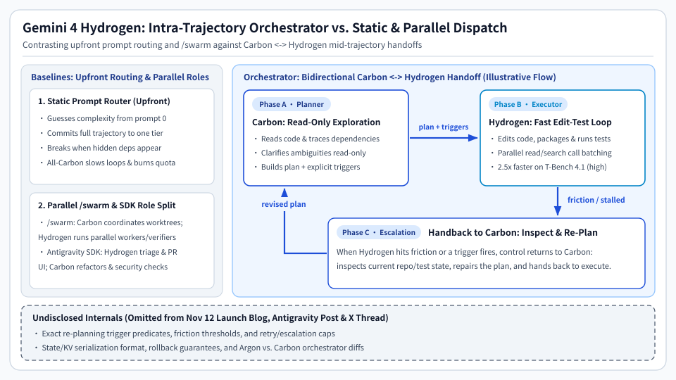
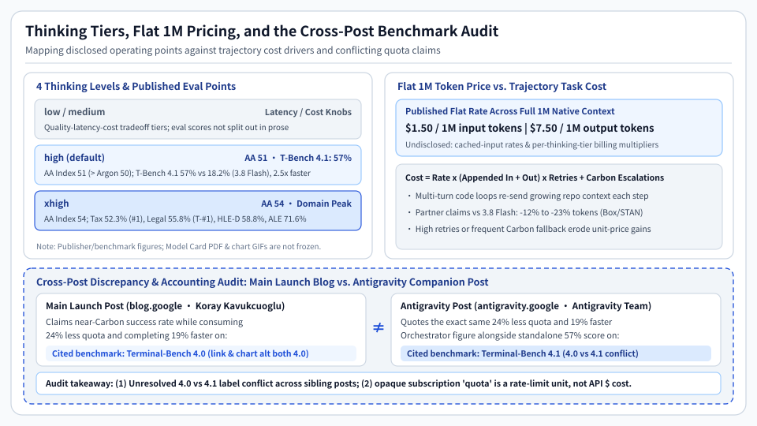

On November 12, 2026, Koray Kavukcuoglu (SVP, Google DeepMind and Chief AI Architect, Google) announced **Gemini 4 Hydrogen** on the [Google launch blog](https://blog.google/innovation-and-ai/models-and-research/gemini-models/introducing-gemini-4-hydrogen/), accompanied by a companion post on **Gemini 4 Hydrogen and Orchestrator** from [The Antigravity Team](https://antigravity.google/blog/gemini-4-hydrogen-in-google-antigravity/) and a launch thread on [Google DeepMind's X account](https://x.com/GoogleDeepMind/status/2120940338869055788). Together, the two announcements advance two engineering claims: a fast agentic execution model with flat 1M-context pricing, and an intra-trajectory orchestration mechanism that hands control back and forth between a frontier planner (Gemini 4 Carbon) and Hydrogen mid-run.

This close reading is strictly grounded in the HTML posts, extracted plain text, and X post JSON frozen on November 13, 2026. Because the six benchmark GIF animations embedded on `blog.google` and the external [Gemini 4 Hydrogen Model Card PDF](https://storage.googleapis.com/deepmind-media/Model-Cards/Gemini-4-Hydrogen-Model-Card.pdf) were not frozen locally in that archive, we omit any numbers present only inside chart images or the unread PDF, and explicitly separate vendor-reported figures from engineering derivations.

## 1. Intra-Trajectory Orchestrator Handoffs vs. Static Routing and Parallel Dispatch

Across both primary posts, Google frames Orchestrator against two existing multi-model baselines to explain why neither upfront guessing nor blanket frontier execution fits long-horizon coding agents:

- **Upfront static model routing**: Conventional model routers inspect only the initial user prompt, estimate task difficulty once, and commit the entire trajectory to the cheapest sufficient model. As the Antigravity post notes, long-horizon coding and debugging tasks routinely uncover hidden dependencies, broken builds, or test regressions mid-trajectory—making prompt-zero routing brittle. Conversely, running a frontier reasoning model like Carbon for every routine file edit or test pass slows the inner loop and exhausts frontier quota.
- **Cross-agent role splits (`/swarm` and Antigravity SDK)**: Alongside Orchestrator, Google preserves explicit multi-agent decomposition for separable work. Its `/swarm` workflow (with "tens of thousands of swarms" cited in Antigravity) uses Carbon as coordinator while Hydrogen powers concurrent worker and verifier agents in isolated workspaces. Similarly, an open-source issue-triage sample built with the **Antigravity SDK** assigns Hydrogen to ticket triage, intake coding, codebase search, clarifying questions, and rapid UI pull-request comment iteration, reserving larger refactors, new features, and security audits for Carbon.
- **Orchestrator's intra-trajectory bidirectional handoff**: Rather than partitioning separate sub-agents beforehand, Antigravity's illustrative Orchestrator trajectory embeds model switching *inside a single sequential run*. **Carbon** enters first in a **read-only phase** to map dependencies, resolve ambiguities, and produce a concrete plan paired with **explicit re-planning triggers**. **Hydrogen** then takes over to edit files, upgrade packages, and run tests. Whenever Hydrogen stalls or hits a re-planning trigger, control hands **back to Carbon** to inspect current repository/test state and repair the plan before returning execution to Hydrogen.

<figure>
  <a class="note-image-link" href="/assets/images/tech/google-gemini-4-hydrogen/orchestrator-handoff-loop-en.svg" target="_blank" rel="noopener">
    
    Expand diagram ↗
  </a>
  <figcaption>Figure 1: Illustrative Orchestrator Carbon and Hydrogen bidirectional handoff loop disclosed across the Nov 12 posts, contrasted against upfront prompt routing, parallel /swarm or SDK splits, and undisclosed runtime internals.</figcaption>
</figure>

**Undisclosed internals**: While the blog prose illustrates the read-only-plan to execute to replan cycle, neither post specifies the predicate syntax or numeric thresholds for re-planning triggers, friction detection rules, cross-model context or KV-cache state serialization formats, partial-edit rollback rules, retry or escalation ceilings, or policy differences between `Orchestrator (Carbon)` (Google AI Ultra) and `Orchestrator (Argon)` (paid Google AI Pro and Ultra). On rollout surface, Hydrogen is available to paid Google AI Pro and Ultra subscribers (and via automatic model selection for consumer Gemini app free-tier users per footnote 1), as well as Google AI Studio, Gemini API, Android Studio, Google Search, Google Sheets canvas, and Gemini for business.

## 2. Gemini 4 Hydrogen Thinking Tiers, Published Benchmarks, and Safety Signals

At the single-model layer, Google expands Hydrogen's reasoning controls to **four thinking levels**—`low`, `medium`, `high` (default), and a new **`xhigh`** tier—described as delivering a "smooth, predictable progression" across quality, latency, and cost. For repository coding mechanics, `blog.google` specifically highlights native parallel batching of file-read and search tool calls (citing qualitative improvement on SWE-sweep without printing a numeric score in prose).

| Dimension | Disclosed Metrics | Baseline & Context | Evidence Scope |
| --- | --- | --- | --- |
| `low` / `medium` | Lower-latency / lower-cost operating points | No per-tier benchmark scores split out in prose | Qualitative vendor claim (`blog.google`) |
| `high` (default) | Artificial Analysis Intelligence Index **`51`**; Terminal-Bench 4.1 **`57%`** | AA exceeds Gemini 4 Argon (`50`); T-Bench 4.1 triples 3.8 Flash (`18.2%`) and finishes **`2.5×` faster** | Vendor & leaderboard figures (not independently reproduced) |
| `xhigh` | Artificial Analysis Intelligence Index **`54`** | +3 AA Index points above default `high` | Vendor & leaderboard figures (extra latency/tokens omitted) |
| Domain evals | Agent Arena **`#5`**; HLE-Diamond **`58.8%`**; Vals Tax **`52.3%`** (`#1`); Vals Legal **`55.8%`** (tied `#1`); MKA **`53.4%`**; ALE v1.1 **`71.6%`** | AutomationBench-AA noted as leading its class; chart GIF tables not frozen | Vendor-reported prose (`blog.google`) |
| Safety & alignment (vs. 3.8 Flash) | Up to **`-81%`** overreach; up to **`-79%`** under-service; **`12×`** fewer shortcuts; up to **`2×`** less permission bypass | **`96.7%`** honesty; **`99.9%`** CoT legibility (`0` deceptive edits over `>200,000` turns); **`>2.3×`** Gray Swan IPI; **`<0.4%`** HealthBench Pro false refusals | Vendor internal audits; Model Card PDF not frozen |
| Partner cases | Graph/SQL/enterprise tasks **`2×–2.8×` faster**, **`12%–23%`** fewer tokens | STAN (`100%` schema, `-28%` latency, `-23%` tokens, up to `2.8×`); Box (`~2×`, `-12%` tokens); LatchBio (`67%` vs. `37%` non-Gemini); Pixelcut (`276` runs, `1.8×`, `30%` cleaner); Sheets (`>30%` faster) | Vendor-curated testimonials; full sample distributions undisclosed |

Taken at face value, these signals show Google optimizing Hydrogen for concurrent read/search execution and lower alignment-drift rates at mid-tier latency. Still, every safety figure (including the `>200,000`-turn Chain-of-Thought audit and Gray Swan resilience multiplier) and partner claim remains unverified without inspecting the external Model Card PDF and raw task denominators.

## 3. Flat 1M Pricing vs. True Trajectory Cost and Cross-Post Benchmark Audit

On API pricing, Hydrogen is listed at a **flat `$1.50` per 1M input tokens and `$7.50` per 1M output tokens** across the entire **`1M`** native context window (also `1M` maximum output), with no mid-context price step disclosed. Crucially, the announcement does **not** publish cached-input token rates or disclose whether `low`, `medium`, `high`, and `xhigh` carry distinct internal reasoning-token multipliers or billing rules.

From a systems accounting standpoint, **low unit token price does not guarantee low per-task spend**. An iterative coding run accumulates cost roughly as `unit_price × Σ(resent_input_t + output_t) × retries + escalation_cost`, alongside developer and CI wall-clock time. Because tool-using loops repeatedly resend growing file reads, diffs, and test logs unless high-hit prefix caching is achieved, total billed input grows quadratically over turns. Even against partner claims of `-12%` to `-23%` fewer tokens than Gemini 3.8 Flash (STAN/Box), an under-scoped plan that stalls Hydrogen into repeated Carbon handbacks—or defaults users onto `xhigh`—can wipe out nominal per-token savings.

Compounding that cost nuance is an explicit **cross-post discrepancy** between Google's main launch post and the companion Antigravity blog regarding Orchestrator's headline efficiency experiment:

| Audit Item | Google Main Post | Antigravity Post | Engineering Audit Finding |
| --- | --- | --- | --- |
| Orchestrator gain | Near-Carbon success with **`24%` less quota** and **`19%` faster** completion on average | Near-Carbon success with **`24%` less quota** and **`19%` faster** completion on average | Identical pair of numbers, clearly referring to the same underlying run |
| Benchmark version | Explicitly names and links [Terminal-Bench 4.0](https://www.tbench.ai/news/terminal-bench-4-0) (chart alt text also reads `Terminal-Bench 4.0`) | Explicitly names **`Terminal-Bench 4.1`** alongside Hydrogen's standalone **`57%`** (`T-Bench 4.1`) score | **Unresolved version conflict (`4.0` vs. `4.1`)**: cannot attribute the `24%` / `19%` gain to `4.1` without an erratum |
| Cost metric | Product subscription **quota** percentage | Product subscription **quota** percentage | **Quota is an opaque rate-limit unit, not API `$` spend**: Carbon/Hydrogen weights are unpublished, and an anecdotal X reply notes `/teamwork` hitting 5-hour limits mid-first prompt |

<figure>
  <a class="note-image-link" href="/assets/images/tech/google-gemini-4-hydrogen/hydrogen-operating-cost-audit-en.svg" target="_blank" rel="noopener">
    
    Expand diagram ↗
  </a>
  <figcaption>Figure 2: Mapping Gemini 4 Hydrogen's four thinking levels and flat 1M token rates against multi-turn trajectory cost drivers and the unresolved Terminal-Bench 4.0 vs. 4.1 cross-post discrepancy.</figcaption>
</figure>

## 4. Engineering Deployment Boundaries and Reproducible Verification Checklist

For teams evaluating Gemini 4 Hydrogen or multi-model agent orchestration in production, four operational takeaways follow directly from the disclosed evidence and its gaps:

1. **Separate read-only planning from fast execution rather than relying on prompt-zero routing**: Orchestrator's architectural split—isolating Carbon to read-only repository exploration and failure recovery while delegating code edits and test loops to Hydrogen—is cleaner than one-shot prompt routers. Even outside Antigravity, agent harnesses can mirror this boundary by enforcing a read-only planning phase that emits explicit failure predicates before handing control to a faster executor.
2. **Treat subscription "quota savings" as non-transferable to API budgets**: Do not extrapolate Antigravity's `24%` quota reduction into cloud API savings. Measure candidate workloads directly across five observable metrics—total input tokens, cached-input hits, output/reasoning tokens, end-to-end wall time, and pass-at-1—comparing `high` vs. `xhigh` against single-model Carbon baselines.
3. **Implement explicit escalation caps and worktree rollback yourself**: Because Google has not documented Orchestrator's re-planning predicates, state serialization, or retry ceilings, API integrators pairing Carbon and Hydrogen must enforce hard loop limits, consecutive-test-failure circuit breakers, and clean Git worktree checkpoints so fast edits cannot amplify thrashing.
4. **Close outstanding documentation gaps before sign-off**: Before finalizing model selection or compliance review, fetch and audit the external [Model Card PDF](https://storage.googleapis.com/deepmind-media/Model-Cards/Gemini-4-Hydrogen-Model-Card.pdf), and pin local evaluations on a single verified Terminal-Bench release (`4.0` vs. `4.1`) rather than mixing sibling-post labels.
