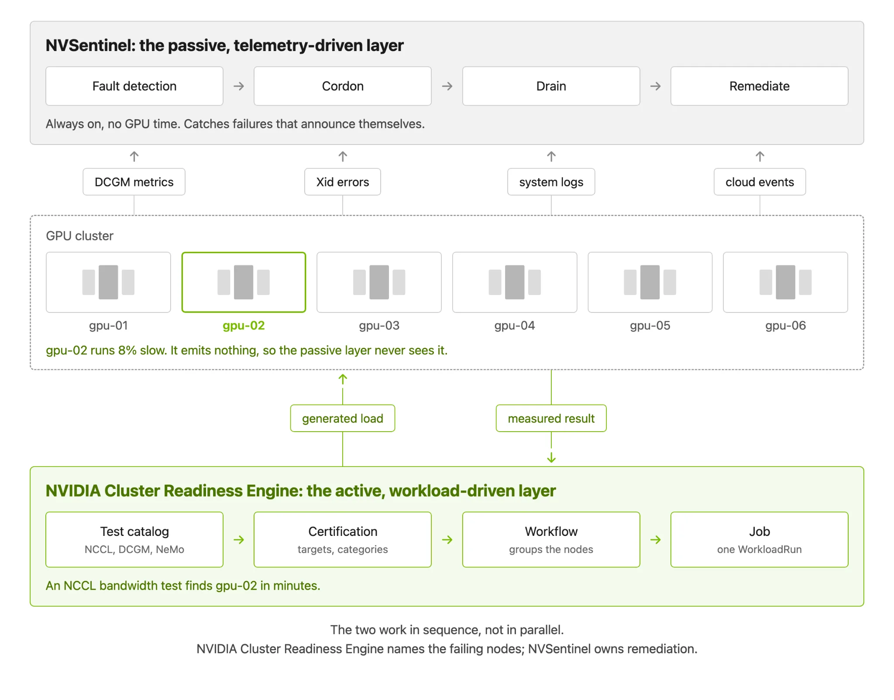

Dhvani Chheda (Solutions Architect, NVIDIA), Kai Wombacher (Product Manager, NVIDIA) · 2026-09-23 · [Original NVIDIA Technical Blog](https://developer.nvidia.com/blog/validate-gpu-cluster-readiness-before-ai-workloads-land/) · [v0.8.0 Documentation](https://docs.nvidia.com/cluster-readiness-engine/v0.8.0/overview/introduction) · [GitHub Repository (Apache 2.0)](https://github.com/NVIDIA/cluster-readiness-engine)

Passing every per-node hardware diagnostic does not prove a GPU cluster can sustain a 512-GPU distributed training job. Even when every GPU, network link, and Kubernetes pod reports healthy, a single slow GPU, a link that degrades only under sustained load, or a routing oversight that pushes traffic onto a slower fabric path can stall synchronous execution or abort training hours into a run—often surfaced first by customer tickets before engineers spend days manually bisecting idle racks. **NVIDIA Cluster Readiness Engine (NVCRE)**, an Apache 2.0 open-source Kubernetes controller within **NVIDIA DSX OS** (the operating layer of the NVIDIA DSX AI Factory Platform), turns distributed readiness from an operational assumption into scoped, reproducible evidence.

> **Evidence & Analytical Boundary**: The primary blog post (2026-09-23) is an **architectural and workflow introduction without controlled fleet benchmarks or ablation tables**. Numerical values in the source—the `512-GPU` failure framing, the `64-node` bisection narrative, Figure 1's illustrative `gpu-02 runs 8% slow` scenario, illustrative GB200 NVL72 CEL gates (`busBandwidthGBps >= 900`, `goodputRatio >= 0.9`, `avgTFLOPsPerGPU >= 800`), and two `nvcrectl certification report` examples (an 8-node `42m 18s` failure snippet and an AWS `gb300` 16-node `3m 56s` passing snippet)—are **mechanism illustrations or documentation examples**, not universal production baselines. Throughout this note, NVIDIA's stated architecture and API semantics are cleanly separated from our engineering derivations on interaction-fault edge cases, threshold versioning, invalidation triggers, and chaos calibration.

## Why Passive Health Checks Miss Distributed Faults: Active Load vs. DSX OS Roles

A cluster matures across four distinct lifecycle phases—**bring-up, burn-in, preproduction, and production**—each enforcing a progressively higher standard; surviving a local smoke test says very little about sustaining a 512-GPU collective run. Platform teams frequently glue together NCCL shell scripts, spreadsheets, and manual runbooks alongside node provisioning and GPU sharing.

Kubernetes also lacks Slurm's operational shorthand for multi-node validation. Where Slurm launches a multi-node workload with one `srun` command, Kubernetes offers no built-in equivalent: running the same distributed check requires aligned GPU and RDMA resource requests, NCCL settings tuned to the fabric, adequately sized shared-memory volumes, and gang/co-scheduled startup so all rank pods launch together.

Within **NVIDIA DSX OS**, NVIDIA partitions production readiness into three standalone yet composable layers answering three sequential questions:

1. **NVIDIA AI Cluster Runtime (AICR) — "Is it configured correctly?"**: Locks validated combinations of drivers, operators, kernels, and OS parameters into versioned recipes, enabling reproducible configuration, live-state checks, and drift detection.
2. **NVIDIA Cluster Readiness Engine (NVCRE) — "Is it ready for real AI workloads?"**: Acts as the **active, workload-driven layer**, generating distributed load across topology-aware node groups to expose silent performance regressions that emit zero telemetry errors.
3. **NVIDIA NVSentinel — "Is it healthy right now?"**: Acts as the **passive, telemetry-driven layer**, consuming existing cluster signals—DCGM metrics, Xid errors, system logs, and cloud provider maintenance events—at **zero GPU compute cost** to trigger quarantine (`cordon`), `drain`, and remediation in live production.

<figure class="note-figure">
  <a class="note-image-link" href="/assets/images/tech/gpu-cluster-readiness/validation.webp" target="_blank" rel="noopener" aria-label="Enlarge original NVIDIA Figure 1 contrasting passive NVSentinel telemetry with active NVCRE load validation">
    
    Click to zoom ↗
  </a>
  <figcaption>Original primary-source illustration (NVIDIA Technical Blog Figure 1, preserved verbatim): Contrasting passive NVSentinel telemetry against active NVCRE load validation; the 8% slowdown on gpu-02 is an illustrative mechanism example rather than an empirical study.</figcaption>
</figure>

A crucial architectural boundary highlighted in Figure 1 is **sequential rather than parallel node control**. NVCRE intentionally **never cordons, taints, or patches Kubernetes node conditions**, avoiding race conditions and desynchronized cleanup across controllers. Instead, NVCRE records failing nodes and failure reasons; the **NVSentinel NVCRE Certification Monitor** translates failed certification outcomes into health events so configured NVSentinel policies can cordon, drain, and trigger remediation; once repairs complete and a subsequent certification passes, NVSentinel clears the failure signal and releases the node taint.

## Layered CRD Control Plane (`v1alpha1`) and the `WorkloadRun` Primitive

NVCRE exposes its control plane through Kubernetes Custom Resource Definitions (`nvcre.nvidia.com/v1alpha1`), making validation inspectable via `kubectl` and manageable via GitOps. Execution flows downward through three layers while failure attribution propagates back up:

- **`Certification` (Intent & Rollup)**: The user-submitted resource defining node selection (`spec.target.nodeSelector`, e.g., `nvidia.com/gpu.present: "true"`) and test `categories` (`domain` + `variant`). It spawns one `Workflow` per category and aggregates final pass counts, failed nodes, and `PASSED` / `FAILED` verdict.
- **`Workflow` (Per-Category Orchestration)**: Manages a single test category—applying catalog, cloud-platform, and GPU overrides, managing iteration count, selecting topology orchestration scale, and creating child `Job` resources.
- **`Job` (Group Execution & Attribution)**: Executes the distributed workload across its assigned node group (running one `WorkloadRun`, as depicted in Figure 1), monitors node health during execution, and records both per-node metrics and typed failure reasons (`ThresholdViolation` vs. `HardwareFailureDetected`).

Out of the box, NVCRE ships a **built-in catalog spanning three domains** while detecting GPU architecture and cloud platform automatically from target nodes to configure GPUs per node, NCCL settings, and platform networking:

1. **Communication (`communication`)**: Five NCCL collective variants—`all-reduce`, `all-gather`, `all-to-all`, `loopback`, and `loopback` across NVIDIA NVSwitch.
2. **Diagnostics (DCGM)**: NVIDIA Data Center GPU Manager (DCGM) level-4 diagnostic suite (requires the standalone DCGM service).
3. **Training (`training`)**: NVIDIA NeMo pretraining runs using **Nemotron 5** models at `8B` and `56B` parameters (illustrated in YAML as `variant: nemotron5-8b`).

Pass and fail gates rely on **Common Expression Language (CEL)** expressions evaluated against measured metrics, governed by two explicit design choices. First, **no thresholds ship by default**—operators must declare target baselines suited to their hardware and fabric (such as the blog's illustrative GB200 NVL72 examples: `busBandwidthGBps: "value >= 900"` for `nccl-all-reduce`, and `goodputRatio: "value >= 0.9"` plus `avgTFLOPsPerGPU: "value >= 800"` for `nemotron5-8b`). Second, **execution completion is decoupled from validation pass**: if a job runs cleanly to exit code 0 yet misses a CEL threshold, NVCRE records a `ValidationFailed` condition and fails the certification category.

For teams seeking reliable multi-node workload execution on Kubernetes without adopting the full `Certification` lifecycle, NVCRE exposes **`WorkloadRun`** as a plain, composable CRD:

- **Unified `torch` / `mpi` / `exec` Runtime Generation**: Given `spec.image` (e.g., `nvcr.io/nvidia/pytorch:26.01-py3`), `spec.numNodes`, and one of `torch` (`torchrun`), `mpi` (NCCL tests or custom MPI binaries via `binary`, `args`, and `mpirunPath`), or `exec` (arbitrary commands)—optionally paired with `bandwidthMeasurement` (`logProfileRef: nccl-bandwidth`, `testType: all_reduce`)—NVCRE generates the matching `Kubeflow TrainingRuntime`, injects shared-memory volumes, configures NCCL and platform environment variables, and enables NVLink scale-up networking where supported.
- **Deadlock Prevention via `spec.gangScheduler`**: On busy shared clusters, Kubernetes' default per-pod scheduler can partially place ranks that sit holding GPUs at the framework rendezvous waiting for peers that never schedule. Configuring `spec.gangScheduler` (for example, **KAI Scheduler**) holds placement until the entire pod group can start together.
- **Prerequisites and CLI Workflow**: Clusters require Kubernetes `1.29` or later, `kubectl`, Helm `3.x`, and NVIDIA GPU Operator; **GB200 NVL72 and GB300 NVL72** catalog profiles additionally require the **NVIDIA DRA Driver for GPUs** to provision `ComputeDomain` resources, while DCGM level-4 requires the standalone DCGM service. The `nvcrectl` CLI wraps deployment and execution into `nvcrectl setup init` (installing CRDs, controller, Kubeflow Trainer, and default log profiles), `nvcrectl certification run --cert-file certification.yaml --wait`, and `nvcrectl certification report`.

| Component / Layer | Primary Inputs & Control Scope | Core Mechanics & Output Semantics | Key Caveats & Prerequisites |
| :--- | :--- | :--- | :--- |
| **`Certification` CRD** | `spec.target.nodeSelector` and `categories` (`domain` + `variant`) | Spawns one `Workflow` per category; rolls up category pass counts, failed nodes, and `PASSED` / `FAILED` | Ships with zero default CEL thresholds; never cordons or taints nodes directly |
| **`Workflow` CRD** | Single category overrides, iteration count, `testScale`, CEL rules | Auto-detects GPU/cloud platform, derives NCCL/network vars, flags missed CEL checks as `ValidationFailed` | Threshold meanings shift across GPU gens, NCCL versions, and cluster scale |
| **`Job` & `WorkloadRun` CRD** | `spec.image`, `numNodes`, `framework` (`torch` / `mpi` / `exec`), `bandwidthMeasurement` | Builds `Kubeflow TrainingRuntime`, SHM volume, and NVLink config; attributes `ThresholdViolation` vs. `HardwareFailureDetected` | Use `spec.gangScheduler` (e.g., KAI) to stop partial-placement deadlocks; usable standalone |
| **Built-in Catalog** | 5 NCCL tests, DCGM Level-4, NeMo Nemotron-5 `8B` / `56B` | Platform-aware defaults exercising node health, collective fabric, and pretraining end-to-end | GB200/GB300 profiles require **NVIDIA DRA Driver** (`ComputeDomain`); DCGM L4 needs standalone DCGM |
| **DSX OS Trio** | AICR recipes → NVCRE load → NVSentinel telemetry (`Certification Monitor`) | AICR enforces drift-free config; NVCRE catches silent lags; NVSentinel runs at 0-GPU cost for cordon/drain/fix | Strictly **sequential handoff**; NVSentinel clears taints only after a passing retest |

<figure class="note-figure">
  <a class="note-image-link" href="/assets/images/tech/gpu-cluster-readiness/nvcre-certification-workflow-en.svg" target="_blank" rel="noopener" aria-label="Enlarge NVCRE layered CRD architecture, built-in catalog, and DSX OS sequential handoff diagram">
    
    Click to zoom ↗
  </a>
  <figcaption>Assistant diagram (not an original figure): Synthesizing NVCRE's three-tier CRD attribution model, WorkloadRun runtime wiring, and sequential DSX OS operational loop.</figcaption>
</figure>

## Topology Grouping (`testScale`), Adaptive Bisection (`diagnose`), and Interaction-Fault Edge Cases

Many distributed hardware defects appear only at specific topological boundaries or collective concurrency levels. Instead of burying group sizing inside hidden heuristics, NVCRE makes topology partitioning explicit via **`testScale`**:

- **`intra-node`**: Tests each node independently to isolate per-node GPU compute, PCIe, or intra-node interconnect faults.
- **`intra-rack`**: Partitions nodes by topology domain using the **`nvidia.com/gpu.clique`** label to test intra-NVLink or single-clique bandwidth.
- **`full-scale`**: Places all selected nodes into one collective group to exercise the cross-rack scale-out fabric and cluster-wide synchronization.
- **`diagnose`**: Triggers adaptive hierarchical fault isolation.

The authors highlight a fundamental physical boundary here: **running an NCCL test inside one NVLink domain measures NVLink bandwidth, whereas running the same test across three racks measures the scale-out fabric—the two tests measure entirely different hardware paths**. Passing a single-rack check cannot justify certifying cross-rack training jobs.

At `full-scale`, however, failures exhibit **collective implication**: if a 64-node all-reduce falls short on bandwidth, every participating node looks equally degraded, and manual rack bisection routinely consumes days of engineering time. Setting **`testScale: diagnose`** automates topology-aware hierarchical group testing: NVCRE splits each failing group into halves, reruns each half, recurses on any failing subgroup until reaching **`minGroupSize`**, and flags subgroups that still fail at `minGroupSize` as targeted suspect nodes paired with per-node failure reasons. Crucially, **`maxConcurrent`** caps concurrent diagnostic jobs so test traffic itself does not saturate shared network links and fabricate congestion failures.

Examining this design from a systems-engineering perspective (clearly separated below as **our operational boundary derivation extending the blog's bisection path**), automated bisection implicitly assumes fault monotonicity—namely, that a defect hurting the full group persists inside smaller subsets. Across multi-rack AI fabrics, **interaction faults** routinely violate that assumption:

1. **Faults that vanish when partitioned**: If degradation stems from cross-switch congestion, routing hash collisions across spine/leaf uplinks, a defect confined to a specific distant node pair, or high-concurrency collective pressure, cutting a 64-node group into two 32-node halves (especially aligned with intra-rack cliques) can eliminate the trigger so **both subgroups pass cleanly**.
2. **Never close "both halves pass, parent fails" as resolved**: Collapsing isolation logic to leaf pass/fail results silently masks fabric-level faults. Operators should treat **`"both subgroups pass, original group fails"`** as an explicit first-class diagnostic state pointing to inter-group interconnects, shared switch buffers, or scale effects.
3. **Preserve failing membership and rotate partition cuts**: Retest plans for this signature should retain the exact failing node set while rotating partition strategies (for example, testing cross-clique pairs or alternating subgroup splits) to expose sensitivity to grouping geometry.
4. **Inspect rank-level variance alongside aggregate throughput**: Synchronous collectives stall at the pace of the slowest rank; even without explicit process crashes or Xid errors, one consistently slow participant drags down effective output across the entire group. Inspecting per-rank lag alongside aggregate goodput catches silent stragglers earlier.

<figure class="note-figure">
  <a class="note-image-link" href="/assets/images/tech/gpu-cluster-readiness/bisection-interaction-boundaries-en.svg" target="_blank" rel="noopener" aria-label="Enlarge NVCRE testScale grouping, diagnose adaptive bisection, and interaction-fault boundaries diagram">
    
    Click to zoom ↗
  </a>
  <figcaption>Assistant diagram (not an original figure): Contrasting the physical scope of the four testScale strategies with the diagnose bisection loop and engineering interaction-fault boundaries.</figcaption>
</figure>

## Evidence Boundaries, Sample Reports, and Safe Operational Loops

Keeping every figure in the primary post anchored to its actual context prevents documentation snippets from being misread as universal cluster guarantees:

| Item / Metric in Primary Post | Exact Source Context & Conditions | What It Validly Demonstrates | Validity Boundary / What It Does Not Prove |
| :--- | :--- | :--- | :--- |
| **`512-GPU` failure & `64-node` bisection** | Narrative problem framing in intro and *Adaptive fault isolation* | Why component health checks miss distributed slowdowns and why manual triage takes days | Not an empirical fleet incident dataset or measured MTTR benchmark |
| **Figure 1 `gpu-02` `8%` slowdown** | Illustrative diagram scenario inside `validation.webp` | Explains why passive telemetry misses silent compute/link lag that active NCCL load exposes in minutes | Mechanism illustration only; does not report recall or latency distribution across real hardware faults |
| **GB200 NVL72 CEL thresholds** | Explicitly labeled **illustrative examples**: `busBandwidthGBps >= 900`, `goodputRatio >= 0.9`, `avgTFLOPsPerGPU >= 800` | Shows how CEL separates process completion from SLO attainment (`ValidationFailed`) | NVCRE ships with **zero default thresholds**; blindly copying values across fabrics or models breaks accuracy |
| **Sample failing CLI report** | `communication/nccl-all-reduce`, `full-scale`, `8` nodes/job, `42m 18s`, `1/2` categories, `FAILED` | Demonstrates dual attribution format (`gpu-node-07 ThresholdViolation` vs. `gpu-node-12 HardwareFailureDetected`) | Illustrative CLI output formatting without cluster hardware/topology disclosure |
| **Sample passing CLI report** | `aws`, `gb300`, `16` nodes, `MNNVL: Enabled`, `16 GB` message, `AlgBW 473.44 GB/s`, `BusBW 932.09 GB/s` (`9` samples, `3m 56s`) | Shows reporting granularity across `AlgBW`, `BusBW`, sample count, and `MNNVL` status | Single `16`-node, `16 GB` message-size snapshot; cannot certify arbitrary message sweeps or larger scales |
| **Controlled quantitative evaluation** | Omitted in the primary blog post | Architecture, CRD contract, and DSX OS integration are clearly specified | Post reports **no controlled ablation** on bisection MTTR vs. manual triage, false-alarm rate under load, or multi-tenant cluster overhead |

Combining NVIDIA's architecture with operational systems reliability practice yields four concrete guardrails when integrating NVCRE into production cluster workflows (explicitly framed as **engineering synthesis** extending the primary post):

1. **Attach explicit scope descriptors to every certification**: Store the exact tested node set, interconnect domain (`intra-rack` clique vs. cross-rack fabric), collective message sizes, concurrency, and duration alongside every `PASSED` verdict. A passing result certifies only those exact operating conditions—never an unconditional guarantee for future training topologies.
2. **Version CEL thresholds alongside hardware and software**: Re-baseline CEL expressions whenever GPU generations, NCCL/CUDA stacks, driver versions, or cluster topologies evolve. Stale loose thresholds hide real regressions; overly tight thresholds flood NVSentinel with false positives from benign variance.
3. **Define certification invalidation events and confidence-gated quarantine**: Never let a passing `Certification` turn into a permanent health badge. Automatically invalidate affected results and re-trigger scoped revalidation upon GPU driver upgrades, NIC firmware updates, switch/topology changes, or node repairs. Before allowing NVSentinel to auto-`cordon` or `drain` nodes from certification failures, check diagnostic confidence (including whether `maxConcurrent` congestion could explain variance), workload blast radius, and rollback paths.
4. **Calibrate fault isolation via chaos experiments**: Use `WorkloadRun` and `testScale: diagnose` as a controlled chaos-validation target—injecting known rank slowdowns, degraded links, or misrouted NCCL configurations to empirically measure detection coverage, final suspect-set compactness, and GPU-hour isolation cost. The engineering goal is not running more tests, but converging on an accurate, actionable diagnosis at bounded cluster cost.

---

### Verified Primary References

- Primary technical blog post: Dhvani Chheda and Kai Wombacher, *[Validate GPU Cluster Readiness Before AI Workloads Land](https://developer.nvidia.com/blog/validate-gpu-cluster-readiness-before-ai-workloads-land/)*, NVIDIA Technical Blog, 2026-09-23.
- Official documentation: *[NVIDIA Cluster Readiness Engine Documentation (v0.8.0)](https://docs.nvidia.com/cluster-readiness-engine/v0.8.0/overview/introduction)*.
- Open-source repository (Apache 2.0): *[NVIDIA/cluster-readiness-engine](https://github.com/NVIDIA/cluster-readiness-engine)* (installer referenced in the primary post resolves under `https://github.com/NVIDIA/cluster-readiness-engine/releases/latest/download/installer`).

> **AI-Assisted Curation & Archival Note**: Both this English deep dive and its paired Chinese edition ([中文版](/tech/zh/gpu-cluster-readiness/)) were rewritten by the assistant (`authoring_source: assistant`, `translation_source: assistant`) from the frozen capture of the primary NVIDIA Technical Blog post, preserved official Figure 1 (`validation.webp`), and verified official links listed above. Original `id`, `date`, `permalink`, `source_url`, `source_date`, and canonical tags (`systems-reliability`, `observability`) are preserved; `validation.webp` remains untouched alongside two assistant-drawn `v3-blue` diagrams (`nvcre-certification-workflow-en.svg`, `bisection-interaction-boundaries-en.svg`). Every threshold, report snippet, and figure example is scoped explicitly to its illustrative context, engineering derivations on interaction faults and certification invalidation are labeled distinctly, and zero unverified benchmarks or external URLs are introduced.
