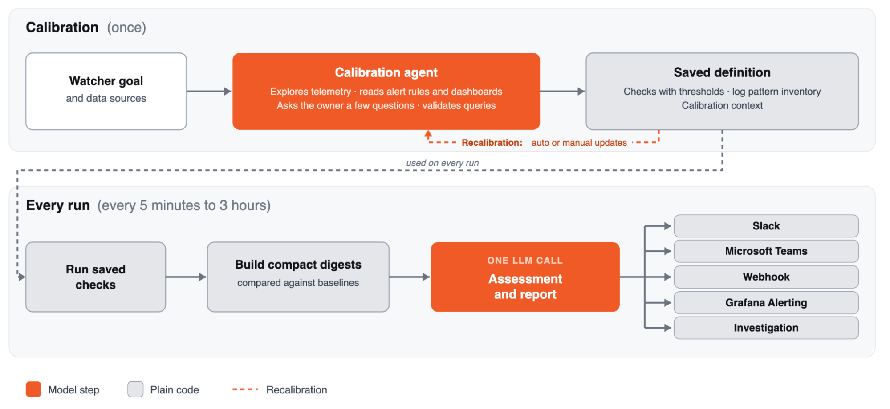

[Run cost-effective, always-on agents to monitor your environment: the engineering behind Watchers](https://grafana.com/blog/run-cost-effective-always-on-agents-to-monitor-your-environment-the-engineering-behind-watchers/) · Grafana Labs · 2026-11-09

Running a complete investigation every ten minutes can make monitoring costs explode. Grafana’s internal experiment priced a full agentic investigation at $0.56–$1.26; 4,320 monthly executions would cost thousands of dollars for one target. Its engineering response reallocates reasoning: a capable agent decides what to check, ordinary code repeatedly measures it, and a small model judges whether a change deserves attention.

## Calibration produces checks and decision context

At creation, a calibration agent explores selected telemetry, starting with alerts and dashboards that encode agreed thresholds, severities, and failure experience. It asks the user about ambiguous scope, such as whether production clusters should be judged individually or together.

It samples signals across the previous week and considers daily and weekly cycles, avoiding false concern over normal quiet periods. Checks are tested against live data before saving queries, thresholds, a log-pattern inventory, and compact calibration context covering the service, user decisions, deployment behavior, normal ranges, and known noise.

<a class="note-image-link" href="/assets/images/tech/grafana-watchers/architecture.png" target="_blank" rel="noopener" aria-label="Grafana Watchers: calibrate once, make one narrow decision per check · View original image ↗">View original image ↗</a>

*Calibration saves checks and context above; each run below builds a digest in code and makes one LLM decision about reporting and escalation.*

The output is therefore more than a long prompt. It fixes repeatable executable work and prepares context for the remaining judgment. Recalibration is necessary when assumptions become stale; amortizing exploration works only while the saved checks still represent the environment.

## Compress evidence before one tool-free decision

Runtime performs no exploratory agent loop. Code compares metrics with the same time yesterday and statistical baselines, applies calibrated thresholds, and sends verdicts rather than arithmetic to the model. Loki’s ingestion-time pattern grouping supports an inventory across runs, emphasizing new patterns and material rate changes. Deployment checks add temporal context.

Healthy checks collapse to one line. The compact digest enters exactly one small-model call without tools, returning structured OK/warning/critical status, a short report, tracked issues with evidence, and notification or Investigation decisions. The question is narrow: do a new log pattern, rising error rate, and recent deployment together justify interrupting someone?

A deeper Investigation becomes an escalation path, not the default periodic expense. Its bill and the initial calibration sit outside the quoted recurring-check costs. Reusing the design requires preserving those accounting boundaries rather than counting only the small model’s tokens.

## What internal costs and incident findings establish

At the stated $2 per million tokens, the 43 internal Watchers cost a median below $5 per month; 41 cost below $10. The most expensive has 43 checks every fifteen minutes and costs slightly above $20. Frequencies range from five minutes to three hours, so these observations describe particular internal configurations rather than a fixed price for arbitrary targets.

The Watcher monitoring Assistant reportedly found more than ten customer-affecting production bugs over recent months: a crashlooping Teams integration, broken reports, missing regional webhook credentials, and notifications that never reached Alertmanager. The examples show why correlating a new error pattern with rising errors and a deployment is more useful than merely spotting an unfamiliar log line.

Detection still differs from diagnosis. In one exhausted-MySQL case, the Watcher flagged genuine failures but blamed the wrong cause; engineers later found an expensive query plan that likely contributed. Its role is to notice and provide evidence, leaving causal investigation to people or a heavier Investigation. Ten-plus detected bugs are not ten-plus correctly automated root causes.

## Coverage and escalation remain the limits

The article says candidate models are evaluated through production-decision replay. The currently common model missed no tested critical case at roughly half its predecessor’s decision cost, but sample size, label composition, and false-positive distribution are not published. This cannot establish zero population-level misses.

The transferable AgentOps design assigns capable reasoning to exploration, code to repeated measurement, and a small model to narrow judgment. Its effectiveness still depends on accessible telemetry, representative calibration, visible log changes, and useful escalation evidence. Watchers complement deterministic alerts for already well-specified failure conditions.
