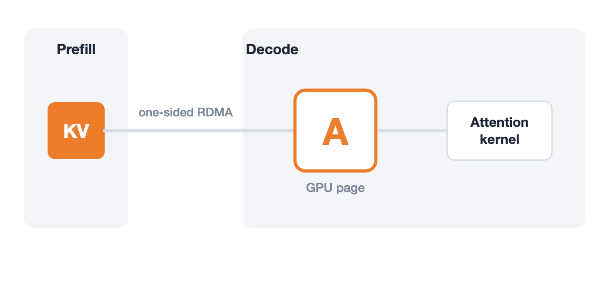

[Towards Verifiable LLM Infra](https://haoailab.com/blogs/verifiable-llm-infra/)  
Yuxuan Zhang, Minshen Zhang, Junda Su, Yi Sun, Junda Chen, Hao Zhang · 2026-11-10

HTTP 200 does not establish that an inference engine used the right request's KV state. In disaggregated serving, Decode may time out and reassign a GPU page while Prefill still has a queued GPUDirect RDMA write targeting it. The address remains valid and the server keeps running, but the contents can belong to another user.

Hao AI Lab connects two engineering efforts: vstack organizes agent-driven modeling and verification, while veriserve prototypes an explicit KV-page lifecycle. Together they address both misleading proofs and unsafe resource reclamation.

## Pin the property before building the model

vstack derives requirements from real issues, fixes, and kernel preconditions, then pins specification files by hash. An agent should not make a failing check pass by weakening an invariant, deleting a timeout path, or assuming the race away. TLA+ and Z3 transitions are mapped to locations in a concrete code version, with non-atomic distributed operations split into separate actions.

Fidelity gates require the historical buggy version to fail, its fix to pass, removal of nonredundant guards to fail again, and recorded executions to replay through the model. TLC then searches bounded executions, while Apalache, Z3, and TLAPS check or prove the relevant properties. Subsequent changes rerun the suite, and selected preconditions become runtime checks.

This order matters because a rigorous proof can concern the wrong abstraction. Fix discrimination and execution replay connect the model to the engine, but do not constitute a complete refinement proof of the implementation.

## A local timeout cannot certify remote completion

The authors describe premature reuse of transfer identities or pages, publication of corrupted pages into a shared prefix cache, and stalled leases that leave Decode holding pages indefinitely. Selected RDMA paths are reproduced on GB200 and control-plane deadlocks on CPUs. Six upstream PRs are proposed; that does not mean every affected release is already fixed.

Their impossibility result assumes unbounded asynchronous delay, indistinguishable local histories, and no trustworthy stop or revocation evidence. Under those conditions, local-only reclamation cannot guarantee both isolation and eventual page reclamation. A shorter timeout does not supply the missing information.

## PdLedger separates request termination from reclamation

Built on mini-sglang and Mooncake, veriserve tracks physical pages with `(page, gen)` tickets across Free, Private, Shared, Draining, Quarantined, and Dup states. Generations prevent stale messages from acting on a new request incarnation.

<a class="note-image-link" href="/assets/images/tech/haoailab-vstack-verifiable-llm-infra/pdledger.gif" target="_blank" rel="noopener" aria-label="Without stop evidence a page is quarantined; the completion-backed cancellation path drains before reuse. Prefix-sharing states are omitted.">View original image ↗</a>

*Without stop evidence a page is quarantined; the completion-backed cancellation path drains before reuse. Prefix-sharing states are omitted.*

A page with outstanding tracked accesses enters Draining and returns to Free only after completion evidence. If a transfer times out without that evidence, the request can terminate while the page remains Quarantined for the process lifetime. Late writes may still arrive, but cannot overwrite a newly assigned page or enter the prefix cache.

This spends capacity to preserve correctness: repeated quarantine can consume the pool. The simplified timeout diagram also omits Shared and Dup. Explicit accounting makes that trade-off visible instead of treating request completion, hardware completion, and cache publication as the same event.

## Separate model proofs from implementation measurements

Bounded TLC checks explore over 21 million reachable states. Under explicit Sizes and Design assumptions, a 226-module TLAPS proof contains 516,973 obligations across 64 actions and 54 inductive invariants; Z3 additionally checks modeled KV-address arithmetic. These establish abstract-model safety, not bug freedom of Python, kernels, or RDMA providers, and proof counts do not establish every liveness property.

Runtime preconditions, mutation tests, and boundary-event replay connect implementation to model. All 22,104 mapped events from eight normal runs replay successfully. Eight single-page sharing/eviction tests produce 540 matching checksums, and checks catch three injected glue faults. Finite traces still leave unobserved implementation behavior uncovered.

On GB200 with Qwen3-32B, six paired comparisons against a bypass baseline report +0.18% mean p50 HTTP TPOT overhead, with a 95% interval of −0.32% to +0.68%. A 0.33-ms p50 CPU ledger check cannot simply be divided by the 13.6-ms TPOT to infer end-to-end overhead because execution overlaps. The durable design contribution is the requirement for completion evidence before reuse; the small measured overhead belongs to this prototype and workload.
