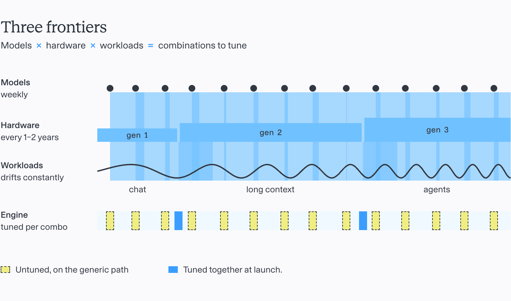

A serving stack that works on release day can encounter a different bottleneck by the final checkpoint. During MiniMax M3.1 Flash onboarding, traffic shifted from long-context coding to short inputs with long outputs. The final checkpoint doubled output length and pushed the workload toward decode. Simon Mo describes two operational pieces of Inferact’s autonomous inference project: testing candidate changes on live traffic distributions and investigating quality regressions through competing hypotheses.

## From local checks to M3.1 shadow evaluation

M3.1 combined indexed sparse attention, a large MoE, vision inputs and native DSpark. The team kept open-source and production changes on one branch and mirrored all live M3 traffic to M3.1 before cutover. Local gates preceded shadow evaluation. Mirroring retains real request combinations while the existing service answers users. Reported median first-token time moved from 1.5 seconds on the first non-disaggregated endpoint to 0.8 seconds in production. Expert-parallel prefill patches cut TTFT by 60–70%. Pipeline-parallel prefill delivered 19–46% more throughput than tensor parallelism. Those gains have distinct baselines and cannot be multiplied.

<a class="note-image-link" href="/assets/images/tech/inferact-autonomous-inference-system/figure.png" target="_blank" rel="noopener" aria-label="Models, hardware and workloads evolve separately. Evaluating an engine change requires specifying all three.">View original ↗</a>

*Models, hardware and workloads evolve separately. Evaluating an engine change requires specifying all three.*

## Why batch neighbors changed output quality

Kimi K3.1 degraded only on some batches. Throughput alone could have made incorrect execution look like a successful optimization. Inferact reports that sixteen parallel investigative agents reproduced the issue and traced it to an attention-routing switch sensitive to batch composition. After repair, DeepSWE rose from 0.558 to the cited reference accuracy of 0.602. Quality here acts as a serving-path acceptance test. The other requests executing alongside a prompt can affect its result.

## Search time and serving time measure different things

Agent V takes tasks through Slack and explores candidates in a sandbox. A separate 24-hour search on GB300 accelerated time to first token by 2.78× at 800K context. Another 30-hour search reduced p99 time per output token by 35%. Hours measure engineering search, while the gains describe the selected serving configurations. Production throughput per GPU rose from roughly 0.77 million to 1.4 million tokens per minute between mid-September and late October. That longitudinal change cannot be attributed to a single patch.

## The traffic available for verification

The article imagines a future system rearranging its own checks after inspecting failed attempts. Today its feedback comes chiefly from operated deployments, authorized customer workloads and community contributions. Simulating requests that never arrived remains difficult. The cases document shadow evaluation, fault diagnosis and parallel search. Safely changing the optimization process itself depends on broader and more representative feedback.

Simon Mo · 2026-11-18 · [Building an Autonomous Inference System](https://inferact.ai/news/building-autonomous-inference-system)
