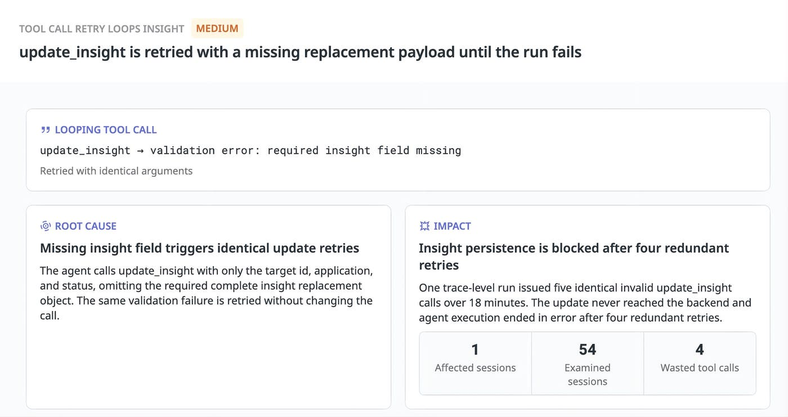

The next step in agent observability is turning trace evidence into verifiable changes. Datadog uses Insights to analyze the agent behind Insights, with concrete examples of oversized search results, broken cache prefixes, repeated invalid calls, and guessed skill-resource names. A single error message or aggregate token count would not identify all of these mechanisms.

Original: [How we use Insights to improve the agent behind Insights](https://www.datadoghq.com/blog/improving-insights-agent-observability/) · Alex Barksdale, Miguel Tulla Lizardi, Zhengda Lu · Datadog · 2026-10-30.

## How tool results become downstream cost

The agent uses `search_llmobs_spans` to retrieve trace evidence. Broad searches return large results that enter the conversation and are sent again in later requests. Across two inspected runs, five searches returned roughly 80,000 tokens. One result contributed 19,000 tokens to a request containing 97,000 input tokens. These are observations about requests, not achieved savings.

Initial recommendations were narrower filters, smaller pages, and on-demand retrieval. When the behavior recurred, the recommendation evolved into compact previews. Such previews must retain identifiers for retrieving full spans; an untraceable summary would lose the evidence path. The agent can then select relevant evidence before paying for its full context.

Validation must follow the same chain: returned content, actual model-token use, and investigation quality. Lower token counts alone cannot distinguish efficient evidence collection from missed decisive information. The article proposes replaying affected investigations, without reporting a universal post-fix savings percentage.

## Caching depends on request construction

Another production finding placed task-specific information before stable tool definitions. Changing that information prevented reuse of the otherwise repeated prefix, causing similar requests to write nearly the whole prompt into cache again. The recommendation places stable instructions and tool definitions before task details and conversation.

For the analyzed requests, Datadog projects $91.14 in daily savings, or approximately $2,734 over 30 days. It explicitly says those savings have not been measured. Real gains depend on reuse frequency, caching eligibility, and provider prices. The chart also selects requests above 1,024 input tokens for a particular model/provider; it is not a universal caching threshold or savings promise.

The transferable lesson is that message construction is a performance interface. Cache reads and writes, prompt prefixes, and task variation need to be connected to individual runs, rather than reduced to one global hit-rate number.

## Decide whether a retry can change the outcome

<a class="note-image-link" href="/assets/images/tech/insights-agent-observability/overview.jpg" target="_blank" rel="noopener" aria-label="Insights diagnosis of repeated calls missing the required insight field · View original image ↗">View original image ↗</a>

*The left panel identifies the missing replacement object; the right links unchanged retries to a failed run. Correcting the request, rather than repeating it, addresses this error.*

One run issued five identical `update_insight` calls over approximately 18 minutes. It supplied an ID, application, and status but omitted the complete replacement insight object. Validation rejected every call before it reached the backend, and the run ended in error after four retries. This was not transient backend unavailability; the agent failed to repair its input.

Another finding identified guessed or altered resource names across 193 sampled sessions. Instructions already required exact names from the skill loader. The proposed change validates names against its list and returns valid choices on a mismatch. Replaying affected turns would then test whether the agent stops requesting nonexistent resources and repeating failures.

Both examples move a constraint from prose into an executable interface check. Validation and recovery remain distinct: rejecting invalid input is useful, but feedback must also help the next call change appropriately.

## A trace-backed PR still needs validation

“Fix with Bits” passes the finding, recommendation, and trace reference to a coding agent. For compact search previews, it prepared a PR preserving full-content identifiers and pagination, with tests for both newly retrieved and cached results. This gives reviewers an explicit evidence source and behavioral target.

The article contributes inspectable engineering cases, not proof of universal autonomous optimization. It documents failures and proposed changes, without a long-term controlled comparison of realized gains. Start with oversized tool results and invalid retries: they show how to connect individual requests to multi-turn mechanisms while keeping observed waste, projected savings, and prepared fixes separate.
