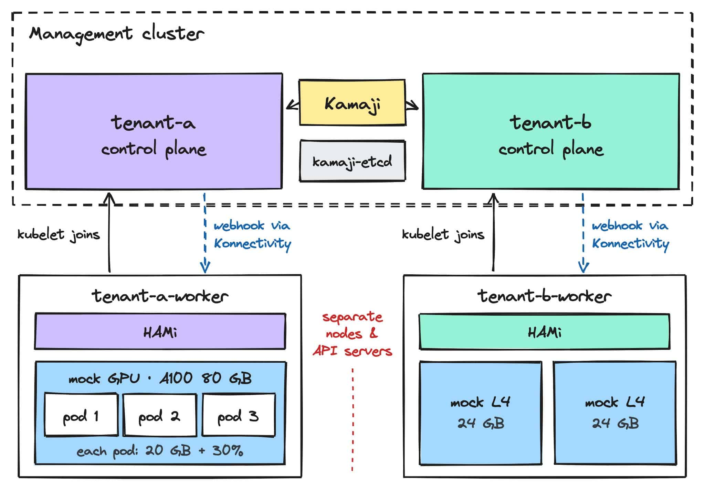

Anish Bista (CNCF Golden Kubestronaut) · Originally published 2026-10-23 · [CNCF Blog Post](https://www.cncf.io/blog/2026/10/23/multi-tenant-gpu-kubernetes-on-simulated-hardware-with-kamaji-and-hami/) · Related Projects: [Clastix Kamaji](https://github.com/clastix/kamaji) · [HAMi](https://github.com/Project-HAMi/HAMi) · [HAMi Mock Device Plugin](https://github.com/Project-HAMi/mock-device-plugin)

Platform teams building multi-tenant GPU Kubernetes clusters routinely hit a three-way trade-off: giving every team a dedicated cluster forces you to pay for a control plane per team; consolidating everyone into one shared cluster weakens API and operational boundaries; and standard Kubernetes allocates GPUs strictly as whole cards, so a pod needing 4 GB of an 80 GB accelerator still locks down the entire device. In an October 23, 2026 CNCF engineering post, Anish Bista demonstrates a **zero-GPU pre-hardware validation path**: combining **Kamaji** (hosted tenant control planes) with **HAMi** (fractional GPU virtualization and scheduling) on one Linux machine using HAMi's `mock-device-plugin` to verify whether a hosted tenant API server can traverse a Konnectivity reverse tunnel to reach worker-side webhooks and enforce fractional memory and compute quotas.

> **Evidence & Simulation Scope**: This deep read is strictly grounded in the frozen October 23, 2026 CNCF blog post (including its reproducible `kind`, `Helm`, and `kubectl` commands and raw test logs). What the lab tests is **control-path wiring and quota scheduling logic**: workload containers execute `busybox` `sleep infinity`, **no NVIDIA driver is present, zero CUDA kernels run, and no throughput, latency, or noisy-neighbor benchmarks are measured**. All component descriptions, version pins, command caveats, and test outcomes below reflect the primary write-up; the staged hardware-handoff checklist in the final section and explicit failure-domain extrapolations are labeled as engineering analysis derived from those simulation boundaries.

## Architecture Layers and the Cross-Boundary Hop: Kamaji, HAMi, and Konnectivity

Kamaji and HAMi compose cleanly without custom glue code because they operate on orthogonal layers of the Kubernetes stack:

- **Kamaji owns the cluster and control-plane boundary**: Through `TenantControlPlane` resources (`kamaji.clastix.io/v1alpha1`), Kamaji runs each tenant's control plane as pods inside a shared management cluster. In this lab, a single `kind` cluster (`kamaji`) hosts both `tenant-a` and `tenant-b` in the `tenants` namespace. Each tenant control-plane pod reports `4/4` `READY` containers—`kube-apiserver` (exposed via a MetalLB `LoadBalancer` VIP on port `6443`), `kube-scheduler`, `kube-controller-manager`, and `konnectivity-server` (listening on port `8132`). Tenants never share worker nodes or API servers; the shared substrate consists of the management cluster and the `kamaji-etcd` datastore, where each tenant's keyspace is stored separately.
- **HAMi owns intra-tenant GPU slicing**: Deployed inside each tenant's `kube-system` namespace, HAMi lets pods request fractional slices of a GPU—memory in MB (`nvidia.com/gpumem`) and compute as a percentage of one card (`nvidia.com/gpucores`)—allowing multiple pods to co-locate on one device.

<figure class="note-figure">
  <a class="note-image-link" href="/assets/images/tech/kamaji-hami/architecture.jpg" target="_blank" rel="noopener" aria-label="View original CNCF blog architecture diagram of Kamaji and HAMi lab topology">
    
    <span class="note-image-action">Click to zoom ↗</span>
  </a>
  <figcaption>Preserved original figure (from Anish Bista's October 23, 2026 CNCF blog post): shared management cluster hosting isolated tenant control planes above, separate tenant workers running HAMi and mock GPUs below, and dashed Konnectivity paths carrying webhook admission traffic.</figcaption>
</figure>

The real architectural risk is neither whether Kamaji can boot control-plane pods nor whether HAMi can pack pods inside an ordinary cluster, but the **cross-boundary round trip** depicted by the dashed lines above:

1. A user submits a GPU-requesting pod to the tenant's `kube-apiserver`, which lives inside the **management cluster**.
2. During admission, `kube-apiserver` must call **back down** to HAMi's mutating webhook running on the **tenant's worker node** behind a distinct network boundary. That reverse hop traverses the tunnel formed between `konnectivity-server` (control-plane pod) and the `konnectivity-agent` DaemonSet running on the tenant worker.
3. HAMi's webhook mutates `spec.schedulerName` to `Hami-scheduler`, diverting placement away from the tenant's default `kube-scheduler` to HAMi's fractional-GPU scheduler, which filters nodes and writes allocation annotations before binding.
4. As the author states explicitly, **"Proving that path works was the main goal of this lab."** If the Konnectivity reverse hop fails, GPU pods never reach HAMi's webhook and **silently fall back to the default `kube-scheduler`**, bypassing fractional accounting altogether.

<figure class="note-figure">
  <a class="note-image-link" href="/assets/images/tech/kamaji-hami/kamaji-hami-control-plane-en.svg" target="_blank" rel="noopener" aria-label="Enlarge Kamaji and HAMi cross-boundary control-path diagram">
    
    <span class="note-image-action">Click to zoom ↗</span>
  </a>
  <figcaption>Assistant diagram (not an original figure): Expanding the October 23, 2026 CNCF lab topology into explicit control-plane containers, Konnectivity admission round trips, and the mock bind-lock divergence.</figcaption>
</figure>

To keep "components run" distinct from "full multi-tenant isolation," the matrix below maps each architectural component to its verified scope and shared failure domain:

| Layer / Component | Deployment Location in Lab | Primary Responsibility | Isolation Scope & Shared Failure Domain |
| :--- | :--- | :--- | :--- |
| **Management Cluster & `kamaji-etcd`** | Single `kind` cluster (`kamaji`) + shared etcd service | Hosts `cert-manager`, MetalLB, Kamaji controller, and tenant control-plane state | Tenant data keys are separated inside `kamaji-etcd`, but management nodes and datastore remain a **shared blast radius** |
| **Kamaji `TenantControlPlane`** | `4/4` pods in management `tenants` namespace | Runs dedicated `kube-apiserver`, `kube-scheduler`, and `controller-manager` per tenant | Separates tenant API endpoints, kubeconfigs, and resource visibility; exposed via MetalLB VIPs (`:6443`) |
| **Konnectivity Reverse Tunnel** | `konnectivity-server` (`:8132`) + worker `konnectivity-agent` DaemonSet | Bridges management control plane to worker nodes across network boundaries | Carries reverse admission calls from hosted API server to worker-side HAMi webhook (top integration risk) |
| **HAMi Webhook & `hami-scheduler`** | Deployed inside each tenant's `kube-system` | Mutates `schedulerName: Hami-scheduler`, checks `gpumem`/`gpucores`, writes binding annotations | Follows the **real HAMi software path** in this lab; breaks silently into default scheduling if webhook is unreachable |
| **Device Plugin (Real vs. Mock)** | Lab installs `Project-HAMi/mock-device-plugin` (without `gpu=on`) | Mock reads node annotations to advertise capacity; real plugin handles NVML, `Allocate`, and driver caps | Mock omits hardware discovery and `Allocate` completion—neither **releasing `mutex.lock`** nor invoking **`HAMi-core`** |

## Reproducing Without GPUs: Single-Host Topology, Mock Resource Model, and Two Lab Gotchas

Bista's entire build runs on a single Linux host without physical GPUs (recommending at least **4 CPU cores, 8 GB free RAM, and 20 GB disk**), organized across five reproducible steps with pinned versions:

1. **Management cluster & ingress addressing**: Create the `kamaji` `kind` cluster, install `cert-manager v1.21.2` and `metallb v0.16.1` (`metallb-frr-k8s.yaml`), and configure an IPv4 `IPAddressPool` (`172.18.255.200-172.18.255.250`) plus `L2Advertisement` for tenant API `LoadBalancer` services.
2. **Kamaji controller**: Install `clastix/kamaji` (`--version 0.0.0+latest`, `--set 'resources=null'`) into `kamaji-system`.
3. **Two tenant control planes**: Apply `TenantControlPlane` manifests for `tenant-a` and `tenant-b` (`TENANT_VERSION=v1.36.4`, `replicas: 1`, `podCidr: 10.244.0.0/16`, `cgroupDriver: systemd`, and `coreDNS`, `kubeProxy`, and `konnectivity` addons), then extract `tenant-a.kubeconfig` and `tenant-b.kubeconfig` from their admin secrets.
4. **Separate worker containers & in-tenant CNI**: Because Kamaji provides no native `kind` worker helper, the author launches privileged `kindest/node:v1.36.4` containers (`tenant-a-worker`, `tenant-b-worker`) on the `kind` Docker network, joins each to its respective tenant via standard `kubeadm token create --print-join-command` and `kubeadm join ... --ignore-preflight-errors=all`, and installs `Calico v3.31.2` **inside each tenant** (not the management cluster) configured with `10.244.0.0/16`.
5. **HAMi + Mock GPU injection**: Install `hami-charts/hami` into `kube-system`—explicitly warning **never to label the worker `gpu=on`**, which would start HAMi's real NVIDIA device plugin and fail without a driver. Instead, apply `Project-HAMi/mock-device-plugin` (`k8s-mock-rbac.yaml` and `k8s-mock-plugin.yaml`) and register mock devices via node status patches and annotations.

Reading the **mock resource model** correctly is critical so slot integers are never confused with physical GPU counts:

- **`tenant-a` (1 × simulated NVIDIA A100 80 GB)**: Annotated via `hami.io/node-nvidia-register` with `GPU-MOCK-0` (`type: "NVIDIA-A100-SXM4-80GB"`, `devmem: 81920`, `devcore: 100`, `count: 10`, `mode: "hami-core"`), paired with a status subresource patch setting `nvidia.com/gpu: "10"`. Within ~30 seconds, the node advertises `nvidia.com/gpu: "10"`, `nvidia.com/gpucores: "100"`, `nvidia.com/gpumem: "81920"`, and `nvidia.com/gpumem-percentage: "100"`. Here `10` denotes **10 fractional sharing slots** on one simulated GPU, not ten physical cards.
- **`tenant-b` (2 × simulated NVIDIA L4 24 GB)**: Annotated with `GPU-MOCK-B0` and `GPU-MOCK-B1` (`24,576 MB` and `100` cores each) and `nvidia.com/gpu` capacity patched to `"20"` (20 sharing slots across two cards), reporting allocatable totals of `nvidia.com/gpucores: "200"`, `nvidia.com/gpumem: "49152"`, and `nvidia.com/gpumem-percentage: "200"`.

Along the way, the author hit and documented **two concrete gotchas** with single-command workarounds:

- **Gotcha 1 — Dual-stack IPv6 gateway concatenation on `kind`**: Running the Kamaji guide's gateway lookup printed `fc00:f853:ccd:e793::1172.18.0.1` (gluing IPv6 and IPv4 gateways together), breaking MetalLB pool setup. Fix: inspect the IPv4 subnet directly with `docker network inspect kind | grep Subnet` and hardcode `172.18.255.200-172.18.255.250`.
- **Gotcha 2 — Node lock contention after the first GPU pod**: After `gpu-share-1` scheduled, subsequent pods stayed `Pending` with `Warning BindingFailed hami-scheduler node tenant-a-worker has been locked within 5m0s: node lock contention`. Why: during binding, HAMi sets `hami.io/bind-phase: allocating` and places a concurrency lock (`hami.io/mutex.lock`) on the node. On real nodes, HAMi's device plugin completes `Allocate` and clears the lock; the mock plugin skips that completion hook, leaving the lock stuck until its **5-minute expiry**. In the lab loop, the author unlocks each iteration manually—explicitly noting this is a **mock-only artifact** rather than a Kamaji or HAMi bug, and clearly unsuitable as a production habit (manually deleting node locks in real clusters would defeat concurrent scheduling serialization):

```bash
kubectl annotate pod gpu-share-1 hami.io/bind-phase=success --overwrite
kubectl annotate node tenant-a-worker hami.io/mutex.lock-
```

## Eight Passing Checks and Negative-Test Logic: What Is Proven vs. Unproven

Bista reports **"All eight tests passed"**, printing full Pod manifests, annotations, scheduler events, and CLI outputs for **TC-03, TC-05, TC-06, TC-07, and TC-08** (transparently, TC-01, TC-02, and TC-04 are counted within the reported eight passing tests without standalone command transcripts in the post). Collectively, the printed checks establish a much tighter causal chain than mere container startup:

- **TC-03 & TC-05 (Positive fractional packing)**: A loop deploys `gpu-share-1`, `gpu-share-2`, and `gpu-share-3` (`busybox` `sleep infinity`, each requesting `nvidia.com/gpu: 1`, `nvidia.com/gpumem: 20000`, `nvidia.com/gpucores: 30`), manually releasing the mock lock after each pod binds. Inspection confirms `spec.schedulerName: Hami-scheduler`, `hami.io/vgpu-devices-allocated: GPU-MOCK-0,NVIDIA,20000,30:;`, `hami.io/vgpu-node: tenant-a-worker`, and `FilteringSucceed` / `BindingSucceed` events. All three reach `1/1 Running` on `tenant-a-worker`, accounting for **60,000 MB and 90% compute** on `GPU-MOCK-0`.
- **TC-06 & TC-07 (Single-axis negative rejections)**: A fourth identical pod (`gpu-share-4`) would push compute demand to `120` of `100` cores and remains `Pending`, with `hami-scheduler` emitting `FailedScheduling` / `FilteringFailed` citing **`CardInsufficientCore`** (`no preemption victims found`). Next, `gpu-mem-big` requests `nvidia.com/gpucores: 10` (which **does fit** inside the remaining 10% compute budget) alongside `nvidia.com/gpumem: 90000` (exceeding the `81,920 MB` card capacity). It also stays `Pending`, failing specifically with **`CardInsufficientMemory`**.
- **Why negative checks outweigh `Running` alone**: Three `busybox` containers reaching `Running` could occur spuriously if the webhook quietly failed and `kube-scheduler` placed them without fractional tracking. Proving that an oversized compute request fails with `CardInsufficientCore` while a compute-fitting but memory-oversized request fails with `CardInsufficientMemory`—combined with `Hami-scheduler` mutations and allocation annotations—establishes that requests traversed Konnectivity to the webhook, reached HAMi, and triggered independent quota accounting along both resource axes.
- **TC-08 (Cross-tenant API visibility separation)**: Running identical queries (`get nodes`, `get pods -A`, and `status.allocatable`) against `tenant-a.kubeconfig` and `tenant-b.kubeconfig` returns strictly disjoint views: `tenant-a` sees only `tenant-a-worker`, `gpu-share-1..3`, and `81920 MB / 100 cores`, while `tenant-b` sees only `tenant-b-worker`, zero `gpu-*` pods, and `49152 MB / 200 cores`. That proves API-plane visibility separation for the demonstrated topology, without testing malicious RBAC escapes, shared-bridge CNI attacks, or management-cluster compromise.

<figure class="note-figure">
  <a class="note-image-link" href="/assets/images/tech/kamaji-hami/simulated-vs-physical-gpu-fid-en.svg" target="_blank" rel="noopener" aria-label="Enlarge simulated vs physical GPU fidelity boundaries diagram">
    
    <span class="note-image-action">Click to zoom ↗</span>
  </a>
  <figcaption>Assistant diagram (not an original figure): Separating verified control-path scheduling evidence in the October 23, 2026 CNCF post from mock lifecycle workarounds and unproven hardware runtime isolation.</figcaption>
</figure>

Cross-referencing the author's explicit *What this lab does not prove* section against operational security layers yields the following fidelity boundary table:

| Validation Dimension | Direct Lab Evidence Observed | Simulation Artifacts & Manual Workarounds | Required Hardware / Production Verification |
| :--- | :--- | :--- | :--- |
| **Hosted API → Worker Webhook Tunnel** | Pods receive `schedulerName: Hami-scheduler` and `FilteringSucceed` / `BindingSucceed` | Single-host `kind` Docker network; zero cross-AZ latency, NAT, or firewall drops | Cross-subnet Konnectivity reconnects, cert rotation, and webhook failure policy behavior |
| **Fractional Quota Accounting** | 3 × `20G + 30%` schedule; 4th hits `CardInsufficientCore`; `90G + 10%` hits `CardInsufficientMemory` | Node capacity (`10`/`20` slots) and card annotations written by hand; manual `mutex.lock-` in loop | Automated NVML annotation updates, native `Allocate` lock release, burst scheduling & node reboot recovery |
| **Tenant Boundary & Blast Radius** | `tenant-a` and `tenant-b` APIs expose only their own workers, pods, and GPU capacities | Tenants sit on **separate worker containers** (not sharing one card); shared `kamaji-etcd`; no adversarial tests | Management cluster HA & sizing, tenant CNI `NetworkPolicy` tests, and (if co-locating tenants on 1 node) hardware/MIG isolation |
| **In-Container GPU Runtime Limits** | None—containers run `busybox sleep infinity` | No NVIDIA driver loaded; `HAMi-core` never intercepts CUDA memory or SM execution | Real CUDA stress tests triggering VRAM OOM caps, compute throttling, and multi-pod noisy-neighbor tail-latency benchmarks |

## From Simulated Lab to Real GPU Clusters: A Staged Validation Roadmap

Read alongside its explicit caveats, the enduring engineering value of Bista's experiment is **risk shifting**: it moves control-plane hosting, MetalLB VIP routing, Konnectivity webhook tunneling, and fractional quota rejection failures *left* onto commodity CPU/Docker hosts before GPU servers ever arrive—without pretending that passing mock scheduling checks equates to hardware-enforced GPU isolation.

Translating that simulation boundary into practice (the following four-stage handoff checklist is an engineering derivation based on the article's caveats rather than steps executed in the post) gives platform teams a disciplined path from zero-GPU PoC to production GPU nodes:

1. **Stage 1 — Pre-hardware CI smoke gate (mock topology)**: Automate the lab's exact verification sequence—MetalLB IPv4 addressing, `4/4` `TenantControlPlane` readiness, Konnectivity webhook reachability, `Hami-scheduler` co-scheduling, **both single-axis negative rejections** (`CardInsufficientCore` and `CardInsufficientMemory`), and cross-tenant API visibility checks—as a zero-GPU platform regression test.
2. **Stage 2 — Supported Kamaji worker & management-plane hardening**: Replace the experimental `kindest/node` container join path with Kamaji's supported **`kubeadm` on bare-metal/VMs or Cluster API (`KamajiControlPlane`)** integration. Load-test `kamaji-etcd` sizing, backup/restore, and control-plane upgrades so high pod churn in one tenant never starves API latency for peers sharing the management plane.
3. **Stage 3 — Real NVIDIA driver & device-plugin lifecycle validation**: Remove `mock-device-plugin` and label GPU workers with `gpu=on` so HAMi's real device plugin handles NVML discovery and registration. **Strip out any manual `hami.io/mutex.lock-` scripts** and verify native lock serialization under concurrent pod bursts, clean quota reclamation after pod deletion or container crashes, and node health updates on driver or Xid hardware errors.
4. **Stage 4 — CUDA runtime enforcement & noisy-neighbor benchmarking**: Replace `sleep infinity` with real CUDA inference or compute kernels that push allocated `gpumem` and SM utilization limits to confirm `HAMi-core` enforcement, measure OOM recovery, and quantify cross-pod tail latency on shared GPUs. Keep topology boundaries explicit: running separate worker nodes per tenant (as in this CNCF lab) cleanly limits physical-GPU contention, whereas ever sharing a single GPU across mutually untrusted tenants demands stronger kernel/hardware partitioning such as NVIDIA MIG beyond Kubernetes control-plane separation.

---

### Verified References

- Primary CNCF Lab Post: Anish Bista, *[Multi-tenant GPU Kubernetes on simulated hardware with Kamaji and HAMi](https://www.cncf.io/blog/2026/10/23/multi-tenant-gpu-kubernetes-on-simulated-hardware-with-kamaji-and-hami/)*, CNCF Blog, 2026-10-23.
- Hosted Control Planes: Clastix, *[Kamaji GitHub Repository](https://github.com/clastix/kamaji)* and *[Kamaji Documentation](https://kamaji.clastix.io/)*.
- Fractional GPU Virtualization: *[Project-HAMi / HAMi](https://github.com/Project-HAMi/HAMi)* and *[HAMi Documentation](https://project-hami.io/)*.
- Hardware-Free Mock Plugin: *[Project-HAMi / mock-device-plugin](https://github.com/Project-HAMi/mock-device-plugin)* (`k8s-mock-rbac.yaml` and `k8s-mock-plugin.yaml`).

> **AI-Assisted Curation & Archival Note**: Both this English deep read and its paired Chinese edition ([中文笔记](/tech/zh/kamaji-hami/)) were rewritten and verified by the assistant against the frozen October 23, 2026 CNCF blog post, preserving original `id`, `date: '2026-10-25'`, `permalink`, `published_at`, and canonical tags (`systems-reliability`, `inference-serving`). The original CNCF architecture image `architecture.jpg` is preserved untouched alongside two assistant-drawn `v3-blue` diagrams (`kamaji-hami-control-plane-en.svg` and `simulated-vs-physical-gpu-fid-en.svg`). Only directly verified URLs are linked, and no runtime CUDA isolation or GPU throughput claims are extrapolated beyond the simulated control-path evidence.
