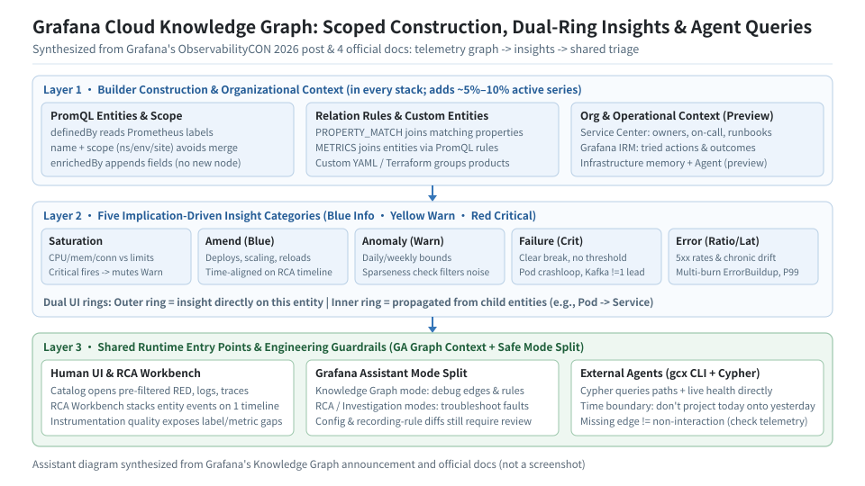
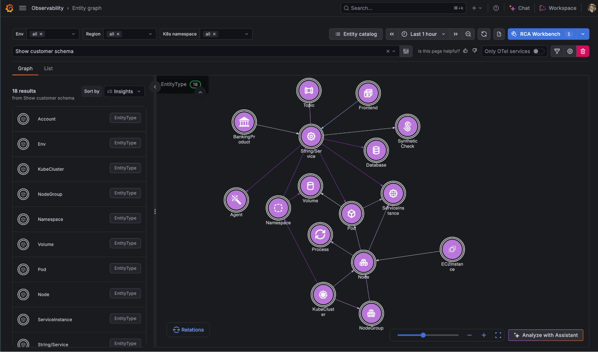
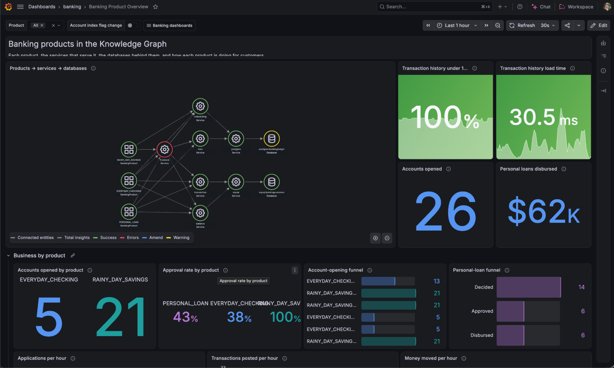

Sarah Constant (Grafana Labs) · 2026-10-20 (ObservabilityCON 2026) · [Original announcement](https://grafana.com/blog/full-stack-observability-with-knowledge-graph/) · Companion Grafana Cloud docs: [Overview](https://grafana.com/docs/grafana-cloud/knowledge-graph/) / [Graph rules](https://grafana.com/docs/grafana-cloud/knowledge-graph/entity-graph/graph-rules/) / [Insights](https://grafana.com/docs/grafana-cloud/knowledge-graph/insights/) / [Assistant](https://grafana.com/docs/grafana-cloud/knowledge-graph/assistant/)

Incident response stalls on two fronts: engineers lose minutes manually stitching metrics, logs, and dashboards across disconnected infrastructure layers, while autonomous agents burn tokens guessing PromQL labels just to reconstruct basic topology. Announced at ObservabilityCON 2026, **Grafana Cloud Knowledge Graph** stores a unified map of runtime entities, health implications, and organizational memory inside every Grafana Cloud stack—at **no separate license fee**, adding roughly **`5% to 10%` additional active series** for graph construction and insight telemetry.

> **Verification & scope note**: This rewrite synthesizes the October 20 launch post alongside four official Grafana Cloud documentation pages (`graph-intro`, `graph-rules`, `graph-insights`, `graph-assistant`). While the announcement cites customer architect Neil Wilson (LexisNexis Risk Solutions) and a banking product example, **Grafana has not published quantitative MTTR reductions or RCA accuracy benchmarks**. We also document a minor release-stage discrepancy between the announcement blog and the official overview doc regarding Agent Observability.

## Domain Coverage Matrix & Release-Stage Discrepancy

Rather than demanding wholesale application re-instrumentation up front, Knowledge Graph builds entities from existing Prometheus labels, OpenTelemetry traces (optionally switching traces into the primary graph builder), and cloud telemetry. Availability varies sharply by domain:

| Capability / Telemetry Domain | Launch Blog (`2026-10-20`) | Official Doc (`graph-intro`) | Practical Engineering Role |
| :--- | :--- | :--- | :--- |
| **Cloud infrastructure (AWS / GCP / Azure) & Frontend Observability** | **GA** | **GA** | Auto-discovers ECS, EC2, Cloud Run, Kubernetes Pods/Nodes/Volumes, topics, and browser apps |
| **Custom entities, relation rules & Terraform IaC** | **GA** | **GA** | Aggregates technical microservices into business domains (`BankingProduct`) via PromQL/label mappings |
| **Grafana Assistant Knowledge Graph mode & external `gcx`/Cypher queries** | **GA** | **GA** | Exposes live entities, relationships, and health state to Assistant and external agents via `gcx` CLI + **Cypher** |
| **Synthetic checks** | **Public Preview** | **Public Preview** | Links external uptime probes into upstream services to separate edge failures from internal dependency breaks |
| **AI agent observability inside the graph** | **Public Preview** | **Private Preview** | **Doc mismatch**: marked *Public Preview* in the launch post vs. *Private Preview* in `graph-intro`—verify feature flags per stack |
| **Microsoft SQL Server auto-discovery** | **Private Preview** | **Private Preview** | Extends existing MySQL, PostgreSQL, Redis, and Kafka discovery with SQL Server topology |
| **Grafana Cloud Service Center & IRM operational history** | **Private Preview** | **Private Preview** | Attaches ownership, on-call schedules, runbooks, and past incident outcomes (what worked vs. what failed) |
| **Grafana Assistant Investigations + Infrastructure memory** | **Private Preview** | **Private Preview** | Retains environment lessons across incidents and traverses graph dependencies during automated investigations |

That **IRM operational context** carries concrete investigative value beyond static ownership links: in Grafana's `Everyday Checking` banking scenario, the graph stores *outcome-level memory*—recording that a service restart helped briefly before errors returned, and that reverting a database connection-pool change actually restored service—helping prevent future responders or agents from repeating an ineffective mitigation.

## Scoped PromQL Graph Builder & Business-Level Entities

Official `graph-rules` documentation lays out the declarative schema behind the topology, avoiding black-box network magic in favor of reviewable PromQL rules and Terraform modules:

<figure>
  <a class="note-image-link" href="/assets/images/tech/knowledge-graph-context/kg-construction-query-en.svg" target="_blank" rel="noopener">
    
    Expand diagram ↗
  </a>
  <figcaption>Assistant diagram (not an original screenshot): End-to-end Knowledge Graph architecture synthesized from Grafana's launch post and four official docs.</figcaption>
</figure>

Four concrete builder mechanisms prevent common multi-cluster graph corruption:

- **Composite entity identity (`definedBy` + mandatory `scope`)**: Each entity rule runs a PromQL `definedBy` query and enforces a **`scope`** composite key (`namespace`, `env`, `site`) alongside `name`. Two `checkout` services in staging and production will not accidentally fuse into one node; when adding metadata without minting duplicate nodes, **`enrichedBy`** attaches properties to an existing node.
- **Explicit edge generation (`PROPERTY_MATCH` and `METRICS`)**: Deterministic ownership/containment links use `PROPERTY_MATCH` (e.g., `KubeCluster HOSTS NodeGroup`), whereas runtime calls and storage consumption rely on `METRICS` PromQL queries (e.g., `Pod USES Volume`), managed declaratively through **Terraform**.
- **Built-in entity schema inspection**: Running `Show customer schema` in `Entity graph` (`entities.png`) renders all 18 entity types (`BankingProduct`, `Frontend`, `Synthetic Check`, `Topic`, `String/Service`, `Database`, `Agent`, `Pod`, `ServiceInstance`, `Process`, `Node`, `EC2Instance`, `KubeCluster`, `NodeGroup`, `Volume`, `Namespace`, etc.) with one-click transitions into **`RCA Workbench`** and **`Analyze with Assistant`**.

<figure>
  <a class="note-image-link" href="/assets/images/tech/knowledge-graph-context/entities.png" target="_blank" rel="noopener">
    
    Expand diagram ↗
  </a>
  <figcaption>Original screenshot (Grafana Labs): Customer schema visualization across 18 entity types inside Knowledge Graph.</figcaption>
</figure>

- **Mapping infrastructure faults up to banking products**: In Grafana's banking dashboard (`custom-entities.png`), custom entity rules link `RAINY_DAY_SAVINGS`, `EVERYDAY_CHECKING`, and `PERSONAL_LOAN` (`BankingProduct`) across `frontend`, `onboarding`, `loan`, `transaction`, and `balance` services to `postgres:bankingledger` and `mysql:bankingcustomer`. Alongside live business KPIs (`100%`, `30.5 ms` load time, `26` accounts opened, `$62K` loans disbursed), operators immediately spot `frontend` glowing with a **red double ring (`Errors`)** and `postgres:bankingledger` flagged with a **yellow outer ring (`Warning`)**.

<figure>
  <a class="note-image-link" href="/assets/images/tech/knowledge-graph-context/custom-entities.png" target="_blank" rel="noopener">
    
    Expand diagram ↗
  </a>
  <figcaption>Original screenshot (Grafana Labs): Custom-entity mapping linking BankingProduct nodes to services, databases, and business KPIs.</figcaption>
</figure>

## Five Implication-Driven Insights & Dual-Ring Health Propagation

Instead of dumping isolated metric alerts into noisy channels, Knowledge Graph normalizes telemetry into **five implication categories** (`graph-insights`), paired with **dual UI rings** showing both local faults and blast-radius propagation:

| Insight Category | Severity Color | Signals & Systems Covered | Noise Control & Threshold Precedence |
| :--- | :--- | :--- | :--- |
| **`Saturation`** | Warning / Critical | CPU, memory, and connection limits nearing exhaustion | Three-tier override hierarchy (**container > exporter > global**—e.g., global `85%`, Redis exporter `80%`, critical instance `70%`); **Critical suppresses duplicate Warnings** |
| **`Amend`** | **Info (Blue)** | Deployments, scaling actions, Nginx/Elasticsearch reloads | Surfaced alongside faults on the `RCA Workbench` timeline so change causality is immediately visible |
| **`Anomaly`** | **Warning (Yellow)** | Statistically unusual jumps or drops vs. daily/weekly bounds | Applies **`erratic_and_sparse`** filtering to curb alerts on noisy low-volume services plus lower-bound traffic-drop checks |
| **`Failure`** | **Critical (Red)** | Unambiguous broken invariants requiring zero custom tuning | Catches Pod crashloops, Kafka `activecontrollercount != 1`, and hard failures across MySQL, PostgreSQL, Redis, Flux, and K8s |
| **`Error`** | Critical | Elevated HTTP/RPC failure rates and tail latency regressions | Breaks down into **`ErrorRatioBreach`**, multi-burn-rate **`ErrorBuildup`**, **`ErrorRatioAnomaly`**, **`InboundClientErrorAnomaly`**, **`LatencyAverageBreach`**, and **`LatencyP99ErrorBuildup`** |

On every entity circle, the **outer ring** displays health insights triggered directly by that entity, while the **inner ring** aggregates insights propagated upward from hierarchical child components (such as Pods feeding into a Service). Clicking any node opens pre-filtered **RED metrics, logs, traces, continuous profiling**, or aligns connected entities on a shared **`RCA Workbench`** timeline.

## Assistant Mode Separation, Trace Example, and Operational Guardrails

For agent-reliability architecture (`graph-assistant`), the notable design choice is **not** letting one unconstrained prompt mutate graphs and investigate production blindly. Grafana separates responsibilities across explicit modes and retains hard engineering boundaries:

1. **Separated modes & mandatory rule review**: **`RCA assistant` / `Investigation mode`** walks topology and cross-references `Insights` during incidents, whereas **`Knowledge Graph mode`** is dedicated to modeling gaps—for instance comparing Layer-4 byte flows against calls-per-second telemetry to discover missing **`routes`** edges, or reading **`Instrumentation quality`** diagnostics for dropped metrics and incomplete labels. Whenever Assistant drafts configuration or recording-rule edits, **changes arrive strictly as reviewable diffs requiring human approval**.
2. **External `Cypher` + `gcx` access & the LexisNexis trace**: Outside the Grafana UI, external operational agents can invoke **`gcx` CLI** and run **Cypher** graph queries directly against topology and live insights. In the launch post, **Neil Wilson (Principal Systems Architect, LexisNexis Risk Solutions)** cites an incident starting with service latency and a downstream HPCC cluster alert: Grafana Assistant traversed the graph downstream from the alerting service to trace the actual culprit—an **external vendor API call that had silently exhausted a database connection pool**.

Even with shared graph context live in production, engineering teams adopting it should enforce three strict verification guardrails:

- **Respect historical time windows**: Never assume today's live topology snapshot existed unchanged during yesterday's outage—bound graph queries to the incident interval when inspecting post-mortems.
- **Absence of an edge does not prove zero interaction**: Missing instrumentation, unsupported binary protocols, or `Instrumentation quality` label gaps can hide real dependencies; verify gaps against raw traces or network telemetry before ruling out blast radius.
- **Treat graph context as a faster starting line, not measured RCA proof**: With no published quantitative MTTR or accuracy benchmark yet, keep rule modifications human-reviewed and measure resolution time against your own incident baseline.

---

> **Provenance**: Rewritten and expanded by the assistant from Sarah Constant's ObservabilityCON 2026 announcement and four official Grafana Cloud Knowledge Graph documentation pages (`graph-intro`, `graph-rules`, `graph-insights`, `graph-assistant`), retaining original `id`, `permalink`, `published_at`, and topic tags (`authorship: assistant`, `translation_source: assistant`). Includes original screenshots (`entities.png`, `custom-entities.png`) plus assistant-synthesized architecture diagram `kg-construction-query-en.svg`.