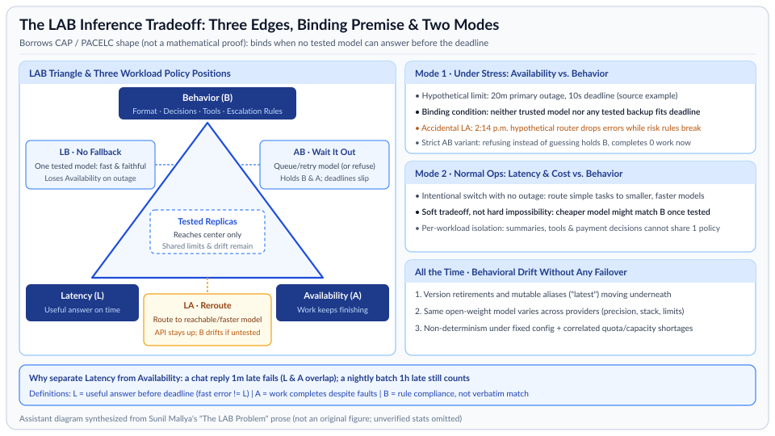
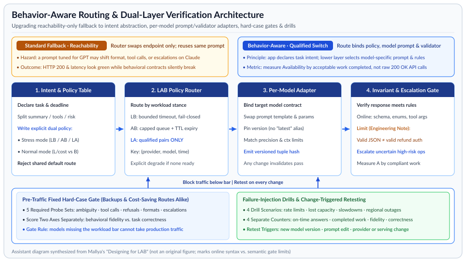

Sunil Mallya (`@sunilmallya`) · 2026-10-23 UTC · [Original X Post & Full Article: "The LAB Problem: A CAP-Like Tradeoff in LLM Inference"](https://x.com/sunilmallya/status/2113775305555116527)

In a high-scale LLM inference stack, a standard router can switch traffic to a backup model within seconds and restore clean HTTP metrics—yet quietly break the business rules the application depends on. In this article, Sunil Mallya introduces the **LAB problem**—**Latency, Availability, Behavior**—borrowing the shape of CAP and PACELC so engineering teams explicitly decide which property yields per workload before an outage happens, rather than letting default fallback rules decide by accident.

> **Evidence & scope boundary**: The author explicitly frames **LAB as borrowing CAP's shape, not a mathematical theorem or unconditional impossibility proof**. The opening **2:14 p.m. risk-agent failover scenario** and the stress example (**20-minute primary outage vs. 10-second deadline**) are **illustrative hypotheticals**, not documented incident postmortems or controlled experiments. Unverified third-party benchmark, tail-latency, and vendor-outage figures linked in the primary X Article are intentionally omitted here because they were not independently fetched or verified in the frozen archive. Original embedded graphics were likewise absent from the frozen export (`post.json`), so both figures below are assistant-authored engineering diagrams grounded in the source prose rather than reconstructions of missing visuals.

## Why Green Routers Still Fail Workloads: The 2:14 p.m. Scenario, Six Pressures & L/A/B Definitions

Mallya opens with a hypothetical incident: at **2:14 p.m.**, the primary model starts returning rate-limit errors. Within seconds, the router shifts traffic to a backup; error rates drop to zero, latency stays green, and on-call closes the alert. Three days later, the team discovers the **risk agent has been approving transactions it previously escalated** for review. The API never went down, yet the router silently traded **Behavior for Availability** without anyone making that choice.

The core lesson is that *restoring reachability is not the same as restoring behavior*. Mallya identifies **six everyday pressures** at production scale that expose this gap:

1. **Unpredictable tail latency**: Even healthy inference APIs exhibit wide spreads between median and high-percentile response times, routinely pushing requests past task deadlines.
2. **Routine provider degradations where backups aren't immune**: Major APIs experience regular periods of reported degradation (not always full outages), and partial overlap between provider incident windows makes naive multi-provider failover helpful yet far from foolproof.
3. **The same model name isn't the same service everywhere**: Even for nominally identical open-weight models, providers vary across latency, throughput, context limits, pricing, and reliability—forcing routers to evaluate **`(provider, model, task, time)`** rather than model name alone.
4. **Prompts aren't portable contracts**: A prompt tuned for GPT can yield different decisions, tool calls, or output formats when run against Claude (the source's example). Switching models frequently requires swapping prompts, parameters, and validation rules together.
5. **Routers solve reachability, not behavioral equivalence**: Citing OpenRouter's standard model fallback behavior, Mallya notes that retrying an existing payload against another model does not substitute an optimized per-model prompt—so HTTP succeeds while the application's contract breaks.
6. **Behavior drifts even without failover**: Model upgrades and retirements, differences in serving stacks, precision/quantization, inference configs, and non-determinism all shift outputs over time under an unchanged model label.

To make these tradeoffs explicit, Mallya defines three separable properties:

- **Latency (answers arrive on time)**: A **useful** response arrives before the task's deadline—a fast error does not count. Cost generally tracks latency because faster models are often cheaper.
- **Availability (work keeps getting done)**: Requests still complete when the primary model fails or slows down, **even if some finish late**.
- **Behavior (output follows the task's rules)**: Responses satisfy required formats, decisions, escalation thresholds, tool calls, and safety limits—meaning **rule compliance, not verbatim identity** with the primary model's wording.

Why separate Latency from Availability? A chat reply arriving one minute late is useless (in strictly real-time APIs, L and A overlap), whereas a nightly batch job finishing an hour late remains completely valid—determining whether queuing to protect behavior is viable.

<figure>
  <a class="note-image-link" href="/assets/images/tech/lab-inference-tradeoffs/lab-tradeoff-positions-en.svg" target="_blank" rel="noopener">
    
    Expand diagram ↗
  </a>
  <figcaption>Assistant diagram (not an original figure): Organizing Mallya's LAB triangle positions, binding condition, two operational modes, and continuous drift vectors.</figcaption>
</figure>

## The CAP/PACELC Premise: Non-Trivial Binding Condition, Three Positions & Two Modes

Reading LAB as "every inference call must always sacrifice one property" misses its central qualification. Mallya states clearly that the **hard binding limit** occurs under one specific condition: **the trusted model cannot answer before the deadline, and no tested backup can meet the deadline either**.

When that premise holds, waiting or refusing protects behavior at the expense of timely completion, while rerouting to an untested alternative might happen to succeed—yet **cannot be promised**. Conversely, when a **verified, equivalent replica** across another provider can respond within budget, switching does not automatically forfeit behavior. That is how tested copies reach the center of the triangle—though Mallya warns they only push the boundary back: **account-wide limits or shared capacity shortages can strike every replica simultaneously, and every copy still drifts independently**.

Inspired by CAP's extension **PACELC**, LAB surfaces across **two operational modes** plus constant drift, selecting among three policy positions per workload:

- **LB — No Fallback**: Pin one tested model with no rerouting. Fast and behaviorally faithful while healthy; forfeits Availability when that model degrades or goes down.
- **AB — Wait It Out**: Queue or retry against the trusted model (with **explicit refusal instead of guessing** as its stricter variant). Behavior holds—and queued work still completes—while deadlines slip.
- **LA — Reroute**: Dispatch to whichever model is reachable, faster, or cheaper. Availability and latency stay green, while Behavior risks drifting unless the target path is verified for that workload.

> **Engineering derivation (distinct from primary source text)**: `LB`, `AB`, and `LA` are policy declarations, not complete runtime state machines. Putting them in production requires three runtime controls: first, pure `LB` still needs tight per-attempt timeouts and circuit-breaking so slow primary degradation does not exhaust caller threads; second, `AB` queues require admission caps, request deadline expiry (`TTL`), and caller cancellation propagation so late completions do not execute stale side effects; third, `LA` must restrict fallback to an explicit per-workload `allowed_failover_pairs` whitelist rather than an open fallback pool.

| Position / Mode | Routing Rule | Triggering Mode & Premise | Protected vs. Yielded Properties | Runtime State-Machine Requirement (Assistant Derivation) |
| :--- | :--- | :--- | :--- | :--- |
| **`LB` No Fallback** | Stick to one tested model; refuse fallback | **Stress**: primary errors or exceeds budget | Holds **L + B** when healthy; drops **A** on outage | Needs bounded per-call timeouts & circuit breakers so slow stalls fail cleanly |
| **`AB` Wait / Refuse** | Queue/retry trusted model, or refuse rather than guess | **Stress** (e.g., 20m outage vs. 10s deadline example) | Queuing holds **A + B**, yields **L**; refusal pauses work | Enforce queue depth caps, TTL expiry, and cancellation so stale tool effects never fire |
| **`LA` Reroute** | Fail over to reachable, faster, or cheaper alternative | **Stress** rescue or **Normal** cost/speed routing | Preserves **L + A**; **B** drifts if route is unverified | Constrain targets to workload-qualified `(provider, model)` pairs + matched prompts |
| **Normal Cost Routing** | Primary healthy; divert simple work to smaller models | **Normal ops (PACELC-E)**: **soft tradeoff**, not hard bound | Cheaper route *may* match **B** once workload-tested | Subject fast/cheap routes to identical pre-traffic hard-case gates and change retests |

## Behavior-Aware Routing Architecture: Intent Abstraction, Adapters & Change Retesting

Under *Designing for LAB*, Mallya stresses that the objective is **not avoiding model switches, but making every switch a tested, deliberate policy choice**. His six prescriptions form a cohesive control loop pushing application semantics down into the routing layer:

1. **Assign an explicit LAB position per workload**: Document deadlines, stress policy (`LB`/`AB`/`LA`), and normal-operation policy separately—summarization and payment decisions should never share rules.
2. **Keep a prompt per model via intent abstraction**: Application code names the *task*; a layer underneath resolves the model-specific prompt, inference parameters, and validators for whichever model executes the call.
3. **Test every model before it serves traffic**: Failover backups and everyday cost-saving routes alike must pass workload qualification before receiving production requests.
4. **Use a fixed suite of hard cases**: Test **ambiguity, tool calls, refusals, formats, and escalations**, scoring **behavioral fidelity** and **task correctness** separately.
5. **Retest on every change**: Any new model version, prompt edit, provider switch, or serving configuration change invalidates prior approval; models falling below the bar must not take workload traffic.
6. **Measure availability as acceptable work completed**, not successful HTTP status codes.

<figure>
  <a class="note-image-link" href="/assets/images/tech/lab-inference-tradeoffs/behavior-aware-failover-architecture-en.svg" target="_blank" rel="noopener">
    
    Expand diagram ↗
  </a>
  <figcaption>Assistant diagram (not an original figure): Synthesizing Mallya's intent abstraction, per-model adapters, fixed hard-case gates, and failure drills with explicit online validation boundaries.</figcaption>
</figure>

> **Engineering derivation (versioned qualification tuples)**: Tracking only `model_name` breaks down as soon as open-weight providers differ in serving precision or when aliases move silently. A production behavior-aware router should pin eligibility to an immutable qualification tuple—`(workload_id, mode, provider, model_version, serving_config, prompt_ver, param_profile, validator_bundle, hardcase_eval_digest)`—automatically blocking `"latest"` aliases and demoting any candidate whenever any tuple field changes until hard-case retests renew its signature.

## Online Invariant Limits, Failure Drills & Workload Policy Matrix

Once validation enters the request path, engineering teams face an unavoidable boundary: **what can a fast online validator actually prove?** Combining Mallya's "verify the response meets the behavioral contract" requirement with practical validator limits (the distinction below is an assistant engineering analysis) requires separating **online structural invariants** from **semantic contracts**:

- **Online invariant gates catch structure and hard boundaries**: JSON schema compliance, valid enums, required fields, tool allowlists, argument types, and hard spend/authority ceilings run in milliseconds and block malformed payloads or unauthorized tools immediately.
- **Valid syntax never proves semantic judgment**: Returning to Mallya's 2:14 p.m. risk-agent illustration, a backup model can emit syntactically flawless JSON and invoke the right tool name while still lowering its threshold on ambiguous high-risk cases from *escalate* to *approve*. Because online schema checks cannot adjudicate edge-case judgment, semantic contracts rely on **offline hard-case gates (including historical edge replays), shadow/canary traffic audits, and strict `AB`/human-escalation queues** for uncertain high-impact actions.

To prevent behavioral drift from hiding behind green API metrics, Mallya prescribes **failure-injection drills** simulating **rate limits, lost capacity, slow responses, and regional outages**—tracking **on-time answers, completed work, behavioral fidelity, and correctness** separately. Recording all four prevents a slow-yet-faithful `AB` recovery from being conflated with a fast-yet-unauthorized `LA` defect.

The matrix below combines Mallya's multi-workload principle with the runtime controls above as a design-review checklist (specific positions remain the workload owner's decision based on business loss rather than a prescriptive score supplied by the primary source):

| Workload Class | Deadline Sensitivity | Typical Stress Position | Normal Cost/Speed Condition | Online Invariants & Escalation Gate (Engineering Extension) |
| :--- | :--- | :--- | :--- | :--- |
| **Live Chat Summaries / Copy** | Tight (late reply loses value) | **`LA` (qualified backups)** or short fallback | Fast/cheap models allowed after passing format & fidelity cases | Enforce length/language/no-fabrication checks; minor phrasing shifts tolerated |
| **Read-Only Search & Internal QA** | Moderate (seconds to tens of seconds) | **`LA` (tested pairs)** or brief `AB` retry | Dynamic `(provider, model, time)` routing once hard-case tested | Enforce citation presence & honest refusal format when all paths fail |
| **External Tool Execution Agents** | Moderate (short task wait viable) | **`AB` (TTL-capped queue)**; fail closed past deadline | Fast routes allowed only after tool-call, ambiguity & refusal passes | Hard-block non-allowlisted tools/args online; never bypass argument checks |
| **Risk / Payment Approvals** | Tolerates escalation/async delay | **Strict `AB` (wait or queue for human review)**; no untested fallback | Keep primary path unless cheaper route proves equal escalation bar | Syntax checks act only as first screen; route uncertain/edge amounts to human queue |

Mallya closes with an unmistakable operational reality: **every production LLM system already holds a LAB position for every workload—the only open question is whether an engineer deliberately chose it.**

---

> **Provenance**: Rewritten and structured by the assistant from Sunil Mallya's X post and frozen primary archive (`post.json` full `article_text` and captured HTML), preserving original `id`, `permalink`, `published_at`, and topic tags (`inference-serving`, `agent-reliability`, `systems-reliability`). Primary source claims are explicitly separated from assistant engineering derivations; unverified third-party benchmark and vendor outage counts are omitted per curation review notes, and no missing embedded visuals are reconstructed. Both `v3-blue` diagrams (`lab-tradeoff-positions-en.svg`, `behavior-aware-failover-architecture-en.svg`) are assistant-authored visualizations derived strictly from the source prose and scope-labeled engineering analysis.