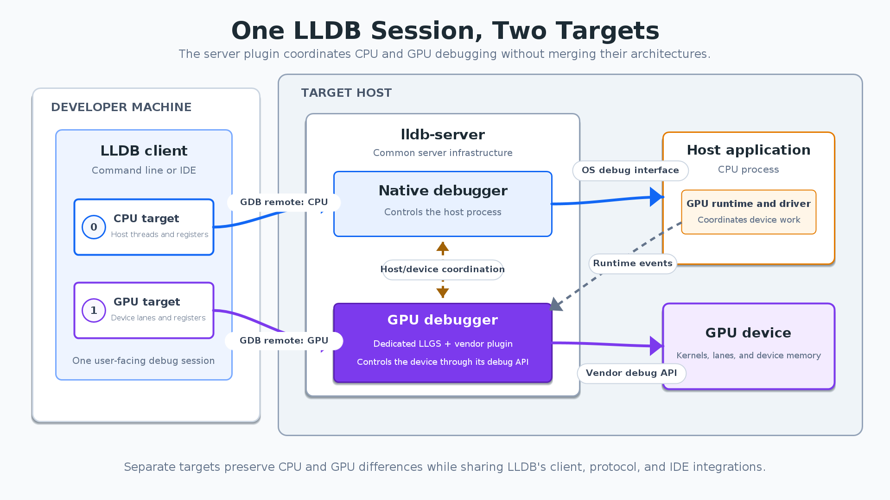

AI failures can cross CPU/GPU boundaries: the host prepares arguments and loads modules before a device kernel fails. Separate vendor debuggers duplicate command handling, symbols, remote protocols and IDE integration. Meta’s LLDB extension separates common infrastructure from device control while exposing different architectures in one session.

Original: [Extending LLDB to Debug Applications That Span CPUs and GPUs](https://engineering.fb.com/2026/11/09/developer-tools/extending-lldb-to-debug-applications-that-span-cpus-and-gpus/)  
Greg Clayton, Satyanarayana Janga, Jeffrey Tan, Janet Yang, Bar Soloveychik, Chen Li, Vipul Bansal · 2026-11-09

## Why a GPU is not simply another set of threads

A conventional debugger often assumes one architecture and one coherent memory view per process. GPUs have different registers, lanes, modules and address spaces. The same numeric address can identify unrelated CPU and GPU objects. Combining everything into one artificial process would make memory reads, stepping and breakpoints conditional on hardware throughout the debugger.

The extension creates separate LLDB targets, each associated with its own debugger process and architecture. The CPU uses the existing native path. An accelerator plugin provides a second connection for the GPU. Users can switch targets within one CLI or IDE session while memory, registers and stop reasons retain their correct ownership.

<a class="note-image-link" href="/assets/images/tech/lldb-accelerators/official-1.png" target="_blank" rel="noopener" aria-label="CPU and GPU targets coordinated by the server plugin in one LLDB session · View original image ↗">View original image ↗</a>

*Reading the diagram: two targets share the client on the left. The native debugger and GPU plugin separately manage the host and device, coordinating through runtime events.*

## Coordinate through host-runtime events

`lldb-server` already controls the host process and communicates through the GDB remote protocol, making it the coordination point. The client discovers available plugins. A plugin requests internal host breakpoints at runtime events where device debugging can initialize. When execution reaches one, the server notifies the plugin, which prepares a device endpoint. LLDB then creates and connects the accelerator target.

The shared protocol describes discovery, initialization, modules and execution coordination. Vendor backends translate their APIs into LLDB processes, threads, registers, memory and breakpoints. Extensibility comes from a stable operations interface, not identical hardware internals. For CPU-only applications without a supported GPU runtime, the article reports preservation of the existing native path without device-debugging runtime overhead.

## The evidence is an operational debugging path

A HIP vector-dot-product example shows x86-64 and amdgcn targets in the same session. A device-function breakpoint begins pending, resolves when its module loads, and produces a GPU backtrace through `compute_element` and the kernel after target selection. This demonstrates module lifecycle, deferred breakpoint resolution and target-specific inspection together.

A hardware-independent mock accelerator plugin tests discovery, breakpoint coordination, connection creation and basic device state in LLVM’s suite. These tests let common infrastructure evolve without specialized hardware, but cannot replace real driver and device compatibility tests. The article supplies no throughput benchmark or measured reduction in diagnosis time.

## Shared framework and device support remain distinct

The design covers live debugging and GPU core dumps. A common base handles LLDB integration for dumps, while vendor implementations provide device threads, registers, memory and modules. Most shared infrastructure is reported upstream; remaining pieces are still planned. This is not complete support for every GPU.

The diagnostic advance is preserving heterogeneous state boundaries inside a shared, testable workflow. Users still need a supported runtime and vendor plugin. A unified client cannot supply a missing device API. Plugin coverage, driver compatibility and core-dump completeness are the next meaningful questions.
