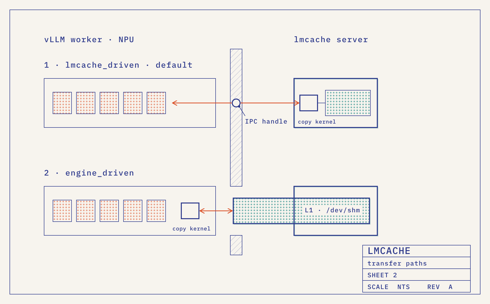

[LMCache × Ascend: Multi-Process Mode On Ascend NPUs](https://blog.lmcache.ai/en/2026/11/16/lmcache-x-ascend-part-two-multiprocess-mode-on-ascend-npus/)  
LMCache Team · 2026-11-16

LMCache’s multi-process support on Ascend changes ownership rather than introducing another cache-hit algorithm. A standalone lmcache server stores KV state, and vLLM connects through LMCacheMPConnector. A surviving cache service can retain state across worker restarts, while compatible prefixes can be shared by multiple engines. This separates inference-process and cache lifetimes.

## Why the process boundary matters

An engine-owned cache typically disappears with the engine. Moving storage, chunking, retrieval and eviction into another process also moves some Python GIL, CPU and I/O work away from scheduling and decode, although necessary connector coordination remains. Lookup and storage run asynchronously where possible, not without any blocking in every case.

The fault boundary is specific: surviving worker failure is not automatic recovery from cache-server failure or replicated multi-node disaster recovery. Reuse still requires compatible prefixes and model configuration. The design separates state ownership; it does not promise that all restarts preserve everything.

## Two data paths assign copying differently

The control plane defaults to lightweight ZMQ RPC. In lmcache_driven, the NPU default, a worker exports device-memory IPC handles. The server accesses KV through those handles and executes native multi-layer block-transfer kernels for gather/scatter. Cross-process events signal when transfers are safe; coordination and tensor movement are distinct paths.

<a class="note-image-link" href="/assets/images/tech/lmcache-ascend-mp/method.png" target="_blank" rel="noopener" aria-label="Above, the server copies through IPC; below, the worker writes shared L1. Tensor movement is distinct from control messages. · View original image ↗">View original image ↗</a>

*Above, the server copies through IPC; below, the worker writes shared L1. Tensor movement is distinct from control messages.*

In engine_driven, workers perform gather/scatter and copy directly into a named /dev/shm pool mapped by both processes, which serves as the server’s L1. Shared memory avoids an extra host-side staging copy, not all device–host movement. This path fits single-format GQA/MHA. DeepSeek-V4’s mixed-dtype latent, rope, DSA-indexer and scale planes use lmcache_driven natively, without host repacking or format downgrades.

Path selection therefore depends on layout and copying responsibility, not an unsupported claim that one is always faster. Hybrid Mamba/GDN state also has alignment and object-group requirements rather than behaving as ordinary interchangeable K/V tensors.

## Separate the upstream platform layer from hardware kernels

Device IPC, interprocess events, device operations, multi-plane formats and transfer-mode negotiation move into LMCache’s upstream device abstraction. LMCache-Ascend supplies Ascend C kernels. Compared with runtime patching inside a plugin, this lets the shared control and storage layers evolve upstream while preserving hardware-specific data paths.

Reported validation covers Ascend 910B/910C and Atlas 800I A2/A3, with Qwen, DeepSeek-V4 and GLM-5.3 among the models. Software pairings matter: development branches and releases are not freely interchangeable, and plugin dependencies must match CANN. DeepSeek-V4 needs 4096-token chunk alignment negotiated before sessions start.

## Functional validation is not a performance promise

The official verification procedure repeats a long prompt and observes stored tokens, retrieval and external-prefix hits. It establishes a working path, but the article supplies no throughput, TTFT or worker-recovery-time measurements. Disabling internal prefix caching in the example isolates attribution; it is not a universal production recommendation.

CacheBlend and CacheGen remain unsupported in MP mode. Compressed and hybrid layouts for engine_driven and multi-node caching remain future directions. The key advance is reusable state outside engine lifetime and concrete NPU transfer ownership. Stint addresses a different problem: a preempted request’s opportunity to generate after recovery. Persistence and progress are complementary, not substitutes.
