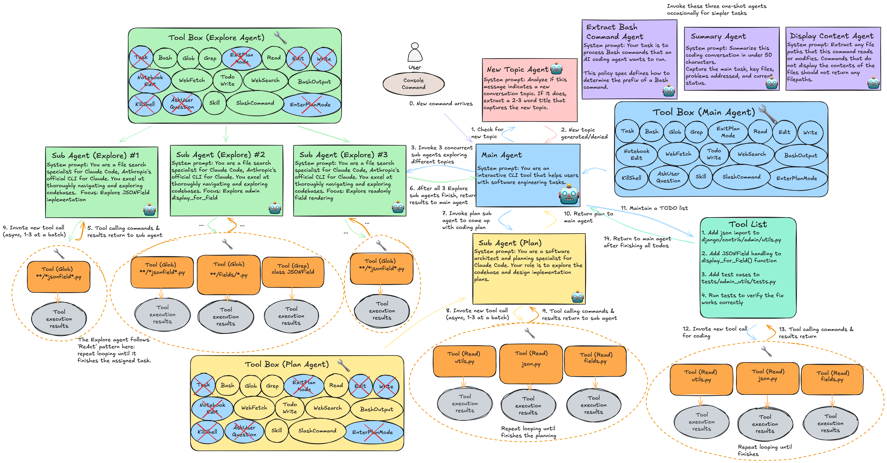
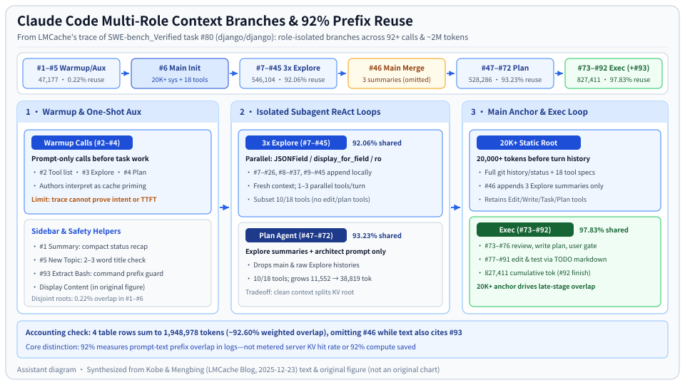

Kobe, Mengbing (LMCache Blog) · Originally published 2025-12-23 · [Primary Engineering Blog](https://blog.lmcache.ai/en/2025/12/23/context-engineering-reuse-pattern-under-the-hood-of-claude-code/) · Author-shared tracing setup from comments: [`kobe0938/claude-code-tracing`](https://github.com/kobe0938/claude-code-tracing) · [Notion Tracing Notes](https://wide-preface-8a2.notion.site/Claude-Code-tracing-30c13b4793fb80d7a26ac1def9c71388?pvs=74)

Even a narrow bug fix can generate nearly two million input tokens across an agent run. On December 23, 2025, Kobe and Mengbing at LMCache took advantage of Claude Code's open-sourced local client to intercept outbound LLM traffic on a single coding task, logging `92` LLM calls, roughly `2M` input tokens, `13` minutes of total duration, and a `92%` prefix reuse rate. The deeper lesson is not the headline percentage by itself, but the architectural tension it exposes: **append-only intra-role loops create massive structural prefix overlap, while cross-role isolation, cache TTL windows, and non-prefix file reads decide whether serving engines actually realize those savings**.

> **Evidence & scope boundary**: Rewritten from the frozen text capture of the December 23, 2025 LMCache post and its preserved diagram `figure.png`. Four boundaries keep metrics separate from extrapolations: **First**, the sample is a **single run on one randomly selected `SWE-bench_Verified` task (`#80`, `django/django` at commit `2e0f04507b17362239ba49830d26fec504d46978`)**, not a population estimate across coding agents. **Second**, the primary post contains internal scope inconsistencies: headlines state calls `#1–#92`, and the four-row phase table sums to `1,948,978` tokens while **omitting `#46`** (where the main agent ingests Explore summaries); meanwhile the execution prose cites an auxiliary call `#93` (*Extract Bash Command*), and `figure.png` includes an unnumbered *Display Content Agent* not listed in the call breakdown. **Third**, `92%` measures **textual prompt-prefix overlap** in `claude_code_trace.jsonl` (which logged only LLM inputs and outputs), not server-metered `cache_read_input_tokens` or measured TTFT deltas; the `$4.85` (`81%`) calculation is back-of-the-envelope arithmetic at Claude Sonnet 4.5 list pricing assuming 100% cache hit realization, and `"5-10x"` TTFT reduction is cited as general industry background rather than a trace benchmark. **Fourth**, the LiteLLM proxy config in the author's comment reply names newer models (`claude-sonnet-4-6`, `claude-haiku-4-5-20251001`, `claude-opus-4-6`), reflecting a later reply template rather than the December 2025 Sonnet 4.5 pricing example.

## Local Traffic Capture and Multi-Role Context Topology Across Calls #1–#93

Unlike cloud-hosted agents whose orchestration stays behind opaque API gateways (the authors contrast Perplexity, Devin, and Manus) or fully open-source harnesses deployed end-to-end (Mini SWE Agent, Terminus 2), Claude Code runs a partially local, open-sourced client that calls remote Anthropic endpoints. That split enabled the authors to intercept every LLM input and output into `claude_code_trace.jsonl`. In the post's comment section, Kobe details the interception recipe: running a local **LiteLLM** proxy at `http://localhost:4000` with `forward_client_headers_to_llm_api: true` (to pass OAuth headers to Anthropic), logging to PostgreSQL via `custom_callbacks.proxy_handler_instance`, and pointing the client via `ANTHROPIC_BASE_URL`, `ANTHROPIC_MODEL`, and `ANTHROPIC_CUSTOM_HEADERS`.

The traced prompt comes directly from `SWE-bench_Verified` task `#80` on `django/django` (commit `2e0f04507b17362239ba49830d26fec504d46978`), where readonly `JSONField` values in Django admin display as Python dicts (`{'foo': 'bar'}`) rather than valid JSON (`{"foo": "bar"}`). The issue statement even hints at a candidate fix in `django.contrib.admin.utils.display_for_field`: calling `prepare_value` on `JSONField` rather than `json.dumps` directly so `InvalidJSONInput` remains handled.

Despite that tight problem scope, the captured trace decomposes into three distinct role families rather than one linear chat log:

1. **Warm-up and one-shot auxiliary calls (`#1`–`#5` plus execution-time helpers)**: Before main execution starts, the client issues five short calls. `#1` (*Summary Agent*, described inside `figure.png` as summarizing in under 50 characters) and `#5` (*New Topic Agent*, checking whether to extract a 2–3 word sidebar title) handle UI metadata. Calls `#2`, `#3`, and `#4` are labeled **"warm-up" steps**, sending bare prompt templates for the tool list (`#2`), Explore subagent (`#3`), and Plan subagent (`#4`) without task history. **Source attribution boundary**: the authors interpret `#2`–`#4` as deliberate cache priming to speed up subsequent subagent calls, yet input/output traffic logs alone cannot verify internal Anthropic design intent or quantify any latency actually saved. During execution, the prose also flags **Extract Bash Command (`#93`)** (a one-shot safety parser checking command prefixes to prevent unconfirmed destructive commands like `rm`), while `figure.png` additionally depicts a **Display Content Agent** extracting file paths read or modified by commands.
2. **Main Agent spine (`#6`, `#46`, `#73`–`#76`, `#77`–`#92`)**: When the main agent starts at `#6`, its system prompt already exceeds **`20,000` tokens** *without conversation history*—packing full git repository state and history, specifications for all **18 tools** (explicitly drawn in `figure.png` as `Task`, `Bash`, `Glob`, `Grep`, `ExitPlanMode`, `Read`, `Edit`, `Write`, `NotebookEdit`, `WebFetch`, `TodoWrite`, `WebSearch`, `BashOutput`, `KillShell`, `AskUserQuestion`, `Skill`, `SlashCommand`, and `EnterPlanMode`), and execution instructions. Rather than browsing files directly at the outset, it delegates exploration, ingests the resulting summaries at `#46`, reviews and persists a markdown plan (`#73`–`#75`), exits plan mode for interactive user approval (`#76`–`#77`), executes edits and tests against the markdown TODO checklist (`#77`–`#91`, targeting `utils.py` and `test_admin_utils.py` / `tests/admin_utils/tests.py` across text and figure), and closes with `#92`.
3. **Context-isolated subagent loops (Explore `#7`–`#45` and Plan `#47`–`#72`)**: Subagents do **not** inherit the main agent's `20K+` history. First, the main agent fans out **3 parallel Explore subagents** (`#7–#26` on `JSONField`, `#8–#37` on `display_for_field`, and `#9–#45` on readonly rendering). Each starts fresh with its own file-search system prompt and a **`10/18` tool subset**—crossing out the 8 write/orchestration/interactive tools marked with red X's in `figure.png` (`Task`, `ExitPlanMode`, `Edit`, `Write`, `NotebookEdit`, `KillShell`, `AskUserQuestion`, `EnterPlanMode`)—running ReAct loops with `1–3` parallel tool calls per step until `#45` completes. Next, the **Plan subagent (`#47`–`#72`)** also starts clean with a software-architect prompt, the `10/18` tool subset, and only the **summaries** of the three Explore runs (dropping main and raw Explore tool histories), accumulating monotonically from `11,552` tokens to `38,819` tokens.

<figure class="note-figure">
  <a class="note-image-link" href="/assets/images/tech/lmcache-claude-code-reuse-pattern/figure.png" target="_blank" rel="noopener" aria-label="View preserved original architecture diagram from the LMCache blog post">
    
    View original figure ↗
  </a>
  <figcaption>Preserved primary figure (Kobe &amp; Mengbing, LMCache Blog, 2025-12-23): Depicts the Main Agent's 18-tool set, the 10/18 Explore and Plan subsets (8 tools crossed out), 3 parallel Explore loops, and one-shot helper agents. Note a minor label quirk in the original graphic where the TODO checklist box at step 11 is titled Tool List.</figcaption>
</figure>

## Anatomy of 92% Prefix Reuse: Role-Local Append Loops and Denominator Math

Why does fixing a single Django admin rendering helper require nearly `2M` input tokens? Because stateless autoregressive LLM APIs do not persist session KV state across turns on behalf of the caller: at every ReAct step, the client replays the entire prior prefix (`system prompt + prior tool calls + prior tool outputs`) plus the latest delta. Across `T` sequential turns with roughly steady observations, cumulative input volume grows quadratically (`O(T²)`) with depth, making the trailing step carry almost exclusively previously seen text.

<figure class="note-figure">
  <a class="note-image-link" href="/assets/images/tech/lmcache-claude-code-reuse-pattern/claude-code-prefix-reuse-anatomy-en.svg" target="_blank" rel="noopener" aria-label="Click to zoom Claude Code multi-role context branches and 92% prefix reuse diagram">
    
    Click to zoom ↗
  </a>
  <figcaption>Assistant diagram (not an original figure): Reconstructing the trace as separate role-isolated prefix trees while flagging the table's omitted #46 step and #93 auxiliary call.</figcaption>
</figure>

Examining the primary post's four-phase breakdown alongside each branch's context boundary clarifies where the `92%` denominator comes from:

| Trace Range | Role & Context Isolation Boundary | Prompt Anchor & Tool Subset | Reported Input Tokens | Reported Shared Prefix % | Audit Note & Structural Driver |
| :--- | :--- | :--- | :--- | :--- | :--- |
| **`#1`–`#6`** | Warm-ups (`#2`–`#4`), sidebar helpers (`#1`, `#5`), and Main init (`#6`) | Disjoint short helper templates; `#6` adds `20,000+` token prompt & `18` tools | `47,177` | `0.22%` | Distinct initial prompts yield near-zero shared prefix |
| **`#7`–`#45`** | 3 parallel **Explore** subagents (`#7–#26`, `#8–#37`, `#9–#45`) | Explore system prompt + `10/18` tools; no Main history | `546,104` | `92.06%` | Append-only ReAct loops inside each branch (`1–3` tools/step) |
| **`#46`** (unlisted) | **Main Agent** ingests 3 Explore summaries & invokes Plan | `20,000+` main prefix + 3 summary strings (drops raw traces) | Not tabulated | Not reported | Narrative places handoff at `#46`, yet the phase table skips it |
| **`#47`–`#72`** | 1 **Plan** subagent (clean ReAct planning chain) | Architect prompt + Explore summaries + `10/18` tools | `528,286` | `93.23%` | Single trajectory grows from `11,552` to `38,819` tokens |
| **`#73`–`#92`** | **Main Agent** plan review, markdown TODO, user gate, & execution | `20,000+` main prefix + plan file + edit/test observations | `827,411` | `97.83%` | Massive `20K+` static anchor replayed ~20 turns; prose also cites `#93` |

Three accounting and systems implications emerge when inspecting those numbers closely (derived by the assistant from the reported trace structure, not stated directly by the authors):

- **Weighted sum vs. table omissions**: Summing the four tabulated rows yields `47,177 + 546,104 + 528,286 + 827,411 = 1,948,978` tokens, with a token-weighted overlap of roughly `1,804,717 / 1,948,978 ≈ 92.60%`—consistent with the headline `~2M` and `92%`. Yet `#46` is missing from the table, `#93` (*Extract Bash Command*) sits outside `#1–#92`, and `figure.png`'s *Display Content Agent* lacks a call number altogether. Treat the table as an accurate structural profile of role-local reuse, not an exhaustive billing ledger.
- **Why execution reaches `97.83%`**: Because the main agent carries a `20,000+`-token system prompt *before* turn 1, every edit/test iteration in `#73–#92` appends a modest tool response behind a massive static block, pushing prefix overlap near 98%.
- **Context hygiene vs. KV tree branching**: Isolating Explore and Plan onto fresh contexts prevents search clutter from polluting the main agent's reasoning—a clear reliability win. From a KV-cache perspective, however, that hygiene forks one linear prefix into at least five disjoint prefix roots (1 Main + 3 Explore + 1 Plan) whose summaries cross roles as compact text rather than shared KV tensors.

## System Prompt Stability, Cache Invalidation Triggers, and TTL Economics

Having `92%` textual prefix overlap only lowers latency and API bills if serving caches stay valid across the exact sequence and timing of real calls. Grounding the pricing mechanics from Section 3 and the non-prefix bottlenecks from Section 5 against the `13`-minute trace exposes four concrete invalidation boundaries.

First, the primary post summarizes current prefix-caching models and applies Sonnet 4.5 pricing to its `2M`-token run:

- **Provider pricing models**: OpenAI Prompt Caching activates automatically past **`1,024` tokens** with a **`90%` read discount** (blog example: GPT-5.2 `$1.75` → `$0.175`/MTok). Anthropic requires explicit **`cache_control`** markers, charging **`1.25×` base input** for **5-minute** cache writes (**`2×`** for **1-hour** cache writes) and granting a **`90%` discount** on reads (blog example: Claude Sonnet 4.5 `$3.00`/MTok base, `$3.75` write, `$0.30` read).
- **Open-source serving mechanisms**: vLLM's automatic prefix caching (APC) hashes physical KV blocks under PagedAttention; SGLang's RadixAttention matches longest prefixes in a radix tree; LMCache pools KV blocks across distributed nodes and storage tiers.
- **Primary cost calculation**: Treating `2M` tokens at Sonnet 4.5 base rates yields `$6.00` uncached versus `1.84M × $0.30 + 0.16M × $3.75 = $0.552 + $0.600 = $1.152` cached—saving **`$4.85` (`81%`)** on one task.

<figure class="note-figure">
  <a class="note-image-link" href="/assets/images/tech/lmcache-claude-code-reuse-pattern/context-mutation-cache-invalidation-en.svg" target="_blank" rel="noopener" aria-label="Click to zoom context mutations, cache invalidation triggers, and non-prefix reuse limits diagram">
    
    Click to zoom ↗
  </a>
  <figcaption>Assistant diagram (not an original figure): Mapping the primary post's 5m vs 1h TTL pricing, early-prefix byte stability, and Section 5 non-prefix KV limits onto one diagnostic frame.</figcaption>
</figure>

Evaluating that ideal `$1.152` baseline against the actual trace structure reveals four real-world invalidation hazards (items 1, 2, and 4 are assistant engineering derivations from the primary figures and cache rules; item 3 is directly documented in Section 5 of the primary post):

1. **Early-prefix fragility on git state**: Section 4 notes that the main agent's `20,000+`-token system prompt embeds *complete git repository state and history*. Read-only Explore steps leave the working tree untouched, but once `#77–#91` edit `utils.py` and `test_admin_utils.py`, **any client implementation that refreshes `git status` or diffs inside the opening system prompt invalidates the entire prefix hash from token 0 onward**, turning `#73–#92`'s `97.83%` overlap into full recomputation. Preserving high cache hits requires keeping session-start repo state immutable in the prefix and appending mid-run file changes solely at the tail.
2. **5-minute TTL vs. 13-minute session length**: The complete task runs **`13` minutes**, more than double Anthropic's **`5-minute`** TTL (`1.25×` write tier). Between `#6` and `#46`, the main branch waits for all three Explore loops (`#7–#45`); between `#76` and `#77`, execution pauses for **interactive human plan approval**. Any pause exceeding 5 minutes silently evicts the main agent's cached `20K+` prefix, forcing another `1.25×` write surcharge—and similarly risking expiry of warm-up `#4` (Plan) during long Explore runs. Moving long pauses onto the 1-hour tier removes mid-run expiry at the cost of a `2×` write premium.
3. **Non-prefix substrings blocked by causal attention (Primary Section 5)**: The authors spotlight two reuse patterns that standard prefix hashing cannot capture. First, Explore and Plan share **`10/18` of the main agent's tool schemas**, yet place them behind different subagent system prompts—causing prefix matching to miss from byte 0. Second, multiple agents repeatedly read the **same source files** (`utils.py`, `json.py`, `fields.py` in `figure.png`) after diverging tool histories. Under standard **causal attention**, a chunk's KV tensors depend on every preceding token, so identical file substrings appearing after different prefixes cannot be pasted directly—motivating selective boundary-token recomputation work like **CacheBlend** ([`arXiv:2405.16444`](https://arxiv.org/abs/2405.16444)) cited by the authors.
4. **Parallel fan-out scatter across serving replicas**: With `3` Explore subagents running concurrently and `1–3` parallel tool batches per turn, stateless load balancing in self-hosted clusters scatters sibling branches across GPUs unless prefix-sticky routing or a cluster-wide KV pool like LMCache bridges replicas.

| Observation / Reported Claim | Primary Source Grounding & Scope | Misreading Risk / Unstated Assumption | Serving & Harness Design Implication |
| :--- | :--- | :--- | :--- |
| **`92` calls vs. `#93` & `#46`** | Headline `#1–#92`; phase table drops `#46`; prose adds `#93`; `figure.png` adds *Display Content* | Treating `92` as a complete metered census of every model call | Log parent-child span IDs, auxiliary small-model calls, and API usage headers together |
| **`92%` overall prefix reuse** | Prompt-text prefix overlap across `claude_code_trace.jsonl` (~`92.60%` weighted across 4 rows) | Equating structural overlap with measured KV hit rate or `92%` FLOP reduction | Audit `cache_read` vs `cache_creation` counters and actual TTFT under production eviction |
| **`$6.00` → `$1.152` (`81%` off)** | Sonnet 4.5 math: `1.84M × $0.30 + 0.16M × $3.75` (`1.25×` 5m write) | Ignoring `5m` TTL expiry across a `13m` run or `2×` cost of `1h` caching | Benchmark `5m` refresh/recompute losses vs `2×` `1h` write costs on approval-gated loops |
| **`"5-10x"` TTFT speedup** | Section 3 general industry statement on prefix caching benefits | Reading `"5-10x"` as an empirical measurement from this Django trace | The trace log contains no TTFT series; validate latency directly at `20K–40K` prefix sizes |
| **Warm-up steps `#2`–`#4`** | Prompt-only pre-task calls observed for tools, Explore, and Plan; framed as priming | Mistaking logged template calls for proven internal intent or measured speedups | Measure cold vs primed subagent TTFT and verify warm-ups stay within TTL before consumption |
| **`10/18` tools & repeated files** | Section 5 non-prefix limits: shared tool subset behind new headers + cross-branch reads | Assuming vLLM APC or RadixAttention automatically reuses identical mid-prompt files | Align shared prefix order for tools; evaluate CacheBlend-class fusion only for repeated mid-context files |

## Design Implications for Prefix-Hash Serving and Agent Context Engineering

Although Kobe and Mengbing dissected a single `SWE-bench_Verified` run, their trace clarifies how **harness-level context engineering** dictates **inference-engine KV efficiency**. Teams building coding agents or operating prefix-aware LLM serving infrastructure can act on four grounded practices without extrapolating beyond what the trace establishes:

1. **Freeze a canonical left-to-right prefix order**: Place immutable behavioral instructions first, canonicalized tool schemas next, and session-static repo metadata third—while deferring mutable `git status` diffs, timestamps, TODO updates, and tool observations strictly to the append-only tail. Even when subagents restrict capabilities to `10/18` tools, placing shared base instructions and ordered tool schemas *before* role-specific directives lets prefix hashes bridge roles without waiting for experimental non-prefix engines.
2. **Instrument metered cache counters alongside inter-turn gaps**: Never rely on offline string-overlap percentages as a proxy for serving efficiency. Record provider `cache_read_input_tokens`, `cache_creation_input_tokens`, and per-role inter-arrival times across fan-outs (`#7–#45`) and human-approval gates (`#76–#77`). Whenever inter-turn pauses exceed `5` minutes and flip `cache_read` back into `1.25×` `cache_creation`, test whether lightweight keepalives or selective `1h` (`2×`) cache breakpoints reduce net cost.
3. **Pair subagent isolation with prefix-aware routing or distributed KV pools**: Starting Explore and Plan subagents cleanly and returning compact summaries protects the main agent's reasoning window from search noise. To keep that context hygiene from thrashing self-hosted GPUs during parallel `3×` subagent bursts and `1–3` batched tool calls, route branches by prefix affinity or back local HBM with a shared cluster KV store (such as LMCache).
4. **Target non-prefix KV fusion only where prefix alignment cannot reach**: Standard prefix caching (`OpenAI`, `Anthropic`, `vLLM APC`, `SGLang RadixAttention`) already captures the `92.06%–97.83%` append-only overlap inside single-role ReAct loops once prefixes stay stable. Reserve selective KV-recomputation approaches like **CacheBlend** (`arXiv:2405.16444`) for workloads where large shared source files or retrieved documents genuinely land behind diverging tool histories across parallel subagents.

---

### Verified Primary & Referenced Sources

- Primary trace breakdown: Kobe, Mengbing, *[Context Engineering & Reuse Pattern Under the Hood of Claude Code](https://blog.lmcache.ai/en/2025/12/23/context-engineering-reuse-pattern-under-the-hood-of-claude-code/)*, LMCache Blog, 2025-12-23.
- Author-shared proxy & trace repository (from post comments): [`kobe0938/claude-code-tracing`](https://github.com/kobe0938/claude-code-tracing) and [Notion Claude Code tracing notes](https://wide-preface-8a2.notion.site/Claude-Code-tracing-30c13b4793fb80d7a26ac1def9c71388?pvs=74).
- Non-prefix KV fusion reference cited in Section 5 (`CacheBlend`): Jincheng Yao et al., *[CacheBlend: Fast Large Language Model Serving for RAG with Cached Knowledge Fusion](https://arxiv.org/abs/2405.16444)*, arXiv:2405.16444, 2024.

> **AI-Assisted Curation & Archival Note**: Rewritten and expanded by the assistant (`authoring_source: assistant`, `translation_source: assistant`) from the frozen capture of the December 23, 2025 LMCache post and its original diagram `figure.png`, paired with the Chinese edition ([中文笔记](/tech/zh/lmcache-claude-code-reuse-pattern/)). Preserves original `id`, `date: '2026-11-13'`, `permalink`, `source_url`, `source_published_at`, and `published_at`, aligns `tags` strictly to `_data/note_tags.yml` (`coding-agents`, `inference-serving`, `observability`), preserves `figure.png` untouched, and adds two assistant-drawn `v3-blue` diagrams (`claude-code-prefix-reuse-anatomy-en.svg`, `context-mutation-cache-invalidation-en.svg`). Reported trace overlaps, Sonnet 4.5 pricing arithmetic, industry TTFT background claims, and assistant engineering derivations are explicitly separated without inventing server hit rates or latency benchmarks.
