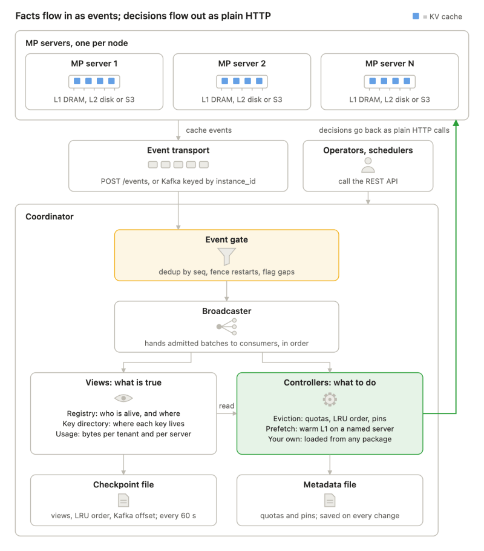

Rui Zhang · 2026-11-11  
Original: [The LMCache Coordinator: A Control Plane for Fleet-Wide KV Cache](https://blog.lmcache.ai/en/2026/11/11/the-lmcache-coordinator-a-control-plane-for-fleet-wide-kv-cache/)

Sixteen RL samples of one prompt spread across four machines can cause four prefills if each machine sees only its own cache. LMCache Coordinator addresses that visibility gap: nodes retain the data plane while a separate control plane tracks where state lives and what to retain or prefetch. Its most useful details concern stale directories, restarts and policy replacement.

## From local caches to an event-derived fleet view

MP mode separates cache servers from inference processes. Each node has CPU-DRAM L1 and disk or S3 L2. This preserves cache across engine restarts without automatically creating a fleet directory. The optional coordinator is a FastAPI process outside the local-hit request path. If it fails, nodes continue inference while fleet features wait.

Servers emit events when chunks are stored, read or deleted, sending batches roughly once a second over HTTP or Kafka. An event gate validates them before broadcasting to shared views and controllers. The registry tracks members, the key directory tracks locations, tiers and sizes, and usage tracks tenant and server bytes. Policy-specific state, such as LRU order, belongs to its controller.

<a class="note-image-link" href="/assets/images/tech/lmcache-coordinator-fleet-kv/figure.png" target="_blank" rel="noopener" aria-label="LMCache event gate, shared views and policy controllers · View original image ↗">View original image ↗</a>

*Follow events downward and HTTP actions back to servers on the right; derived state and operator intent are persisted separately below.*

Controllers read views and send ordinary delete or prefetch requests to existing server endpoints. Because the directory can lag, consumers still check with the node holding the state before use. A location hint does not replace validation by the data owner or imply every remote transfer path is already deployed.

## Why policy plugins depend on views, not each other

Features described for v0.5.6 onward include membership, lookup, tenant L2 quotas, pins, targeted deletion and warm prefetch from L2 into a named node's L1. Default quota eviction assumes shared L2, such as a common object bucket. Local-disk deployments need a controller that sends deletion to the node owning the copy.

External Python packages can supply controllers whose methods declare event consumption, persistence, HTTP routes and background work. Replacing eviction requires disabling the built-in controller; otherwise both implementations compete over state and endpoints. Durable sections are named for meaning, such as pins and quotas, so a replacement can inherit operator intent. Invalid package imports and misspelled disabled-controller names fail startup.

Controllers may depend only on shared views, not another controller's policy. This gives external plugins a stable facts interface instead of dependencies on peer decisions. Event recording and replay support offline policy comparison, but replay results alone do not establish an online throughput improvement.

## Which cache facts survive a restart?

A new server incarnation fences its previous L1 entries because DRAM has vanished. L2 entries remain until deletion events remove them. A health loop runs every ten seconds and removes nodes silent for thirty seconds. Restart semantics therefore follow storage lifetime, instead of treating every fact about one node identically.

Each server has its own sequence numbers. Old batches are discarded, and event application is idempotent. A gap marks that server's slice as potentially stale rather than pretending missing information has been recovered. The design needs per-server ordering, not a global clock, because each server writes its own facts.

The coordinator also distinguishes reconstructible state from operator intent. Directory, usage, LRU and ingest cursors enter checkpoints every sixty seconds and on clean shutdown. Quotas and pins enter metadata immediately on change. Kafka offsets are checkpointed with the views they produced. A missing or corrupt checkpoint causes a cold start; an individual view's failed update can leave views inconsistent and must be observable.

## Availability promises and evidence boundaries

Current HA means fast recovery of one instance, not a hot standby. Recovery without event loss depends on sufficient Kafka retention, persistent state paths and process liveness checks. The article specifies one Kubernetes replica with Recreate: a rolling update can briefly run two consumers in one group, splitting the event stream so neither sees the complete fleet.

Monitoring therefore emphasizes missing events, failed view updates, staleness and background-loop progress. General degradation does not fail the liveness endpoint, avoiding destructive restart loops. Metrics avoid cache-key labels and full-index scans under locks during scraping.

The article does not present a controlled end-to-end throughput gain from the coordinator. Its contribution is an implementable control-plane structure with explicit failure semantics. Richer KV movement, hierarchical coordinators, hot standbys and smarter policies remain partly roadmap items. The event gate, checkpoint and controller boundaries are the substantive reading; the vision of one fleet-wide cache should not be mistaken for automatic placement optimization already delivered in full.
