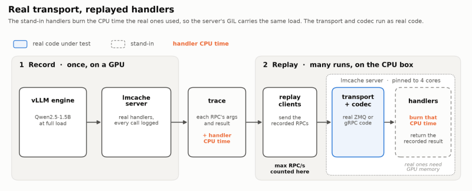

Generation latency at a single vLLM engine barely exposes transport cost. When several engines feed one cache server, its CPU can become the limiting resource first. Minjun Choi follows individual control RPCs to explain why changing the implementation increases shared capacity yet does little for a lone engine.

Minjun Choi · Source date 2026-11-23 · [How gRPC in LMCache Closed the Gap and Surpassed ZMQ](https://blog.lmcache.ai/en/2026/11/23/grpc-in-lmcache-surpassed-zmq/)

## Isolating the control path

In multiprocess mode KV payloads travel over CUDA IPC. ZMQ or gRPC carries small control operations such as lookup, store and session end. One loaded 1.5B engine sent about 270 RPCs per second. Several engines typically share a Python server, whose CPU usage plateaued around 1.1 cores with either transport. GPU work hides much of the server's per-call cost from an engine-side generation timer.

<a class="note-image-link" href="/assets/images/tech/lmcache-grpc-surpassed-zmq/lmcache-grpc-surpassed-zmq.png" target="_blank" rel="noopener" aria-label="View original image">View original image ↗</a>

*Real engine calls are recorded on the left and replayed through real transport with stand-in handlers on the right.*

The replay records real arguments, results and handler CPU time. A real server and codec process the calls, while stand-in handlers spend the recorded CPU time and return the recorded results. This preserves control-path work without copying GPU data. Raising client processes from eight to twelve left maximum throughput unchanged, a check that the server was limiting. Unsaturated latency was measured separately at the recorded arrival pace.

## Smaller exports reduce stalls before the event loop raises capacity

Profiling caught the metrics exporter holding the GIL every 0.5 seconds. Exporting smaller batches every 0.05 seconds retained the metrics. At 530 RPCs/s, P99 fell from 229 to 140 ms. At 265 RPCs/s both settings measured 32 ms. Replacing synchronous receive handling with an aio event loop while keeping existing handler pools raised saturated throughput from 960 to 1,116 RPCs/s on the same commit.

Caching response encoders per method barely moved replay throughput, from 1,129 to 1,133 RPCs/s. Most recorded responses were small. Token IDs in request keys, by contrast, paid repeated Python conversion cost for long prompts. Passing the list to protobuf in bulk improved the common path. The negative result ties a microbenchmark benefit to how often that work occurs in engine traffic.

## What the Rust server changes

Native mode moves HTTP/2 and gRPC handling into Rust outside the GIL and hands calls to Python in batches for decoding and dispatch. In the final saturated replay, native reached 1,617 RPCs/s, ZMQ 1,322, aio 1,030 and synchronous gRPC 859. Earlier per-change tests used different commits and containers. Their absolute rates do not form one continuous speedup curve.

At 31 requests/s per engine, aio saturated before ten engines, ZMQ around fifteen and native around fifteen to twenty. With one engine, all gRPC modes still trailed ZMQ by a few percent. Server migration leaves client cost in place. The project also tests a real engine through a mid-call server failure and restart, checking prompt failure of the outstanding call and subsequent recovery. Both properties matter for a process shared by every engine on a node.
