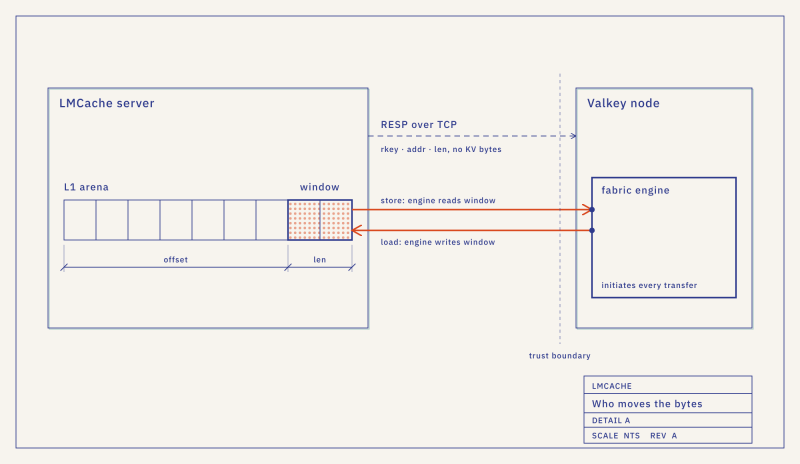

Reusing a prefix computed on another inference worker starts with a data transfer. A request can touch hundreds of multi-MiB KV chunks. LMCache’s Valkey adapter could already find them across machines, but each payload still passed through command buffers and a TCP socket. The new transport changes that part of the path.

Tony Valderrama, Karsten Wade and Ben Kugler · LMCache · 2026-11-19 · [Valkey in LMCache: Building a Fast, Shared Memory Fabric](https://blog.lmcache.ai/en/2026/11/19/valkey-in-lmcache-fast-shared-memory-fabric/)

## A store is a server read and a load is a server write

At startup LMCache registers its populated host-memory L1 arena with the network device. The client still sends RESP commands over TCP, identifying an object and the window of memory available for this operation. For a store, Valkey reads the window. For a load, Valkey writes the object into it. The cache node initiates both directions, keeping addresses in shared server memory out of the inference workers’ hands.

<a class="note-image-link" href="/assets/images/tech/lmcache-valkey-rdma-2026-11-19/figure.png" target="_blank" rel="noopener" aria-label="The client exposes an L1 window and Valkey initiates reads and writes over a separate data path">View original image ↗</a>

*The upper command identifies the window. The lower paths show the cache node reading from and writing to it.*

Direct remote writes change the conditions for a hit. The server rejects an object larger than the window before writing any bytes. A smaller object fails the fixed-size chunk check and counts as a miss. For a successful load, the client also checks CRC32C. If a connection drops without a completion reply, the client cannot assume the server has finished with the window. It revokes the registration and the worker registers again before one retry. An explicit server error leaves the registration usable. The distinction determines when the same memory can be safely reused.

## Each worker spends part of the registration budget

Each thread owns a client that registers the whole arena and handles one transfer at a time. Threads share the underlying allocation, but each registration counts against the device limit. A c8gn.16xlarge has a 384 GiB limit and can accommodate eight registrations of 32 GiB. Eight registrations of 16 GiB exceed the 96 GiB limit on a g6.8xlarge. Concurrency therefore depends on the product of thread count and arena size as well as link bandwidth.

Valkey’s Large Object module manages the stored bytes. DRAM mode uses preallocated memory. Tiered mode writes objects to NVMe and uses DRAM as a read cache, promoting frequently accessed objects. Module objects and ordinary values written by the TCP path use different Valkey types, so migration needs separate key prefixes or nodes. An NVMe copy by itself carries no restart durability guarantee.

## Once the link is full, larger chunks increase waiting time

The authors used two c8gn.16xlarge hosts in one placement group, each with one 200 Gbit/s EFA. One drove the L2 adapter directly. The other ran the module in DRAM mode for RDMA and ordinary Valkey for the TCP baseline. Each submission carried 32 keys, with one outstanding request per worker. Each configuration had one warm-up and three measured rounds, testing stores and loads separately. One TCP worker topped out around 8–10 Gbit/s. With four workers and 4 MiB chunks, RDMA reached 198.1 Gbit/s for stores and 193.5 for loads, against 24.7 and 36.9 over TCP.

Increasing chunks to 16 MiB with the same four workers raised load bandwidth only to 197.8 Gbit/s. Median latency per submission went from 22.2 to 86.8 ms. Each submission moved four times as much data across an already saturated link. The measured endpoints were Valkey and host memory. Model execution, host-to-GPU copies and tiered-mode disk reads fall outside the benchmark. Estimating a request’s first-token saving also requires the number of blocks it hits and how much transfer the engine can overlap.
