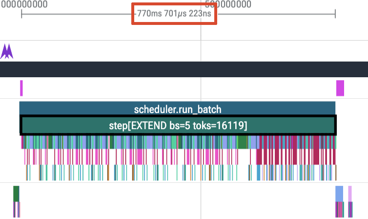

The same four-way tensor-parallel layout need not suit both prefill and decode. Ant International’s AI Infra Team assigned each stage four GPUs on one eight-card H20-3e host and enabled changes incrementally. Mean response time fell from 13.63 to 4.70 seconds while mean time per output token after the first rose from 3.20 to 5.62 ms. Where the request spent its time explains how users could receive a complete response sooner.

## Long shared prefixes determine the starting bottleneck

Each of 256 requests carried 61,440 shared and 4,096 private input tokens and generated 500 tokens at concurrency 24. The team flushed the cache after ten warmups. The measured hit rate reached 93.21%. Both arms used the same checkpoint and DSpark, with KV transfers over intra-node NVLink. The baseline took 12.04 seconds just to produce the first token, so reducing prefill queues offered more leverage than shaving time from individual decode steps.

<a class="note-image-link" href="/assets/images/tech/lmsys-deepseek-v41-flash-h20-pd-colocate/figure.png" target="_blank" rel="noopener" aria-label="The expert-parallel prefill profile shows how kernel work occupies the measured interval.">View original ↗</a>

*The expert-parallel prefill profile shows how kernel work occupies the measured interval.*

## A different partition for each phase

Prefill interleaves a long prompt’s token rows across four ranks. During decode, each request contributes few new rows, so independent requests go to different ranks for attention and the output head. That change alone brought mean end-to-end time to 7.55 seconds and first-token time to 5.16. The Indexer must score visible keys before selecting a small subset for attention. Gathering packed keys, converting to FP8 and scoring with DeepGEMM on Hopper brought the mean down again to 5.29 seconds.

Changing precision raises a correctness question. Small score differences near the selection boundary can change which blocks enter attention. The team sampled 64 query rows across eight Indexer layers on a 64K prompt. None of 16,774,528 sampled key values needed clamping, yet the BF16 and DeepGEMM top-k selections overlapped by 99.08%. Absence of overflow is a weaker claim than identical selections.

## Faster prefill changes the load arriving at decode

Later changes replayed capturable work in CUDA Graphs, changed expert parallelism, enlarged score tiles and reused keys during verification. Median prefill queue depth fell from fifteen to zero. Requests consequently reached decode earlier, and completing one freed a client slot for the next prompt. The observed rise in time per output token therefore cannot be read as an equivalent slowdown of an isolated kernel. Output throughput rose from 847 to 2,465 tokens/s and p99 end-to-end latency fell from about 21.31 to 10.07 seconds. Individual improvements did not always compound: fusing prefill selection and writeback improved first-token time while leaving mean end-to-end time essentially flat at that step.

The profile explains how slower expert matrix multiplications can coexist with a faster batch. Under expert parallelism, ranks hosting popular experts keep others waiting at the collective. Sharding each expert across four cards can shorten that wait. Two prefill profiles, each with five requests and about 16K tokens, took about 771 and 657 ms. The EP comparison did not use DeepEP or MegaMoE all-to-all. Breakable CUDA Graphs also have upfront costs: capture used about 14.5 GB per prefill rank and took about 388 seconds. A long-lived service amortizes that differently from one that starts cold frequently.

## What four-card colocation buys

An optimized four-card colocated worker averaged 7.96 seconds and 1,483 output tokens/s. The eight-card split was faster overall, but colocation yielded about 371 tokens/s per GPU versus 308. The relevant objective is response time or output per card. On 1,314 scored GSM8K questions, correct answers moved from 1,268 to 1,267, and both configurations scored 10/10 on 64K retrieval. Those checks bound the accuracy comparison. The long shared prefix, concurrency and intra-host interconnect also belong alongside the performance numbers.

Siyuan Chen, Bingjia Wang, Bofeng Jiang, Yongxu Ai, Kaixin Shen · 2026-11-19 · [Optimizing DeepSeek-V4.1-Flash PD & Colocate Serving on H20-3e](https://www.lmsys.org/blog/2026-11-19-deepseek-v41-h20/)
