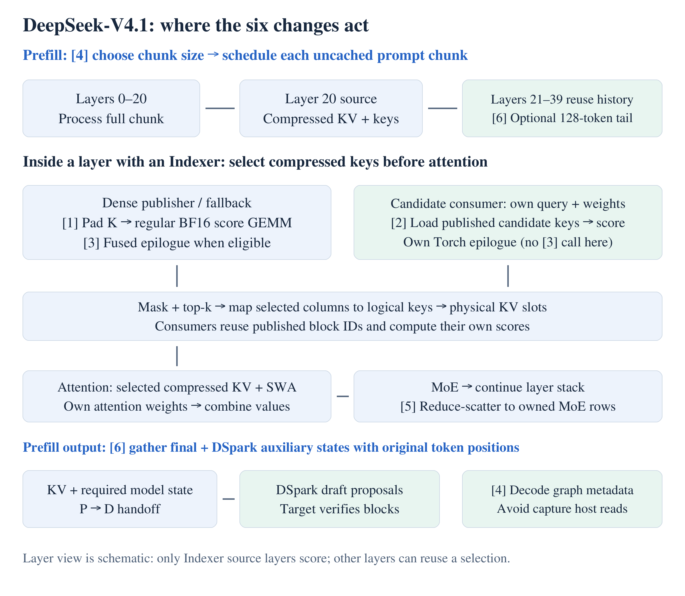

Ant International ran DeepSeek-V4.1-Flash with four H200s assigned to prefill and four to decode. Long prompts exposed distinct expenses. Sparse-attention indexing scored positions consumers would discard, the MoE return path replicated data, and late layers processed more positions than needed. Following these costs improved first-token and request latency while increasing time per subsequent token.

## Shrinking the scoring domain and intermediate traffic

Some BF16 score shapes mapped poorly to the hardware. Aligning width reduced scoring latency by about 40% in microbenchmarks including padding. Consumers that need only candidate positions can filter before computing dot products. A fused epilogue then combines activation, head weighting, reduction and conversion, avoiding intermediate HBM traffic. On an eligible context-parallel MoE path, reduce-scatter returns the needed partition without replicating the full output. Shape, computation and communication are distinct effects. Percentages from individual PRs cannot simply be added.

<a class="note-image-link" href="/assets/images/tech/lmsys-deepseek-v41-h200-pd/overview.png" target="_blank" rel="noopener" aria-label="View original image ↗ — Indexer changes reduce scoring work. MoE communication and late-layer tail computation change later parts of the path.">View original image ↗</a>

*Indexer changes reduce scoring work. MoE communication and late-layer tail computation change later parts of the path.*

## Carrying compact output layout through the consumer

The team also increased prefill chunks from 8,192 to 16,384 tokens. Recorded TTFT fell by up to 31.3%, though the comparison does not isolate every configuration effect. Another path computes just the final 128 tokens at late layers. With four-way context parallelism, a 16,384-token chunk used to imply 4,096 gathered rows per rank. A compact tail supplies only 32. Correcting the gather metadata lets the runner pass compact output to the downstream DSpark path. Changing the producer's tensor extent requires its consumer to agree on the new layout.

## Reading request gains alongside slower decode

Eight cases used roughly 64K input and 512 output tokens, varying prefix reuse and concurrency from 4 to 32. Relative to the original baseline, the combined configuration reduced end-to-end latency by about 15–64% and TTFT by 41–79%, while increasing time per subsequent token by 3–52%. Single-shot GSM8K accuracy across 1,319 questions fell from 96.74% to 95.38%. Prefill savings can dominate for long inputs with short replies. Longer outputs or stricter quality requirements change the trade-off.

[Optimizing DeepSeek-V4.1 on H200 with SGLang PD Disaggregation](https://www.lmsys.org/blog/2026-11-05-deepseek-v41-h200-pd-optimization) · Bingjia Wang, Siyuan Chen, Bofeng Jiang, Jincong Chen, Yongxu Ai, Kaixin Shen · 2026-11-10
