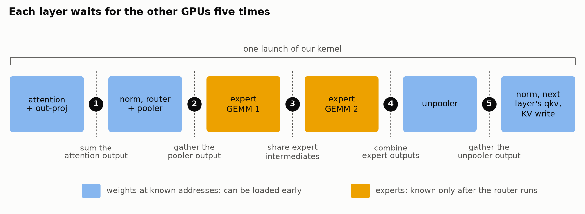

Primary note source: Pranjal Shankhdhar · 2026-11-11 · [Muse Spark Open Ultrafast: Pushing beyond 1,000 Tokens per second](https://www.lmsys.org/blog/2026-11-05-muse-spark-open-ultrafast) (LMSYS / SGLang, 8× NVIDIA GB300, code at [facebookresearch/sgl-muse-mega](https://github.com/facebookresearch/sgl-muse-mega))  
Companion primary post: Haolin Fu, Xiaoyu Zhang, Junyan Xu, Wangyuan Zhang, Haoguang Cai, RadixArk Team · 2026-11-10 · [Optimizing Muse Spark Open on TPU v7 with SGLang-TorchTPU](https://pytorch.org/blog/optimizing-muse-spark-open-on-tpu-v7-with-sglang-torchtpu/) (4-chip / 8-device TPU v7 Ironwood, branch [`haolin/ms-v11` in sglang-torchtpu](https://github.com/sgl-project/sglang-torchtpu/tree/haolin/ms-v11))

At low concurrency (`batch size = 1` or `2`), generating one output token performs very little arithmetic per loaded parameter. Step latency is governed not by peak matrix FLOPs, but by **how continuously weights and KV cache stream out of HBM without draining or stalling across kernel and collective boundaries**. Published within 24 hours of each other on November 10–11, 2026, two engineering teams attacked the exact same model—Meta's **Muse Spark Open**—on two contrasting hardware architectures: PyTorch and RadixArk fused all `62` decoder layers of a step into a single Pallas program on **four TPU v7 chips (`8` chiplets)**, cutting single-request time per output token from `3.78 ms` to `1.95 ms` (`1.94×`) and tracing a 1M-context AgentX Pareto frontier from `6,101` to `25,906 tokens/s/chip`; meanwhile, LMSYS and SGLang built roughly `8,000` lines of CUDA C++ and PTX from scratch on **eight NVIDIA GB300 GPUs**, lifting single-request GSM8K decode speed from `517` to `1,109 tok/s` (`2.1×`) while cutting launches per step from `1,450` to `97`.

Reading both primary accounts side by side exposes far more than two headline speed numbers. It shows how **underlying hardware execution models dictate where megakernel fusion must stop**: GB300's `~128 KB` SM instruction cache and multi-warp sharing forced LMSYS to stop at one launch per layer and invest heavily in `12`-warp static specialization, L2/SMEM code warming, and fence-free Lamport sentinels; TPU v7's single-threaded chiplet execution and software-managed **VMEM** allowed RadixArk to fuse all `62` layers in one `pallas_call`, only to discover that past `BS=1–2`, bottlenecks migrate rapidly to **20 GiB-per-device KV capacity, session-aware eviction for hybrid attention, and chunked prefill fairness**.

> **Evidence & Scope Boundary**: Every figure in this note comes directly from the two frozen primary engineering posts and stays pinned to its test setup—never treated as a matched cross-vendor A/B benchmark. LMSYS evaluates `8× GB300` on a **single GSM8K request (`BS=1`)** with DFlash V2 tree speculative decoding (verifying `16` tokens, mean acceptance length `6.6`) using 20-step medians, and the current implementation explicitly supports only `BS=1 + speculative decoding`. PyTorch/RadixArk evaluates `4 TPU v7 chips (8 devices)`, reporting single- and two-request decode comparisons on an earlier Muse Spark checkpoint (GSM8K with `DFlash2`) alongside a full 1M-context SemiAnalysis AgentX throughput sweep (`393` opt-in Claude Code sessions, counting input + output tokens, referencing `2026-11-02` InferenceX GB200 FP4 external numbers). Authors' analogies and optimization rationales are separated cleanly from measured numbers and engineering takeaways.

## Cross-Layer Fusion and Hardware Execution Models: Single-Layer GPU vs. Whole-Step TPU v7

Both systems target Meta's open-weights **Muse Spark Open** (`816B` total parameters, `~42B` active per token). All `62` decoder layers are sparse MoE layers routing each token to `8` of `256` experts stored in 4-bit **NVFP4** microscaling format (`1` scale per `16` values, with selected non-expert/dense layers in `bf16`). Attention is hybrid: `46` layers use sliding-window attention over the trailing `2,048` tokens, while `16` layers attend across full context up to `1M` tokens (`128` query heads, `16` KV heads, width `64`). Each layer additionally wraps its MoE block with a **pooler** projection (shrinking token vectors before experts) and an **unpooler** (restoring dimension afterward).

Standard serving engines break that 62-layer graph into well over a thousand separate launches. LMSYS notes that baseline SGLang issues roughly `1,450` kernel launches per Muse Spark Open decode step, allowing SMs and memory controllers to drain and refill between consecutive kernels. On TPU v7, RadixArk's prior "native" path—already composed of fused Pallas kernels—still took `2.9×` the theoretical time just to stream active weights from HBM, because at `BS=1` matrix multiplications and attention cost almost nothing while separate collectives burned roughly `45 µs` per layer across program boundaries that could not overlap.

Both teams adopt **8-way tensor parallelism (TP8)** (`8× GB300` GPUs vs. `4 TPU v7 chips × 2 chiplets/chip = 8 devices`), yet diverge sharply in sharding and kernel boundaries.

**Path 1 (GPU, 8× GB300, LMSYS)**: Modified N-Sharded TP8 & Layer-Boundary Crossing. Conventional TP shards expert `GEMM 1` along `N` and `GEMM 2` along the intermediate (`K`) dimension to end with one `bf16 all-reduce`, whereas conventional expert parallelism (EP) suffers severe per-GPU expert load skew during inference. LMSYS instead shards **both** MoE GEMMs along `N`, inserting an `FP4 all-gather` after `GEMM 1` (stop 3) and a `bf16 all-gather` after `GEMM 2` (stop 4). Despite adding one extra communication stop—leaving **five cross-GPU wait stops per layer** where even balanced GPUs can lag up to `4 µs` behind the slowest peer—the scheme cuts total communication volume relative to vanilla TP, scales better to larger batches, and stays **bitwise identical** to EP training numerics.

<figure class="note-figure">
  <a class="note-image-link" href="/assets/images/tech/lmsys-muse-spark-open-megakernel/layer.png" target="_blank" rel="noopener" aria-label="Enlarge original LMSYS diagram showing one decoder layer across eight GPUs with five synchronization stops">
    
    Click to zoom ↗
  </a>
  <figcaption>Preserved original figure from LMSYS (Figure 2): one megakernel launch spans this layer's attention through the next layer's QKV projection and KV write, encompassing five cross-GPU dependency stops.</figcaption>
</figure>

Crucially, LMSYS **places the kernel launch boundary after the next layer's QKV projection and KV write**: because historical KV rows read by attention were produced in earlier steps and do not depend on the previous layer's residual output, the next launch can immediately start streaming KV history as soon as its blocks land on the `144` SMs (launched in clusters of `4` using distributed shared memory, with `12` statically assigned warps per SM). Yet as detailed in the next section, SM instruction-cache limits kept LMSYS at **one launch per layer**, lowering total launches from `1,450` to `97` (including `8` fused launches for the 5-layer draft model captured inside the same CUDA Graph).

**Path 2 (TPU v7, 4 Chips / 8 Devices, PyTorch/RadixArk)**: Whole-Step 62-Layer Program. Each TPU v7 chiplet is exposed as a **single-threaded processor** running one program at a time—eliminating multi-warp instruction-cache contention across SMs—controlled by a Scalar Unit driving two Matrix Units (**MXUs**, `2,307` bf16 / `4,614` fp8 TFLOPs per chip), a Vector Unit (**VPU** with `8 × 128` 32-bit registers plus XLU), high-bandwidth on-chip **VMEM** SRAM, and background **DMA engines** (`192 GiB` HBM per chip at `7.37 TB/s`, plus `1,200 GB/s` ICI links). Without GPU's `128 KB` SM instruction-cache cliff, RadixArk packs **all `62` layers and the final norm of a decode or DFlash2 verify step into one `pallas_call`**, leaving only embeddings, the draft model, LM head, sampling, and a small pipelined KV-write kernel outside. Keeping KV write outside is dictated by an explicit compiler boundary: **XLA copies aliased operands of any kernel that issues remote DMAs**, making in-place KV buffer updates inside the megakernel prohibitively expensive.

<figure class="note-figure">
  <a class="note-image-link" href="/assets/images/tech/lmsys-muse-spark-open-megakernel/muse-spark-megakernel-pipeline-en.svg" target="_blank" rel="noopener" aria-label="Enlarge side-by-side diagram comparing 8x GB300 GPU and 4-chip TPU v7 megakernel pipelines">
    
    Click to zoom ↗
  </a>
  <figcaption>Assistant diagram (not an original figure): Contrasting how GPU multiprogramming hides five intra-layer waits within per-layer launches while TPU v7 fuses all 62 layers via single-threaded DMA and VMEM rings.</figcaption>
</figure>

## Microarchitectural Latency Hiding: Prefetch Rings, Instruction-Cache Limits, and Sync Protocols

Once operations coexist inside a single launch, performance depends on issuing independent fetches early without letting speculative buffers evict instructions or overflow registers. Shankhdhar frames LMSYS's design explicitly as an early GPU operating system—specifically analogous to **IBM OS/360 MFT ("multiprogramming with a fixed number of tasks")**, where every warp receives a compile-time static assignment per phase (`Warp 0–1` prefetch KV, weights, and activations; `Warp 2` drives Tensor Cores and expert scale factors; `Warp 3` warms the instruction cache and sends; `Warps 4–11` execute attention merges, epilogue sends, SwiGLU, and cross-GPU reductions). On TPU v7, the single-threaded Pallas program exposes VMEM ring buffers and DMA queues directly to software scheduling.

| Architectural Dimension | 8× GB300 GPU (LMSYS CUDA/PTX Per-Layer) | 4-Chip / 8-Device TPU v7 (PyTorch/RadixArk 62-Layer Pallas) | Underlying Hardware Constraint & Trade-off |
| :--- | :--- | :--- | :--- |
| **Fusion Scope & Execution Model** | 1 launch/layer (`1,450 → 97`); `144` SMs × `12` static warps in `4`-block clusters | All `62` layers + final norm in `1 pallas_call`; single scalar control + DMA engines | GPU halts at 1 layer due to SM icache; TPU leaves KV write outside only because XLA copies aliased operands when remote DMA runs |
| **Deterministic Weight Prefetch** | `5 × 32 KB` SMEM ring (`~23 MB`/GPU) + `135 MB` L2; streaming weights use `evict-first` | VMEM ring holds `~10` dense tiles in flight (`3.34 TB/s`/dev vs `1.13 TB/s` single DMA) | TPU's large software-managed VMEM avoids L2 sharing conflicts; GPU uses `evict-first` so streaming weights do not evict code or hot tiles |
| **Router-Dependent Experts** | Warp 3 pulls top-14 prev-step experts into L2 during attention (`~50 MB`/GPU); L2-hit tiles scheduled first | Requests `3` in-flight experts right after routing; defers next-layer attention refills until expert loop | GPU guessing saves `~0.2 ms` of `5.3 ms` verify step, yet degrades speed if code is unprotected in L2; TPU queues transfers strictly by priority |
| **Code Size & Register Pressure** | Machine code `215–314 KB` vs `~128 KB` SM icache; rolled loops (`-50 KB`), `load_evict_last`, `2-pass` dry run | `8`-row branch `f32` accumulators spilled `~0.37 µs`/expert in shared loop; split into `≤4` vs `>4` row loops | GPU hits an **instruction-cache cliff** (zero register spills observed); TPU hits **cross-branch register allocation spill** (`-61–64%` spill instructions) |
| **Cross-Device Sync & Collectives** | Hardware `mbarrier` inside SM/cluster; NVLink busy polling + **Lamport sentinels** (`bf16 0xFFFF` / `+0↔-0`) | In-kernel remote DMA writes directly to peer HBM (`~3 µs` small round vs `~45 µs`/layer); **Collective Folding** | GPU `MEMBAR.ALL.SYS` / TMA-stalled fence costs `3.6–4.0 µs` per stop; TPU commutes RMSNorm scalars so slices multiply on arrival (non-bitwise) |
| **Long-Context Attn & KV Layout** | Global TC path; SW warps `4–11` load own KV; prefetch next layer's old KV into L2 at `65 µs` | QK-norm bounds score `≤43.8` → **drop running max** (`3.9×` microbench); `sequence-on-lane fp8` (`512→256 B`) | TPU proves overflow impossible at build time to break FlashAttention's `0.17 µs`/chunk chain; `sequence-on-lane` eliminates fp8 lane padding |

### Three Hidden Walls on GPU: L2 Eviction, the Instruction-Cache Curse, and `MEMBAR.ALL.SYS`

LMSYS documents three microarchitectural surprises that only surface once launch gaps vanish:

- **Why fusing all 62 layers failed on GPU (the Instruction Cache Curse)**: Stitching two `100 KB` straight-line blocks back-to-back without extra synchronization slowed each block from `12.4 µs` solo to `19.5 µs` (`+14 µs` per pair). After verifying zero `ptxas` register spills, shrinking one block to `20 KB` immediately restored `12.4 µs` solo speed—exposing GB300's `~128 KB` per-SM instruction cache. Each real per-layer megakernel compiles to `215–314 KB` of machine code, whereas a launch brings only the first `32–64 KB` near SMs and fetches the rest line-by-line through the unified L2 cache. Left unprotected, speculative expert prefetching (`~50 MB` in L2) evicted `>10%` of sliding-window code and `>50%` of global-attention code (which runs every fourth layer), turning expert prefetching into a **net slowdown**. LMSYS solved this with three measures: keeping non-register-state loops rolled (`~50 KB` smaller, bit-identical), reading one word per `128-byte` code line via `load_evict_last` on every launch (run redundantly across selected SMs because GB300's two dies hold separate L2 caches), and running latency-critical epilogue/combine/norm blocks through a `#pragma unroll 1` **two-pass dry run**—Pass 0 issues the same instructions and loads while data is still landing without waiting or storing, warming SM icache for Pass 1 and saving `0.5–1 µs` per block.
- **Lamport-style readiness without TMA-stalled fences**: Intra-SM and 4-block cluster handoffs suspend waiting warps via hardware `mbarrier`, but cross-SM or NVLink peers lack hardware wait-on-address interrupts and must busy-poll (`141–145 ns` GPU-scope acquire poll; `~1.9 µs` intra-node cross-GPU flag; `1.0–2.6 µs` queuing behind active TMA weight copies). Worse, textbook write–fence–flag synchronization hits a hardware wall on GB300: system-scope releases (`fence.release.sys`, `fence.acq_rel.sys`, `st.release.sys`) all lower to `MEMBAR.ALL.SYS`, and even a GPU-scope fence stretches from `0.4 µs` idle to `3.6–4.0 µs` while TMA weight copies remain in flight—stalling stops 3 and 4 every single layer. Borrowing the Lamport trick from TensorRT-LLM and FlashInfer, producers write directly into peer receive buffers pre-filled with sentinel bit patterns never legitimately produced (`0xFFFF` non-standard NaN for `bf16` gathers; `+0` sentinel while encoding true `+0` as `-0` for all-reduce), letting readers poll slots directly without an inline fence. Buffer reuse still needs one off-critical-path fence per layer via alternating double buffers on expert exchanges or post-consume resets.

### Four Algebraic and Compiler Wins on TPU v7: Folding, Max-Free Attn, Loop Split, and Dual-Bank KV

Freed from multi-warp instruction-cache thrashing, PyTorch/RadixArk focused on saturating DMA engines and keeping XLA/VPU pipelines clean:

- **Collective Folding Across RMSNorm**: Muse Spark's next-layer attention normalizes `α·x + β·s·f`, where `x` is the local residual, `f` is the 8-way gathered MoE output, and per-row scalars `s` and `r` commute with matrix multiplication. Reordering the weight ring in fixed peer order lets each device multiply its local part and each arriving `f_d` slice immediately against `W_d`, applying RMSNorm scalars once at the end. Both the MoE-to-`qkv` and attention-to-`pooler/router` all-gathers fold this way; shifting the `bf16` rounding point breaks bitwise identity and requires accuracy verification.
- **Max-Free Pipelined Attention**: Online softmax's running maximum chains every KV chunk serially (`wait DMA → QK → max → exp → sum → P·V → rescale`, costing `~0.17 µs`/chunk regardless of `fp8`/`bf16`). Exploiting Muse Spark's weightless QK-norm and fixed query gain, RadixArk proves at build time that **no attention score can exceed `43.8` in magnitude**—safely below `f32` `exp` overflow—and drops the running max and rescale chain entirely without needing FlashDecoding++'s overflow fallback. Splitting independent chunks (`1,024–2,048` tokens for global layers, `512` for sliding-window) across parallel softmax streams, feeding `fp8` keys straight into mixed `bf16 × fp8` MXU dots, and folding the exact `1/8` power-of-two scale into queries lifts the attention microbenchmark from `2.4×` to `3.9×` and speeds up 2-request `500K`-context serving by `18%`.
- **Two-Loop Register-Spill Isolation**: Sharing one expert loop body forced common `1–2`-row experts to spill `~0.37 µs`/expert (versus `~1.2 µs` weight stream time) solely to accommodate the `8`-row branch's `f32` accumulators. Sorting experts by row count into separate `≤4`-row and `>4`-row loops reduces spill instructions in the common loop by `61–64%` (bit-identical) and accelerates multi-request random-routing decode steps by `13–19%`.
- **Sequence-on-Lane `fp8` KV Layout & Dual-Bank Writes**: Because TPU VPU registers have `8` sublanes × `128` lanes and each device holds two `64`-wide KV heads (`128` lanes total), packing four `fp8` elements down sublanes in a token-major layout padded K/V pairs back to 4 slots—saving **zero memory (`512 B` per token/layer/device)**. Adopting `sequence-on-lane` (`sglang-torchtpu#344`, tokens across `128` lanes and head dims down sublanes) cuts KV footprint and read traffic in half to **`256 B`**. Pairing that with moving the `2,048`-window draft model KV out of the full-context pool into the sliding-window pool (`+38%` token capacity) and adding a dual-VMEM-bank pipelined KV-write kernel (`810 → 155 µs` at 16 rows; `2,286 → 336 µs` at 64 rows, bit-identical) unlocks substantial capacity for agent concurrency.

## Performance Attribution, Internal Observability, and Regime Boundaries from BS=1 to High Concurrency

Both primary sources provide clear boundaries showing where megakernels dominate and where system bottlenecks shift once concurrency and context length scale up.

In the **`BS=1–2` low-latency regime**, removing launch and collective boundaries yields near-`2×` gains on both platforms:

- **8× GB300 (`BS=1`, GSM8K + DFlash V2)**: Median 20-step latency drops from `12.9 ms` to `5.9 ms` (`517 → 1,109 tok/s`, `2.1×`), shrinking the draft model (`15` predicted tokens per step) from `1.16 ms` to `440 µs` (`2.6×`, `175 → 8` launches) and verify from `10.9 ms` to `5.3 ms` inside one CUDA Graph. LMSYS notes its `16`-token verification averages `6.6` accepted tokens, contrasting with Xiaomi's `MiMo-V2.5-Pro` (`8` verified, `6.3` accepted above `1,000 tok/s`): verifying 16 activates more experts, yet proved more practical for sustaining `6.6` acceptance here.
- **In-Kernel Self-Instrumentation (`%globaltimer`)**: Because Nsight Systems and PyTorch Profiler see only a single opaque bar per layer, LMSYS records `%globaltimer` nanoseconds from lane 0 without atomics or barriers (`2.5 µs`/layer, `2.8%` step cost, compilable out, bit-identical). On a `4,096`-token synthetic GSM8K-routing replay (`45` sliding-window layers, `2` GPUs, `49` experts/layer), the earliest 10% of blocks launch `GEMM 2` at `47 µs` before the slowest 10% leave `GEMM 1` at `50 µs`, yet `GEMM 2` finishes across `55–64 µs` (P10–P90) and global combine/unpooler dependencies wait until `65 µs`—leaving `~12.5 µs` average idle time per block (nearly half of all block idleness). Launching the next layer `4 µs` early via PDL (`79 µs`) still waits until old blocks exit at `84 µs`, so LMSYS prefetches next-layer old KV into L2 at `65 µs`.
- **4-Chip TPU v7 (`BS=1–2`, GSM8K + DFlash2)**: With DFlash2 enabled, the megakernel cuts `BS=1` time per output token from `3.78 ms` (native path) to `1.95 ms` (`1.94×`), while within the megakernel itself DFlash2 cuts single-request latency from `3.93 ms` (non-speculative) to `1.95 ms` (`2.0×`, because TPU MXU time scales with row tiles so verifying a draft block costs little more than one token); gains narrow to `1.85×` at `BS=2` and continue to narrow at higher concurrency as verify steps hit `1.5–1.7×` the pure HBM weight-streaming floor.

Once workloads move into **1M-context multi-turn agent serving (`AgentX 1M`, `393` Claude Code sessions, `~990K` prompts)**, each TPU v7 device has only `~20 GiB` of HBM left after weights. RadixArk's Pareto frontier spans **`433 output tok/s/req @ 6,101 tok/s/chip`** down to **`95 tok/s/req @ 25,906 tok/s/chip`** (total input + output tokens, all points `P90 ≤ 47 s`). At the high-throughput end of that curve, gains come primarily from **memory hierarchy and prefill scheduling** rather than single-step kernel launch reduction:

1. **L2 HiCache + Hybrid Session-Aware Eviction**: Backing every HBM KV pool with `960 GB` host DRAM lifts agent throughput by **up to `77%`**. Crucially, hybrid architectures amplify LRU eviction penalties: **losing only the small `2,048`-token sliding-window tail invalidates the entire massive global-attention KV prefix**. Protecting live conversation IDs only inside host DRAM (keeping HBM plain LRU for running requests) drops prefill recomputation from `1.2×` down to **within `1–5%` of an oracle cache**.
2. **Die-to-Die Pair Exchange & Sequence-Parallel Prefill**: Rather than paying `~50 ns`/row scalar serialization for `8`-way scattered MoE writes, sibling chiplets swap tiles across TPU v7's `6×`-faster intra-chip die-to-die link and send combined runs once to remote owners—halving cross-chip ICI bytes, cutting owner merges `8 → 5`, reducing MoE prefill time `3,247 → 2,368 µs`/layer, and (with ping-pong weights and one-pass combine) cutting a `4,096`-token cold `100K` chunk from `440` to `384 ms`. Adding sequence parallelism (`512` tokens/device between matmuls, replacing `all-gather` with `1/8`-byte `all-to-all`) trims another `51 ms` (`~11%`, non-bitwise) at `131K` context.
3. **Chunk Sharing Against Head-of-Line Blocking**: Reserving at least `1,024` tokens of each `4,096`-token prefill batch for long prompts while filling the rest with short turns eliminates `15–95 s` stalls behind half-second cold chunks, cutting AgentX median E2E latency by **`58%`** and P90 by **`33%`** within `5%` throughput.

<figure class="note-figure">
  <a class="note-image-link" href="/assets/images/tech/lmsys-muse-spark-open-megakernel/megakernel-batch-regime-boundaries-en.svg" target="_blank" rel="noopener" aria-label="Enlarge diagram illustrating megakernel regime transitions from BS=1 latency peaks to 1M-context AgentX throughput">
    
    Click to zoom ↗
  </a>
  <figcaption>Assistant diagram (not an original figure): Mapping how bottlenecks migrate from launch/weight streaming to KV capacity and prefill fairness across concurrency regimes while isolating non-comparable benchmark scopes.</figcaption>
</figure>

| Headline Metric | Hardware & Setup | Baseline & Measurement Scope | Numerics & Extrapolation Boundary |
| :--- | :--- | :--- | :--- |
| **`517 → 1,109 tok/s`** (`12.9 → 5.9 ms`) | **8× NVIDIA GB300**, TP8, DFlash V2 (`16` verified / `6.6` accepted) | Median of `20` GSM8K steps at **`BS=1`**; baseline already runs SpecDec (`1,450` launches) | Currently **restricted to `BS=1` + SpecDec**; cannot extrapolate to multi-tenant cluster throughput or general context lengths |
| **`3.78 → 1.95 ms/tok`** (`1.94×`; `1.85×` `BS=2`) | **4-chip (`8`-device) TPU v7**, TP8, 62-layer Pallas + DFlash2 | GSM8K on an **earlier Muse Spark checkpoint**, vs. "native" fused Pallas baseline | Low-concurrency regime; verify sits `1.5–1.7×` above HBM floor (vs `2.9×` native), narrowing at higher batch |
| **`433/req @ 6,101/chip → 95/req @ 25,906/chip`** | **4-chip TPU v7**, FP8 compute + NVFP4 experts + HiCache + Chunk share | **AgentX 1M** (`393` Claude Code sessions, `~990K` prompts, `P90 ≤47s`); input + output tokens | External GB200 FP4 baseline cited from `2026-11-02` InferenceX (owning cost `USD 1.21` vs `USD 1.86`/hr); not same-harness A/B |
| **`+18%` decode (`500K`, `BS=2`) / `3.9×` microbench** | **TPU v7** max-free pipelined attention + `fp8` keys directly in MXU | Production-shape microbenchmark vs. FlashAttention online softmax; server `500K` `BS=2` | Requires Muse Spark's **weightless QK-norm + fixed gain (`score ≤ 43.8`)**; unsafe to apply blindly to unbounded models |
| **`+13–19%` decode (`-61–64%` spills) / `+77%` HiCache** | **TPU v7** `≤4` vs `>4` expert loop split / `960 GB` host DRAM L2 | Random-routing multi-request kernel test / AgentX tool-pause replay | Split loop is **bit-identical**; `1.2× → 1–5%` recompute relies on client session IDs and preserving the `2,048`-token SW tail |
| **`2.8%` stamp cost / `12.4 → 19.5 µs` icache hit** | **GB300** `%globaltimer` (`2.5 µs`/layer) / twin `100 KB` straight-line blocks | `4,096`-token context, `45` SW layers, `2` GPUs, `19` replays, `49` experts/layer | Telemetry compiles out and is bit-identical; `~128 KB` SM icache explains why GPU stopped at 1 kernel per layer |

## Engineering Decision Criteria: When Megakernels Pay Off and When Bottlenecks Move Elsewhere

To turn both engineering reports into production guidance without over-extrapolating, it helps to separate the primary authors' forward-looking arguments from verified deployment rules. LMSYS explicitly frames its static warp mapping as an **OS/360 MFT milestone** on the road to a dynamic GPU virtual machine with runtime work-stealing (and notes that per-op `BS=1` tuning—SMEM vs. L2 placement, prefetch distance, cache hints—is an ideal search space for coding agents), while PyTorch/RadixArk explicitly marks high-concurrency prefill—**topology-aware cross-chip EP + intra-chip TP MoE**, larger prefill graphs, and **host-level P/D disaggregation**—as its next bottleneck.

Across both hardware stacks, four concrete engineering rules govern when and how to apply these techniques:

- **Match kernel engineering to your concurrency regime before writing PTX/Pallas**: If your workload demands ultra-low single-user TPOT (`BS=1–2` interactive coding or real-time voice), launch gaps (`1,450` kernels or `45 µs`/layer collectives) and unpipelined HBM weight streaming dominate, making cross-layer megakernels deliver near-`2×` returns. If your cluster runs high-batch background agents optimizing tokens/dollar, higher token counts already overlap intra-layer waits—as LMSYS itself notes for future multi-batch GPU work—while diminishing TPU megakernel speedups push ROI toward KV capacity and prefill throughput.
- **Size fusion boundaries to instruction caches, register pressure, and compiler aliasing**: On multi-warp GPUs, blindly fusing across layers past the `~128 KB` SM instruction cache or letting `50 MB` of speculative expert prefetching evict kernel lines from shared L2 can invert gains unless protected by `evict-first` weight hints, rolled loops, `load_evict_last` code warming across dies, and dry runs. On single-threaded TPUs, whole-step fusion works cleanly, but heavy accumulator branches (`>4` rows) must still be split out of light loops and XLA operand-aliasing side effects around remote DMAs determine which ops (like KV write) belong outside the megakernel.
- **Treat sentinel sync and max-free attention as invariant-gated shortcuts, not generic defaults**: Lamport readiness eliminates `3.6–4.0 µs` TMA-stalled fences only when producers cannot emit sentinel bit patterns (`0xFFFF` NaN, `+0`/`-0`) and off-critical-path reuse fences strictly guard buffer turnover. Max-free attention removes `0.17 µs`/chunk softmax chaining only when build-time checks prove exact score bounds (`≤43.8`) under weightless QK-norm. Neither should be enabled without automated invariant checks.
- **At 1M-context agent concurrency, prioritize KV layout, hybrid tail retention, and chunk sharing**: When HBM leaves only `~20 GiB` per device for KV, vector-register-aligned `fp8` layouts (`sequence-on-lane` halving `512 → 256 B`), moving short-window drafts into sliding-window pools (`+38%` tokens), session-aware host DRAM eviction (explicitly protecting the `2,048`-token sliding-window tail so global KV remains valid), topology-aware die-pair exchanges, and chunk sharing (`-58%` median latency) deliver the decisive system-level wins.

---

### Primary Sources & Verification Links

- Primary GPU post (note entry): Pranjal Shankhdhar, *[Muse Spark Open Ultrafast: Pushing beyond 1,000 Tokens per second](https://www.lmsys.org/blog/2026-11-05-muse-spark-open-ultrafast)*, LMSYS Org, 2026-11-11; code repository: [facebookresearch/sgl-muse-mega](https://github.com/facebookresearch/sgl-muse-mega).
- Companion primary TPU post: Haolin Fu, Xiaoyu Zhang, Junyan Xu, Wangyuan Zhang, Haoguang Cai, RadixArk Team, *[Optimizing Muse Spark Open on TPU v7 with SGLang-TorchTPU](https://pytorch.org/blog/optimizing-muse-spark-open-on-tpu-v7-with-sglang-torchtpu/)*, PyTorch Blog, 2026-11-10; open-source branch: [`haolin/ms-v11` on sgl-project/sglang-torchtpu](https://github.com/sgl-project/sglang-torchtpu/tree/haolin/ms-v11).
- Model, hardware & referenced papers: LMSYS, *[Muse Spark Open](https://www.lmsys.org/blog/2026-10-15-meta-muse-spark-open)*; Xiaomi, *[MiMo-V2.5-Pro 1,000 tok/s](https://mimo.mi.com/docs/en-US/news/latest/1000tps)* and [Hugging Face model card](https://huggingface.co/XiaomiMiMo/MiMo-V2.5-Pro); Google Cloud *[TPU7x Documentation](https://docs.cloud.google.com/tpu/docs/tpu7x)* and JAX *[Pallas TPU Guide](https://docs.jax.dev/en/latest/pallas/tpu/details.html)*; SemiAnalysis *[AgentX Benchmark Guide](https://inferencex.semianalysis.com/blog/agentic-benchmark-agent-benchmark-guide)*; Chen et al., *[DFlash: Block Diffusion for Flash Speculative Decoding](https://arxiv.org/abs/2602.06036)*; Hong et al., *[FlashDecoding++](https://arxiv.org/abs/2311.01282)*; SGLang Team, *[SGLang HiCache](https://lmsys.org/blog/2025-09-10-sglang-hicache/)*; Hazy Research, *[Look Ma, No Bubbles!](https://hazyresearch.stanford.edu/blog/2025-05-27-no-bubbles)*; Cheng et al., *[MPK (OSDI 2026)](https://www.usenix.org/conference/osdi26/presentation/cheng)*; Novack et al., *[Inferact TPU Megakernels](https://github.com/Inferact/tpu-megakernels/tree/4048f0820aa4ff8787f707ca9d99b2bada9751aa)*.

> **AI-Assisted Curation & Archival Note**: Both this English note and its paired Chinese edition ([中文阅读](/tech/zh/lmsys-muse-spark-open-megakernel/)) were expanded and verified by the assistant (`authoring_source: assistant`, `translation_source: assistant`) from frozen captures of the LMSYS (`2026-11-11`) and PyTorch/RadixArk (`2026-11-10`) primary posts. Original `id`, `date`, `permalink`, `source_url`, and `published_at` are preserved alongside verified `source_published_at`; official LMSYS figure `layer.png` remains untouched on disk alongside two new paired `v3-blue` diagrams (`muse-spark-megakernel-pipeline-en.svg`, `megakernel-batch-regime-boundaries-en.svg`). All URLs are directly verified from frozen primary documents, and `BS=1` latency peaks remain strictly separated from 1M-context AgentX throughput curves.
