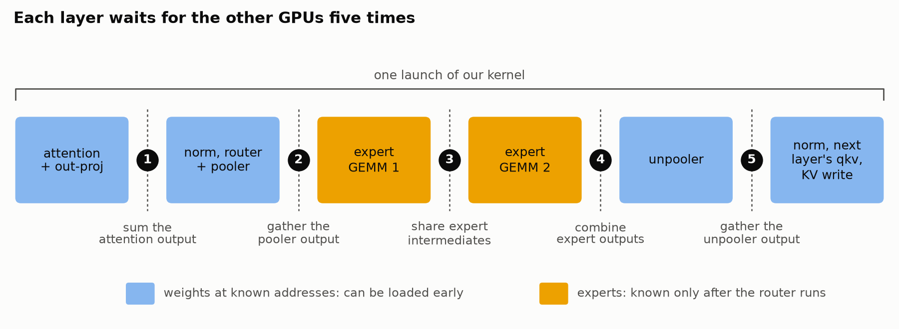

[Muse Spark Open Ultrafast: Pushing beyond 1,000 Tokens per second](https://www.lmsys.org/blog/2026-11-05-muse-spark-open-ultrafast)  
Pranjal Shankhdhar · 2026-11-11

SGLang's CUDA C++/PTX megakernel raises Muse Spark Open decoding from 517 to 1,109 tokens/s on eight GB300 GPUs. The mechanism goes beyond fewer launches: different warps begin independent work inside a layer, overlapping compute, weight traffic, and communication. The current implementation supports batch size one with speculative decoding.

## One launch crosses a layer boundary

A launch runs from the current layer's attention through the next layer's QKV projection and KV write. Previously generated KV can be loaded before the preceding layer's outputs are ready. Each SM hosts a twelve-warp block with distinct loading, tensor-core, reduction, and communication roles.

<a class="note-image-link" href="/assets/images/tech/lmsys-muse-spark-open-megakernel/layer.png" target="_blank" rel="noopener" aria-label="One launch covers attention through the next layer’s QKV; blue stages have known weight addresses, while orange expert stages depend on routing.">View original image ↗</a>

*One launch covers attention through the next layer’s QKV; blue stages have known weight addresses, while orange expert stages depend on routing.*

The eight-GPU scheme shards both expert GEMMs along N, adding an intermediate all-gather rather than conventional TP's single final all-reduce. Different intermediate representations reduce communication volume, while avoiding EP load skew. Five cross-GPU dependencies remain: the goal is to do useful independent work during their waits.

## Prefetch instructions as well as weights

Known-address weights enter a shared-memory ring early; larger portions wait in L2. Expert identities are unavailable before routing, so the implementation speculatively prefetches the fourteen most-used experts from the previous step, approximately 50 MB per GPU. Wrong guesses consume bandwidth.

Instruction capacity produces a less obvious limit. Two approximately 100-KB straight-line code blocks take about 12.4 microseconds each in isolation but 19.5 each when alternated. Shrinking one restores the other's speed. Real kernels contain roughly 215–314 KB of machine code, exceeding the approximately 128-KB SM instruction capacity measured by the authors; expert prefetching also evicts code from L2.

The implementation limits unnecessary unrolling, reads code lines into L2 on every launch, and dry-runs selected critical paths without publishing outputs. This helps explain why whole-model fusion is not an automatic next step: code footprint, register allocation, and scheduling opportunities must be considered together.

## Data readiness still needs a reuse protocol

Within an SM, mbarriers coordinate asynchronous copies. Across SMs or GPUs, polling remains necessary. A conventional write–fence–flag sequence can wait behind in-flight weight transfers. The implementation instead initializes receive slots with values producers cannot emit and waits until all relevant slots change. Sentinel choice depends on representation, including a designated bf16 NaN pattern.

This does not eliminate all synchronization or apply to arbitrary data. Buffer reuse still requires a fence, moved to once per layer off the critical path, with alternating buffers for expert exchanges. The draft model is also fused: launches fall from 175 to eight and draft time from 1.16 to 0.44 ms, with draft and verification captured in one CUDA Graph.

## Preserve the measurement scope

Total launches per step fall from 1,450 to 97. Speculation verifies sixteen tokens with mean acceptance length 6.6; phase measurements use medians over twenty steps of one GSM8K request. These are not high-concurrency multi-tenant throughput results or guarantees across workloads.

A megakernel appears as one long profiler bar, so warps record their own stage timestamps. Instrumentation adds about 2.8% and can be compiled out. Those timelines still reveal idle dependency chains after communication. The transferable lesson is to schedule independent data and instruction fetches early and measure the overlap. Prefetch distances, cache hints, and warp assignments remain hardware- and model-specific engineering choices.
