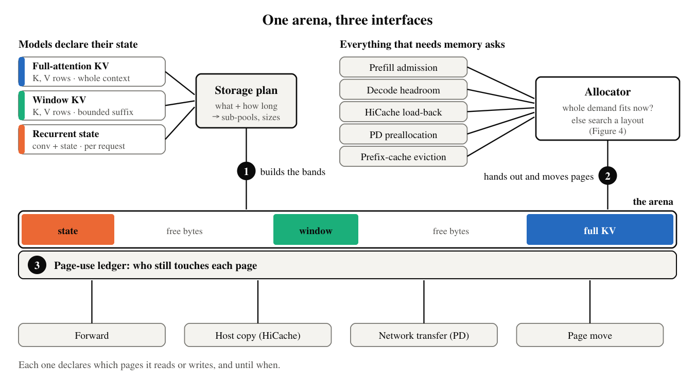

Cheng Wan, Caihua Li, Yonghao Zhuang, Seokwoo Song, Shuwen Wang, Lianmin Zheng · 2026-11-11  
Original: [Unified Memory in SGLang: One Arena for Every Token Lifetime](https://www.lmsys.org/blog/2026-11-11-unified-memory)

Hybrid-model memory pressure is not determined by context length alone. Full-attention KV grows with history, sliding-window KV retains a bounded suffix, and recurrent state grows with active requests. SGLang's experimental unified memory puts these states into one arena so available capacity can follow demand. Its contribution spans layout, admission and asynchronous reclamation: combining buffers alone would not make sharing safe.

## Why fixed partitions strand capacity

Separate pools reserve ratios at startup. Long contexts can exhaust full-attention storage while recurrent slots sit idle; many short requests can reverse the imbalance. Even a well-tuned ratio represents one traffic assumption.

In the arena, full KV grows downward from the high end and bounded state upward from the low end. Either can claim the space between them. Each sub-pool retains its own page or slot size rather than rounding everything to the largest allocation unit. Lazy compaction moves live data toward the ends; a third, floating band can also relocate. This addresses capacity stranded between state types, while page rounding and workspace outside the arena still matter.

Layout changes from separate per-layer buffers to one entry per token, packing its rows across layers. Compatible speculative drafts can add lanes with different shapes and dtypes. Allocation, freeing and movement then carry related state together instead of moving only one part of a correspondence.

## Admission accounts for the whole request

<a class="note-image-link" href="/assets/images/tech/lmsys-sglang-unified-memory/figure.png" target="_blank" rel="noopener" aria-label="State declarations, allocator and page-use ledger around one arena · View original image ↗">View original image ↗</a>

*Declarations define shape and lifetime, the allocator answers capacity questions, and the ledger constrains movement and overwrites.*

A 32K context with a 4K sliding window needs 512 full-KV pages and 64 window pages at 64 tokens per page in steady state. A recurrent model also needs a state slot. Admission additionally includes rounding, expected decode headroom and rows temporarily retained before retirement. A full-attention free-token counter cannot represent this demand.

The allocator first reuses holes and grows bands in place, then compacts the ends, and finally relocates floating bands if needed. This ordering favors less movement before broader rearrangement. Eventual feasibility is distinct from immediate realization: the former can consider pages whose users will finish, while the latter must respect fixed pages and active network transfers.

The same demand model supports prefill admission, chunked processing, decode preallocation and cache eviction. After each candidate eviction, the allocator checks whether the joint requirement now fits, including capacity released in other sub-pools. Cache policy and memory feasibility therefore use a consistent boundary.

## Logical release does not authorize an immediate overwrite

With overlap scheduling, the host prepares the next step while the GPU may still access the previous step's KV. Request tables hold virtual IDs. A move updates their physical mapping, allowing new forwards to use the destination while old readers retain the source. Reusing that source must wait for those readers.

An old writer imposes a stronger dependency: it must finish before copying, otherwise the destination can be stale and the writer can corrupt the source's next owner. Ordinary frees likewise become pending even though capacity accounting changes immediately. A page-use ledger tracks forward work, HiCache copies, network transfers and moves, allowing each kind of next writer to wait for the relevant users. The article describes seeded stress tests and real CUDA work, rather than a formal proof for every concurrency combination.

## Workload-dependent gains and compatibility limits

The authors compare two-run averages on one H200 per server at SGLang commit daa171846f. For GPT-OSS-20B with 512 input tokens, 1,536 output tokens and concurrency 1,024, unified memory runs about 1,000 requests simultaneously versus 618 with default separate pools. Throughput rises 14%, and TTFT falls from 43 to 6 seconds. For Qwen3.5-4B at 16K input, 4,096 output and concurrency 64, active requests rise from 22 to 32 with a 26% speed increase.

Gains are not universal. At Qwen's 1,024-input, 256-output, concurrency-64 setting, output throughput is 5,830 versus 5,880 tokens/s; both score 0.875 on 200 GSM8K questions. Under long-output pressure, retractions fall from roughly 294 to 233 per thousand completions, rather than disappearing.

Support currently targets selected hybrid models, excluding full-attention-only models and DeepSeek-V4, among others. LMCache, FP4 KV and several parallelism combinations are rejected at startup. Priority preemption is disabled, so high-priority requests may wait. Window admission assumes recurrent checkpoints advance; unavailable replacement state slots can cause retention beyond the priced footprint. The central systems lesson is to manage capacity feasibility and safe reuse of old bytes together, and interpret performance within those lifetime constraints.
