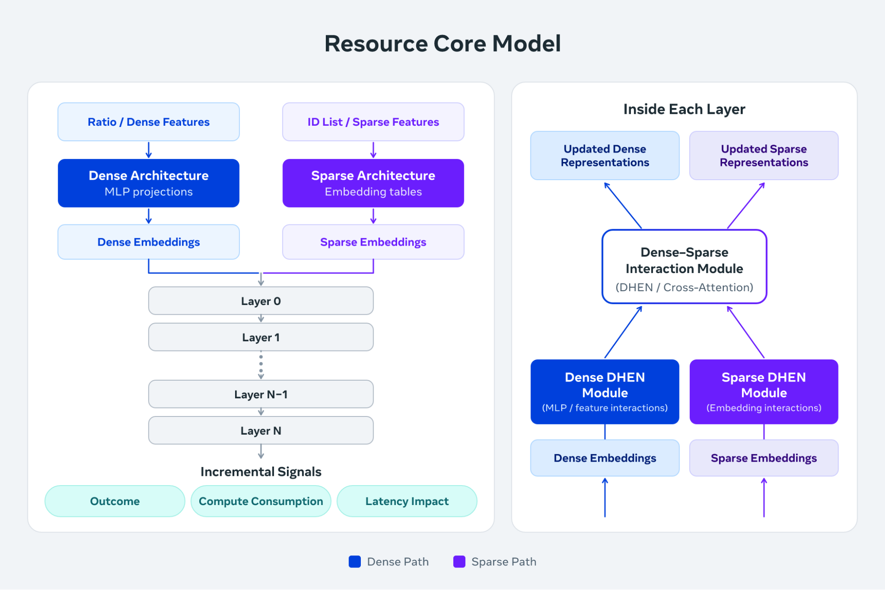

[Intelligent Delivery: Making Every Unit of Compute Serve Better Ads](https://engineering.fb.com/2026/11/11/ml-applications/intelligent-delivery-serve-better-ads/)  
Zhaojun Zhang, Qinwei Zhu, Gang Li, Jianwei Xiao, Yanan Wang, Hongmei Li, Deepak Vijaywargi, Ke Pan, Li Yu · 2026-11-11

An extra millisecond of compute has different value for different advertising requests. Meta's Intelligent Delivery extends serving optimization from making each inference faster to allocating scarce capacity where it improves aggregate outcomes. Although it is not an LLM decoding system, its prediction and control design transfers to heterogeneous inference and adaptive budgeting.

## Predict response to resources

Handwritten segments struggle with nonlinear feature interactions. The Resource Core Model runs once before retrieval, using 6B sparse and 20M dense parameters to provide a shared representation across the ranking funnel. Specialized fine-tuned models predict outcome, compute consumption, and latency impact for allocation mechanisms.

<a class="note-image-link" href="/assets/images/tech/meta-intelligent-delivery-ads-compute/resource-model.png" target="_blank" rel="noopener" aria-label="Dense and sparse features interact in a shared representation that predicts outcomes, compute use, and latency for allocation mechanisms.">View original image ↗</a>

*Dense and sparse features interact in a shared representation that predicts outcomes, compute use, and latency for allocation mechanisms.*

A controller needs more than a high-value-request score: it needs the expected benefit and cost of additional resources. The reported approximately 20% offline improvement concerns identifying high-impact requests relative to the previous production model, not final ranking quality or service-cost reduction.

## Local optima interact

Regional controls shift traffic on a minutes timescale toward comparable marginal capacity efficiency. Hardware assignment uses measured workload–SKU performance because retrieval, ranking, and inference encounter different memory and compute constraints.

Within a host, predicted benefit and cost determine allocation under a tail-latency SLO. High-cost, low-impact work is trimmed first as load increases. Enforcement spans kernel scheduling, application thread pools, and higher-level knobs such as candidate counts. Regional changes alter host load and therefore request budgets, so an end-to-end closed-loop hardware environment checks their interaction rather than summing isolated gains.

## Agents narrow experiments; engineers approve changes

New models, hardware, and mechanisms invalidate prior configurations. Agents read code, design documents, and historical experiments to identify promising changes and design and run tests. Engineers approve the final changes. This is an optimization workflow, not unrestricted agent control on each serving request.

Meta reports approximately 10% cumulative incremental ranking improvement from 2017 through the first half of 2026, beyond model and system advances. Separately, agents contribute to about 20% of Intelligent Delivery optimizations in the first half of 2026 and about 80% of engineering effort on its most automated mechanism. These denominators differ; neither establishes 80% system-wide autonomy or attributes historical gains to recent agents.

## A transferable division of responsibilities

The article does not release a rerunnable search dataset, complete objective function, or causal ablations. Convergence toward a global optimum is an objective, not a proved guarantee. GPU allocation, batching, and memory also differ from CPU scheduling. The reusable pattern is shared marginal-value prediction, constrained controls at multiple layers, and end-to-end experiments that test their interactions.
