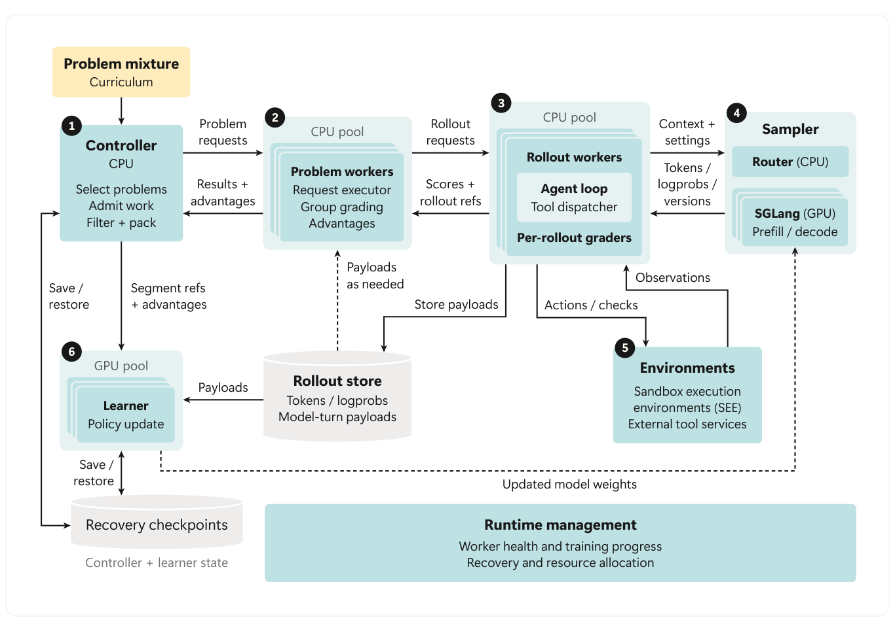

A long-running coding task can still be waiting on a tool after the learner has updated its policy several times. Microsoft AI's Rocket also faces a subtler discrepancy. Even with the same weights and inputs, the sampler and learner can compute different token probabilities. A run spanning thousands of updates needs separate controls for these two sources of drift.

The Microsoft AI Team · Source date 2026-11-23 · [RL infrastructure at Microsoft AI](https://microsoft.ai/news/rl-infrastructure-at-microsoft-ai/)

## Where a token grows stale

Rocket dispatches several rollouts for each problem. A problem worker collects rewards and computes group-relative advantages before the controller packs references into learner batches. Each token has a generation policy version because the sampler refreshes its weights periodically. Staleness is the difference between that version and the learner version that consumes the token. Waiting before the first token can tie up a sandbox without aging any training data.

<a class="note-image-link" href="/assets/images/tech/microsoft-ai-rocket-rl-infra/microsoft-ai-rocket-rl-infra.png" target="_blank" rel="noopener" aria-label="View original image">View original image ↗</a>

*The controller passes trajectory references to the learner, with weight refresh and independent recovery supervision.*

In one group, the first finisher waited 7.6 hours for the last. Rocket gives ongoing rollouts priority, scales work in flight to inference capacity and drops failed rollouts so a retry does not hold up a group. Dropping failures can bias the group baseline. Selected sampler engines first pull parameter chunks, then distribute them to corresponding ranks across replicas. The reported transfer takes 15 seconds in the current configuration. With a fixed batch, adding inference capacity can actually age an hours-long rollout by more policy versions because learner updates arrive more frequently.

## Checking numerical parity separately from capacity

Expert weights account for over 95% of MAI Base 2 parameters. The sampler stores them in MXFP8 and converts them to BF16 before multiplication. The learner mirrors quantization and dequantization so its loss sees the same rounding. Local-attention caches and the final three global-attention caches stay in BF16, while remaining global caches use MXFP8. The team reports about 67% more global-context tokens than with BF16 caches. That denominator is global cache capacity, not total serving throughput.

Shared formats alone do not ensure bitwise agreement. Reduction order and parallel decomposition change intermediate rounding. Matched checkpoints and inputs isolate implementation differences. On a smaller 180B-total, 7B-active model, the bitwise-matched run scored higher at comparable training steps. The two runs started roughly a month apart, limiting attribution to any one numerical change.

## What survives a learner restart

Health checks monitor progress as well as liveness. A stalled learner triggers a pause in new problem admission, termination of learner ranks and restoration from the latest checkpoint. The rebuilt learner reconnects to the existing controller, preserving curriculum state, eligible work and healthy inference replicas. Learner-only recovery takes about five minutes in the team's runs. Sampling continues during that interval at the cost of additional policy lag. The team estimates this recovery alone saved more than 7% of GPU-hours in a recent run. Failed inference replicas can be replaced separately, with job-level recovery available when too little capacity survives.
