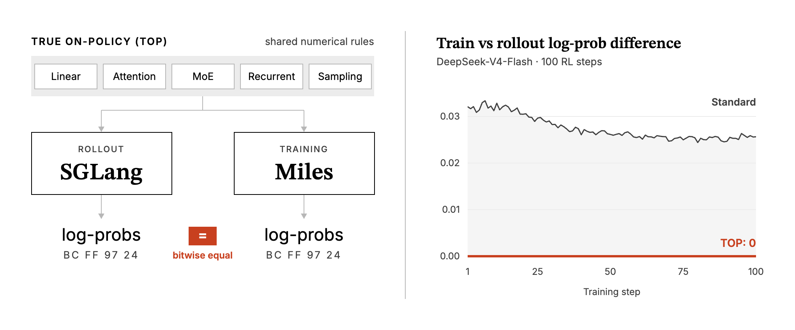

An RL sample passes through two systems. An inference engine records the probability of a generated token, and a trainer later uses the trajectory to update the model. Even at identical weights, stepwise rollout and whole-sequence training can use different kernels. A rounding difference in a feed-forward layer may stay small. In an MoE router it can reorder nearly tied experts and change the subsequent computation. Importance weights then reflect both policy changes and execution differences.

## Defining forward agreement in bytes

Yiming Li and the Miles team use a directly checkable endpoint: with the same weights and trajectory, the trainer’s FP32 log-probability bytes must equal SGLang’s for every sampled token. The project reports full-depth forward checks on specific DeepSeek-V4, GLM-5 and Qwen3 variants, including speculative decoding where supported.

Both sides bind model modules to operations with the same arithmetic rules. Fixed matrix tiles and reduction order keep a token’s additions independent of the other requests in its batch. Chunked prefill, prefix-cache hits, resumed requests, decode and training recomputation must preserve the same order. Expert parallelism can move tokens between devices, but returned contributions are combined in canonical expert-slot order. Both sides currently run at tensor parallel degree one. The trainer uses pipeline, context and expert parallelism, while rollout combines attention data parallelism with expert parallelism.

<a class="note-image-link" href="/assets/images/tech/miles-sglang-true-on-policy-rl/overview.png" target="_blank" rel="noopener" aria-label="Matched arithmetic yields bitwise-equal train and rollout log-probabilities at equal weights">View original image ↗</a>

*Matched arithmetic yields bitwise-equal train and rollout log-probabilities at equal weights*

## An FP8 checkpoint can hide small updates

The trainer keeps higher-precision master weights and rounds them to FP8 for the forward pass using the rollout rule. Masters initialized from an FP8 checkpoint sit at the centers of their rounding cells. Several small updates can accumulate without changing the FP8 value used in the forward pass. The team applies a deterministic one-time offset within each cell so small updates can cross a boundary sooner. Initial forward agreement alone would miss this interaction between quantization and repeated updates.

## What remains different in asynchronous RL?

A sample from an older policy should receive different probabilities under updated weights. In a multi-turn Qwen3.6-35B-A3B text-to-SQL experiment, the team separates that difference from same-weight kernel mismatch. The latter contributed about 0.006–0.0095 per token with standard kernels and zero on fresh tokens with TOP. The aggregate curve including stale samples still moves with weight lag. Episodes had up to five SQL tool turns, and mean version lag differed between the two arms.

New weights can also change expert choice. The asynchronous TOP configuration therefore replays the rollout routes. With uncapped importance weights, TOP with route replay stayed smooth, while standard kernels with replay and TOP without replay both lost accuracy mid-run. The ablation identifies what bitwise agreement buys: one source of discrepancy disappears at equal weights, and stale samples still require separate treatment.

## Where exactness costs time

On 64 H200s, whole-step token throughput reached 0.90 of standard on DeepSeek-V4-Flash and 0.93 on GLM-5.2. Rollout alone reached 0.79 and 0.88 respectively. GLM-5.2 uses the same sparse prefill attention kernel during decode to preserve order, adding 2.2–2.8 milliseconds per iteration. Qwen3.6’s MoE matrix multiplication added 1.3–1.7 milliseconds. Fixed order also constrains parallel layouts: data parallelism can expand batch throughput, while tensor parallelism available to standard execution at low concurrency is currently unavailable to TOP. Whole-step throughput, sampling speed and single-request latency capture different costs of the contract.

Yiming Li (RadixArk Miles Team) · 2026-11-23 · [True On-Policy RL: Bit-Exact Rollout and Training with SGLang and Miles](https://miles.radixark.com/blogs/true-on-policy-rl-bit-exact-rollout-and-training-with-sglang-and-miles)
