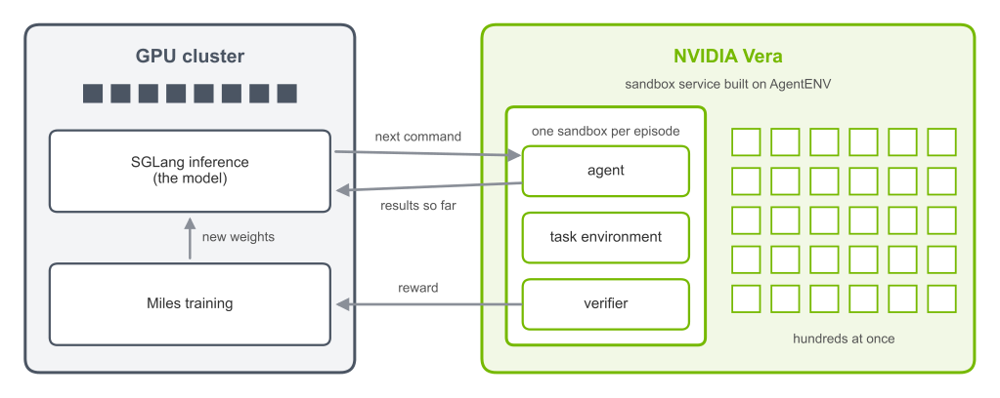

In agentic RL, GPUs wait for CPUs. After a model issues a command, a sandbox may compile code, run tests, and prepare output before the next model turn can proceed. Parallel rollouts concentrate this work on environment servers. RadixArk Miles Team moves all sandboxes to NVIDIA Vera and traces how environment performance affects episode duration, sample freshness, and retained GPU state.

Original: [RadixArk Miles runs agentic RL training on NVIDIA Vera CPUs: faster sandboxes, faster training](https://www.lmsys.org/blog/2026-11-13-miles-vera-sandboxes) · RadixArk Miles Team · 2026-11-13

## Independent environments, with inference and training on GPUs

The sandbox service uses AgentENV and gives each episode a fresh Firecracker microVM, reportedly starting from a snapshot in under 0.1 seconds. An agent sends the task to a model served by SGLang, executes its command in the sandbox, and returns the result for the next turn. A verifier runs tests in that environment and produces a reward for Miles training. Hundreds of concurrent environments create sustained CPU demand.

Migration changes the environment layer rather than training logic. The team rebuilt arm64 environments for 530 Terminal-Bench and SWE-bench tasks and checked them with reference solutions. It also supported Vera’s 64K memory pages and built Firecracker for arm64. Equivalent executable environments are a prerequisite; changing processors does not make x86 images portable. The end-to-end GLM-4.7-Flash demonstration covers synchronous and fully asynchronous training, 68 steps, and over 2,400 episodes.

<a class="note-image-link" href="/assets/images/tech/miles-vera/pipeline.png" target="_blank" rel="noopener" aria-label="GPUs run inference and training; Vera sandboxes execute commands and return rewards · View original image ↗">View original image ↗</a>

*Reading the figure: GPUs run inference and training; Vera sandboxes execute commands and return rewards.*

## The controlled measurement concerns episodes, not proven step-time gains

The comparison places sandboxes on Vera or AMD EPYC Turin with the same model, tasks, GPUs, and settings. Each socket runs 176 background tasks before a five-step, 160-episode training run is added. The foreground workload contains four SWE-bench Verified tasks and uses the same 8×H200 inference machine. The authors compare mean episode duration because step time depends on slowest samples and five steps cannot resolve small percentage differences reliably.

Turin episodes take 12% longer than Vera episodes, equivalent to approximately 11% shorter duration when moving from Turin to Vera. These percentages have different denominators. Of the additional 53 seconds per episode, commands account for 26, the verifier for 11, other sandbox work for 12, and model waiting for four. The 90% confidence interval for the Turin/Vera duration ratio is 1.04–1.22. This is a narrow but controlled task comparison.

## Full-load results require their configuration context

The authors replay identical command trajectories and check command results and final rewards, reducing variation from different model choices. Their latency threshold requires 95% of commands to complete within 1.5× the same command’s solo time on a reference machine. Under that threshold, a Vera socket carries 1.3–1.5× the load of Xeon 6 and 1.4–2.1× that of Turin. The key observation is different per-core slowdown when all cores are busy; unloaded performance alone cannot predict saturation behavior.

Hardware and configuration differ together. Vera has 88 cores/176 threads, Turin 96 cores without SMT, and Xeon 6 96 cores/192 threads per socket. NVIDIA tuned Vera’s boot parameters; x86 primarily uses AWS defaults, with Xeon C6 disabled to avoid file-access degradation. Equal background task counts also create different pressure per hardware thread. A 96-background-task Turin comparison retains a smaller command-time gap. These are results for the tested systems, not an isolated ISA effect or a universal CPU ranking.

## How sandbox time affects GPU state and freshness

An episode retains KV state while waiting for tools. Using context length multiplied by command-wait duration, the authors report idle KV at 17.9% of cache in use on Turin versus 12.1% on Vera. Longer asynchronous episodes also arrive with older policy weights. GRPO groups wait for their slowest episode, making environment tails relevant to group-slot release.

The claim that Turin episodes would take 33% longer with 8× faster inference is a projection holding measured sandbox time constant. Up to 12% faster training at fixed staleness is also an estimate from episode durations, assuming GPUs keep up. Neither is a measured time-to-quality improvement. The transferable lesson is to separate model waiting, commands, verification, and group tails before deciding whether CPUs limit training progress.
